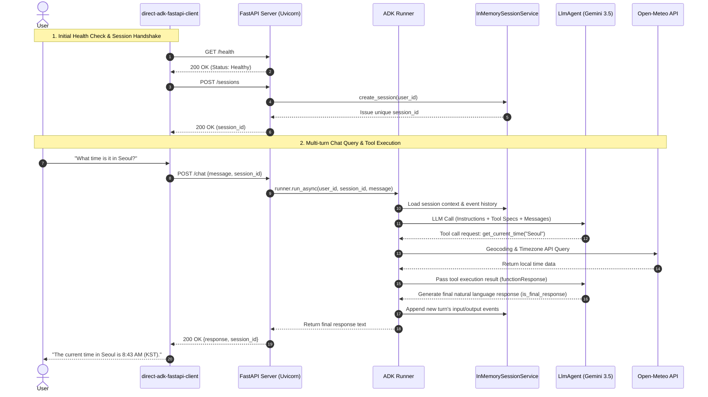

# Direct ADK (Agent Development Kit)

A hands-on practice and reference project for building and controlling AI agents using the Google ADK (Agent Development Kit) directly without excessive abstractions.
It demonstrates how to combine core ADK building blocks—such as `Agent` / `LlmAgent`, `Runner`, `InMemorySessionService`, `InMemoryMemoryService`, and `PlanReActPlanner`—to construct various agent architectures and extend them into a production-grade web service (FastAPI).

---

## 📁 Project Directory Structure

```
Direct_ADK/
├── 📄 Configuration & Documentation
│   ├── .env                                  # Environment variables (Gemini API key setup)
│   ├── README-KR.md                          # Korean project guide and learning notes
│   ├── README-EN.md                          # English project guide and learning notes
│   └── _path.py                              # Path helper for common packages and agent imports
│
├── 🔹 Execution Mode Comparison (Sync vs Async)
│   ├── direct-adk-simple-sync.py             # [Synchronous] Basic synchronous ADK agent runner example
│   └── direct-adk-simple-async.py            # [Asynchronous] Standard non-blocking asynchronous ADK runner
│
├── 🔹 Memory & Session Management
│   ├── direct-agent-ref-session.py           # [Long-term Memory] MemoryService & multi-session recall
│   ├── direct-adk-working_memory.py          # [Working Memory] Flight booking tool & one-shot ToolContext.state
│   ├── direct-adk-working_memory-Chat.py     # [Working Memory] Travel booking interactive chatbot with session state
│   ├── run_memory_layers.py                  # [Memory Layers] Comparison of Session (short-term) vs Memory (long-term)
│   └── Session_management/                   # [Session Control Directory]
│       ├── direct-adk-agent-rewindsession.py # Roll back/restore session state via Runner.rewind_async
│       ├── workflow.md                       # Session management and rewind workflow documentation
│       └── .env                              # Environment variables for session management tests
│
├── 🔹 Interactive Agents & Web Service Extension
│   ├── direct-adk-agent.py                   # [Tool Agent] Fixed city weather & time lookup (Seoul, NYC, etc.)
│   ├── direct-adk-agent_mod.py               # [Tool Agent] Real-time worldwide weather & time via Open-Meteo
│   ├── direct-adk-agent_mod-context.py       # [Context Inspection] Real-time display of entire Context Window per LLM call
│   ├── direct-adk-fastapi-server.py          # [FastAPI Server] Uvicorn + FastAPI + ADK Agent REST API
│   └── direct-adk-fastapi-client.py          # [FastAPI Client] Interactive multi-turn terminal client
│
└── 🔹 Events & Workflow Analysis
    ├── direct-agent-reference.py             # [Event Inspection] Detailed tracking of Tool Calls, responses & state deltas
    ├── run_events.py                         # [Event Lifecycle] Complete event lifecycle tracing for a single turn
    └── run_workflow_events.py                # [Workflow Routing] ADK 2.0 Workflow branch routing & node event tracking
```

---

## 📊 Summary of Code Files & Execution Methods

| # | File Name | Type / Category | Core Features & Description | How to Run (CLI Command) |
|:---:|---|---|---|---|
| **1** | `direct-adk-simple-sync.py` | Basic (Sync) | Fundamental synchronous execution using `Runner.run()`. Demonstrates `types.Content` creation and event iteration | `python direct-adk-simple-sync.py`<br>`(or uv run direct-adk-simple-sync.py)` |
| **2** | `direct-adk-simple-async.py` | Basic (Async) | Standard asynchronous execution using `Runner.run_async()` async generator. Non-blocking I/O handling | `python direct-adk-simple-async.py`<br>`(or uv run direct-adk-simple-async.py)` |
| **3** | `direct-agent-reference.py` | Event Analysis | Detailed inspection of internal ADK events: Tool Calls, Tool Results, streaming text, and state mutations | `python direct-agent-reference.py` |
| **4** | `direct-agent-ref-session.py` | Long-term Memory | Recalls knowledge from Session 1 in Session 2 using `InMemoryMemoryService` and `load_memory_tool` | `python direct-agent-ref-session.py` |
| **5** | `direct-adk-agent.py` | Practical Agent | Terminal interactive agent bound to weather and time tools for predefined cities (Seoul, NYC, etc.) | `python direct-adk-agent.py` |
| **6** | `direct-adk-agent_mod.py` | Global Tool Agent | Automated real-time weather and time lookup for any global city via Open-Meteo Geocoding and Forecast APIs | `python direct-adk-agent_mod.py` |
| **7** | `direct-adk-agent_mod-context.py` | Context Inspection | Real-time terminal visualization of the raw Context Window (system prompt, tool definitions, chat history, tool results) and token usage via `BasePlugin` | `python direct-adk-agent_mod-context.py` |
| **8** | `direct-adk-fastapi-server.py` | Web API Server | REST API server wrapping `direct-adk-agent_mod.py` with Uvicorn and FastAPI (`/health`, `/sessions`, `/chat`) | `python direct-adk-fastapi-server.py` |
| **9** | `direct-adk-fastapi-client.py` | Web Client (CLI) | Interactive terminal client communicating with the FastAPI server over HTTP with multi-turn session persistence | `python direct-adk-fastapi-client.py` |
| **10** | `direct-adk-working_memory.py` | Working Memory (One-shot) | Flight booking tool and one-shot test verifying short-term session state updates via `ToolContext.state` | `python direct-adk-working_memory.py` |
| **11** | `direct-adk-working_memory-Chat.py` | Working Memory (Chat) | Interactive travel booking chatbot that accumulates and updates booking state in Working Memory each turn | `python direct-adk-working_memory-Chat.py` |
| **12** | `Session_management/direct-adk-agent-rewindsession.py` | Session Rollback | Rolls back session state to before a specific invocation index using `Runner.rewind_async()` | `python Session_management/direct-adk-agent-rewindsession.py` |
| **13** | `run_events.py` | Event Lifecycle | Observes the complete lifecycle of events (tool calls, runner lifecycle, model responses) for a single user turn | `python run_events.py` |
| **14** | `run_memory_layers.py` | Dual-Layer Memory | Compares storage scope, lifecycle, and search mechanisms between Session State (short-term) and Memory Service (long-term) | `python run_memory_layers.py [offline\|llm\|all]` |
| **15** | `run_workflow_events.py` | Workflow Routing | Traces ADK 2.0 `Workflow` node routing and event transitions without requiring an LLM | `python run_workflow_events.py` |
| **16** | `_path.py` | Shared Helper | Configures `sys.path` for parent packages (`common`) and loads environment variables from `.env` | Module import helper (do not execute directly) |

---

## ⚡ Synchronous (Sync) vs Asynchronous (Async) Comparison & Trade-offs

Google ADK provides first-class support for both synchronous (`runner.run`) and asynchronous (`runner.run_async`) execution.

### 1. Key Differences

| Feature | Synchronous (Sync) | Asynchronous (Async) |
|---|---|---|
| **Execution Method** | `runner.run(...)` | `runner.run_async(...)` |
| **Session Creation** | `asyncio.run(session_service.create_session(...))` | `await session_service.create_session(...)` |
| **Event Iteration** | `for event in events:` (Sync Iterator) | `async for event in runner.run_async(...):` (Async Generator) |
| **I/O Model** | Blocking (thread pauses until completion) | Non-blocking (thread can process other tasks while awaiting I/O) |
| **Recommended Files** | `direct-adk-simple-sync.py` | `direct-adk-simple-async.py`, `direct-adk-fastapi-server.py` |

---

### 2. Pros and Cons

#### 🔹 Synchronous (Sync) Mode
- **Advantages**:
  - **Simplicity**: Intuitive, step-by-step code flow without `async/await` syntax or event loop management.
  - **Ideal for One-off Tasks**: Quick to write and test for one-shot scripts, CLI utilities, and data science notebooks.
- **Disadvantages**:
  - **Thread Blocking**: The process blocks while waiting for LLM network latency or external tool APIs.
  - **Concurrency Limits**: Inefficient when handling concurrent requests from multiple users.

#### 🔹 Asynchronous (Async) Mode (ADK Standard Recommendation)
- **Advantages**:
  - **Non-blocking I/O**: The event loop continues processing other coroutines while awaiting model responses or tool APIs, enabling high-throughput concurrency.
  - **Web Framework Integration**: Seamlessly integrates with modern async web servers like FastAPI and Tornado.
  - **Real-time Streaming**: Ideal for real-time token streaming to frontends and background event processing.
- **Disadvantages**:
  - **Syntax Complexity**: Requires familiarity with asynchronous programming constructs (`async def`, `await`, event loops).

---

### 3. When to Use Which?

- **Choose Synchronous**: Fast algorithmic prototyping, batch automation scripts, data exploration notebooks.
- **Choose Asynchronous**: Web/API service deployments, real-time streaming chatbots, multi-agent communication networks (A2A).

---

## 🚀 Prerequisites

### 1. Configure Environment Variables (`.env`)

Add your Gemini API key to the `.env` file:

```env
GEMINI_API_KEY=your_api_key_here
GOOGLE_GENAI_USE_VERTEXAI=False
```

> You can generate a free Gemini API key at [Google AI Studio](https://aistudio.google.com/app/apikey).

### 2. Install Dependencies

```bash
uv sync
```

---

## 🛠️ Key Examples Walkthrough

### 1. `direct-adk-simple-sync.py` (Synchronous Execution)
The most basic synchronous agent execution example using ADK.

```bash
uv run direct-adk-simple-sync.py
```

```python
user_msg = types.Content(role="user", parts=[types.Part.from_text(text="Why is the sky blue?")])
events = runner.run(user_id=user_id, session_id=session1.id, new_message=user_msg)

for event in events:
    if event.is_final_response() and event.content and event.content.parts:
        text = "".join(p.text for p in event.content.parts if hasattr(p, "text") and p.text)
        print("Session 1 Response:", text)
```

---

### 2. `direct-adk-simple-async.py` (Asynchronous Execution)
The recommended standard async pattern for production ADK applications.

```bash
uv run direct-adk-simple-async.py
```

```python
async def main():
    session1 = await session_service.create_session(app_name="my_adk_app", user_id=user_id)
    user_message = types.Content(role="user", parts=[types.Part.from_text(text="Why is the sky blue?")])
    
    async for event in runner.run_async(
        user_id=user_id,
        session_id=session1.id,
        new_message=user_message
    ):
        if event.is_final_response():
            if event.content and event.content.parts:
                response_text = "".join(p.text for p in event.content.parts if hasattr(p, "text") and p.text)
                print("Session 1 Response:", response_text)

if __name__ == "__main__":
    asyncio.run(main())
```

---

### 3. `direct-agent-ref-session.py` (Long-Term Memory & Cross-Session Recall)
- Uses `InMemoryMemoryService` and `load_memory_tool` to persist dialogue knowledge into long-term memory, allowing a new session (Session 2) to recall facts established in Session 1.

```bash
uv run direct-agent-ref-session.py
```

---

### 4. `direct-agent-reference.py` (Event Analysis)
- Deeply inspects all events emitted by the runner via `Event.get_function_calls()`, `Event.get_function_responses()`, and `event.actions.state_delta`.

```bash
uv run direct-agent-reference.py
```

---

### 5. `direct-adk-agent.py` & `direct-adk-agent_mod.py` (Tool Integration Agents)
- **`direct-adk-agent.py`**: A foundational conversational agent with hardcoded lookup dictionaries for Seoul, NYC, etc.
- **`direct-adk-agent_mod.py`**: Integrates the free Open-Meteo Geocoding & Forecast APIs to resolve any city name to coordinates/timezone and retrieve live weather and current local time. Seamlessly handles both function calling and standard conversation.

```bash
uv run direct-adk-agent_mod.py
```

---

### 6. `direct-adk-agent_mod-context.py` (Raw Context Window Real-Time Inspection & Deep Dive)
Extends `direct-adk-agent_mod.py` by intercepting and printing the **exact raw Context Window (system instruction, tool declarations, accumulated message history, tool calls, and tool outputs)** in JSON format on every single LLM call.

- **How it Works**: Implements a custom `ContextDisplayPlugin` inheriting from ADK's `BasePlugin` and registers it in `Runner(plugins=[...])`.
- **`before_model_callback`**: Intercepts the outgoing `LlmRequest` immediately before calling Gemini and outputs:
  - 📌 **System Instruction**: Developer prompts, role constraints, and ADK internal agent metadata.
  - 🛠️ **Available Tools**: Declarations and docstrings of all callable tools (`get_weather`, `get_current_time`).
  - 📜 **Context Messages**: The exact JSON array of `types.Content` objects comprising the accumulated dialogue (`user`, `model`, `function_call`, `function_response`).
- **`after_model_callback`**: Intercepts the incoming `LlmResponse` immediately after receiving the model's answer and outputs:
  - 📥 **Raw Model Output**: Raw JSON payload containing generated text or `function_call` parts.
  - 📊 **Token Usage**: Prompt tokens, output tokens, and total token count.

```bash
python direct-adk-agent_mod-context.py
```

#### 🔹 Raw Context Window Example (2-Turn LLM Flow for Seoul Weather)
1. **First LLM Call (Tool Calling Decision)**:
   - **Context Window**: System instructions + raw user message
   ```json
   [
     {
       "role": "user",
       "parts": [{"text": "What is the weather in Seoul?"}]
     }
   ]
   ```
   - **Model Output (Raw JSON)**:
   ```json
   {
     "role": "model",
     "parts": [{
       "function_call": {"name": "get_weather", "args": {"city": "Seoul"}}
     }]
   }
   ```
2. **Runner Executes the Tool**:
   - Calls the Open-Meteo API and receives live weather observations.
3. **Second LLM Call (Final Natural Language Summary)**:
   - **Context Window (Previous History + Tool Output Accumulation)**:
   ```json
   [
     {
       "role": "user",
       "parts": [{"text": "What is the weather in Seoul?"}]
     },
     {
       "role": "model",
       "parts": [{
         "function_call": {"name": "get_weather", "args": {"city": "Seoul"}}
       }]
     },
     {
       "role": "user",
       "parts": [{
         "function_response": {
           "name": "get_weather",
           "response": {"status": "success", "report": "Weather in Seoul: Overcast..."}
         }
       }]
     }
   ]
   ```
   - **Model Output (Final Answer Raw JSON)**:
   ```json
   {
     "role": "model",
     "parts": [{"text": "The current weather in Seoul is overcast with a temperature of 6.6°C..."}]
   }
   ```

#### 🔍 Deep Dive: What is "thought_signature" and Why Does It Exist?

When Gemini 2.5 / 3.0 / 3.5 performs function calling or reasoning (thinking), you will observe an opaque binary field inside the JSON output:

```json
{
  "function_call": {
    "name": "get_weather",
    "args": {"city": "Seoul"}
  },
  "thought_signature": "b'\\x12\\xd7\\x01\\n\\xd4\\x01\\x01i\\x14}\\x13\\x9cg\\x8d...'"
}
```

##### 1. What is "thought_signature"?
It is an officially defined **Cryptographic Integrity Token** in the Google GenAI SDK (`google.genai.types.Part.thought_signature`).
- **Format**: An opaque byte string serialized with Protobuf (~200 to 350 bytes).
- **Issuing Entity**: Directly minted and signed by the **Google Gemini backend server**, not by local client code.

##### 2. Core Purpose and Existence Rationale
- **Tamper-proofing & Anti-Prompt Injection for Reasoning and Tool Calls**:
  - In multi-turn agent loops, the triplet of `[User Prompt → Model Reasoning & Tool Call → Runner Tool Execution Result]` is packaged into conversation history and sent back into the model's Context Window in subsequent turns.
  - If a malicious client or attacker could forge fake reasoning ("Fake Thought") or inject destructive tool parameters (e.g., `rm -rf`) into the conversation history, the LLM might hallucinate that it came up with those decisions itself, causing catastrophic prompt injection.
  - To prevent this vector, Google backend signs all model-generated thinking steps and tool calls with a private cryptographic key, producing the `thought_signature`.
- **Stateless API Verification**:
  - When the context arrives in the next turn, Google servers verify the attached `thought_signature`. Only after confirming that the tool calls and reasoning originate unadulterated from authentic Gemini models will the server generate the next response.

##### 3. Binary Structure & Decoded Mapping Example

| Component | Raw Representation & Binary Structure | Interpretation & Semantic Meaning |
|---|---|---|
| **Raw Binary (Python Bytes)** | `b'\x12\xd7\x01\n\xd4\x01\x01i\x14}\x13\x9cg\x8d...'` | Google internal Protobuf signature payload |
| **Hex Encoding** | `12d7010ad4010169147d139c678dc1f0...` | Cryptographic digest of ~220 bytes |
| **Protobuf Wire Inspection** | • `0x12`: Field number 2 (Length-delimited bytes)<br>• `0xd7 0x01`: Payload length 215 bytes (Varint)<br>• Inner Payload: Model ID, timestamp, tool call hash + digital signature | A **digital seal of authenticity** certifying that this tool call (`get_weather`) with argument (`Seoul`) was generated by Gemini 3.5 Flash |
| **Mapped Actual Reasoning<br>(Visible when Thinking Mode is on)** | `part.thought == True`<br>`"Okay, here's my thought process regarding the user's request: The user wants to know current weather in 'Seoul'. Therefore, my immediate course of action is to call the get_weather tool with city='Seoul'."` | The **actual internal Chain-of-Thought reasoning text** protected by the `thought_signature` |

> 💡 **Tip**: By default, Google servers omit the raw thought text and return only the `thought_signature`. However, when `ThinkingConfig(include_thoughts=True)` is enabled (as in `direct-adk-agent_mod-context.py`), the full internal reasoning text is revealed alongside the signature in your terminal.

---

### 7. `direct-adk-fastapi-server.py` & `direct-adk-fastapi-client.py` (Uvicorn + FastAPI Web Server & Terminal Client)
Transforms the high-performance worldwide weather/time agent from `direct-adk-agent_mod.py` into a modern web API backend.

```
[Interactive Terminal Client]
 (direct-adk-fastapi-client.py)
            │  HTTP POST /chat (JSON)
            ▼
[FastAPI + Uvicorn Web Server] (direct-adk-fastapi-server.py)
 ├── GET  /health              # Server and agent health check
 ├── POST /sessions            # Create multi-turn dialogue session
 ├── GET  /sessions/{id}       # Inspect session state and event history
 └── POST /chat                # Run ADK runner.run_async & return response
            │
            ▼
[Google ADK LlmAgent] ──> [Open-Meteo API / Gemini 3.5 Flash]
```

#### 🔹 Key Highlights
1. **Fully Asynchronous I/O Pipeline**: Drives ADK's `runner.run_async` within FastAPI endpoints, eliminating thread-blocking bottlenecks under concurrent load.
2. **Session-based Multi-turn Dialogue**: Persists dialogue state across turns by associating every client request with a unique `session_id`.
3. **Decoupled Architecture**: The server runs as a background Uvicorn daemon, while clients interact through a clean CLI terminal or web frontends.

#### 🔹 How to Run

**Step 1: Start the FastAPI server in Terminal 1**
```bash
python direct-adk-fastapi-server.py
# Or run with the uvicorn CLI directly:
# uvicorn direct-adk-fastapi-server:app --host 127.0.0.1 --port 8000
```
> The server listens on `http://127.0.0.1:8000`.

**Step 2: Start the interactive client in Terminal 2**
```bash
python direct-adk-fastapi-client.py
```

#### 🔹 Interactive Chat Example
```text
=================================================================
  💬 ADK Agent FastAPI Interactive Client
  Target Server: http://127.0.0.1:8000
=================================================================
  Active Session : session_07b7919d
  Commands       : Type 'quit', 'exit', or 'q' to end.
  Capabilities   : Weather, time, and general QA (multi-turn chat)
=================================================================

🧑 You: What time is it in Seoul right now?
🤖 Agent: The current time in Seoul is 8:43 AM (KST).

🧑 You: How about the weather there?
🤖 Agent: Seoul is currently experiencing clear skies with a temperature of around 12°C.

🧑 You: quit
Ending session. Goodbye!
```

---

### 8. `direct-adk-working_memory-Chat.py` & `direct-adk-working_memory.py` (Working Memory State Management)
- Demonstrates how to use `ToolContext.state` to store and update short-term user state (e.g., flight booking codes, reservation status) in the agent's Working Memory across turns.
- **`direct-adk-working_memory.py`**: One-shot execution displaying final session state and history.
- **`direct-adk-working_memory-Chat.py`**: Multi-turn interactive chatbot displaying real-time state mutations (`💾 State Updated`) on each turn.

```bash
uv run direct-adk-working_memory-Chat.py
```

---

## 🌐 'Uvicorn + FastAPI' Agent API Server Architecture

`direct-adk-fastapi-server.py` and `direct-adk-fastapi-client.py` decouple the single-terminal agent script into a modular client-server web architecture.  
By pairing FastAPI on Uvicorn ASGI with the asynchronous `Runner.run_async()` engine in Google ADK, real-time tool calling and multi-turn state management are exposed over clean HTTP REST APIs.

### 1. System Architecture Diagram



### 2. Step-by-Step Processing Pipeline

1. **Server Bootstrap & Agent Binding (`direct-adk-fastapi-server.py`)**:
   - Initializes an `LlmAgent` configured with Gemini 3.5 Flash and registers the two tools (`get_weather`, `get_current_time`).
   - Creates an `InMemorySessionService` and injects it into the `Runner` instance.
   - Uvicorn hosts the FastAPI app and listens for client connections on `http://127.0.0.1:8000`.

2. **Client Handshake & Session Creation (`direct-adk-fastapi-client.py`)**:
   - The client invokes `GET /health` on startup to verify server readiness.
   - Sends `POST /sessions` to obtain a fresh `session_id`. All subsequent chat requests include this ID to **maintain conversation history across turns**.

3. **Non-blocking Asynchronous Pipeline**:
   - When the user sends a message, the client posts a JSON payload to `/chat`.
   - FastAPI triggers `runner.run_async(...)` without blocking the main event loop.
   - External API latencies (Open-Meteo) and Gemini token generation are awaited asynchronously, leaving the server responsive to concurrent requests.

4. **Automated Tool Calling & Event Lifecycle**:
   - When Gemini detects that a city query requires live data, it emits a `functionCall` event.
   - The Runner invokes the corresponding function (`get_weather` or `get_current_time`) to fetch coordinates and weather/time observations.
   - The result is fed back into Gemini as a `functionResponse`, prompting the model to craft the final natural language summary (`is_final_response`).

5. **Session State Accumulation & Response Delivery**:
   - All events from the exchange are committed to `InMemorySessionService`, updating conversation context for subsequent turns.
   - FastAPI wraps the final text into a `ChatResponse` JSON object, which the client prints cleanly in the terminal.

### 3. REST API Endpoint Specifications

| Method | Endpoint | Request Body | Response Body | Description |
|---|---|---|---|---|
| `GET` | `/health` | None | `{"status": "healthy", "agent": "...", ...}` | Server health, bound agent, and active model info |
| `POST` | `/sessions` | `{"user_id": "user01"}` (Optional) | `{"session_id": "session_...", "status": "created"}` | Creates a fresh, isolated dialogue session |
| `GET` | `/sessions/{id}` | None | `{"session_id": "...", "event_count": 4, "state": {}}` | Queries event count and Working Memory state for a session |
| `POST` | `/chat` | `{"message": "...", "session_id": "...", "user_id": "..."}` | `{"response": "...", "session_id": "..."}` | Processes user query and returns agent answer (creates session if omitted) |

### 4. Architectural Advantages & Scalability
- **Separation of Concerns (SoC)**: Agent execution logic (`Runner` / `Agent`) is completely isolated from user interfaces (CLI terminal, React web apps, Slack/Discord bots).
- **High Concurrency**: Pairing Uvicorn (ASGI) with `run_async` eliminates synchronous blocking I/O, supporting concurrent users efficiently.
- **State Isolation**: Independent session IDs prevent cross-user dialogue contamination.

---

## 💡 Key Considerations & ADK Best Practices

1. **`Runner.run()` / `run_async()` Input Parameters**:
   - Use `new_message=types.Content(role="user", parts=[types.Part.from_text(text="...")])` rather than raw strings like `prompt="..."`.
2. **Extracting Model Responses**:
   - `runner.run()` and `runner.run_async()` return an **Event Stream** rather than a plain string. Filter for `event.is_final_response()` and inspect `event.content.parts` to extract the final text.
3. **Automatic API Key Discovery**:
   - Defining `GEMINI_API_KEY` in `.env` and calling `load_dotenv(override=True)` enables `Agent` to locate the API key automatically without manual passing.
4. **Always Prefer Async in Web Servers**:
   - Define FastAPI route handlers as `async def` and always use `runner.run_async()` to avoid blocking the event loop under concurrent traffic.

---

## 🔗 Related Documentation & References

- [Google ADK Official Documentation](https://google.github.io/adk-docs/)
- [Google AI Studio API Key Portal](https://aistudio.google.com/app/apikey)
- [Open-Meteo Free Weather API](https://open-meteo.com/)
- [FastAPI Official Documentation](https://fastapi.tiangolo.com/)
- [Uvicorn Official Documentation](https://www.uvicorn.org/)

