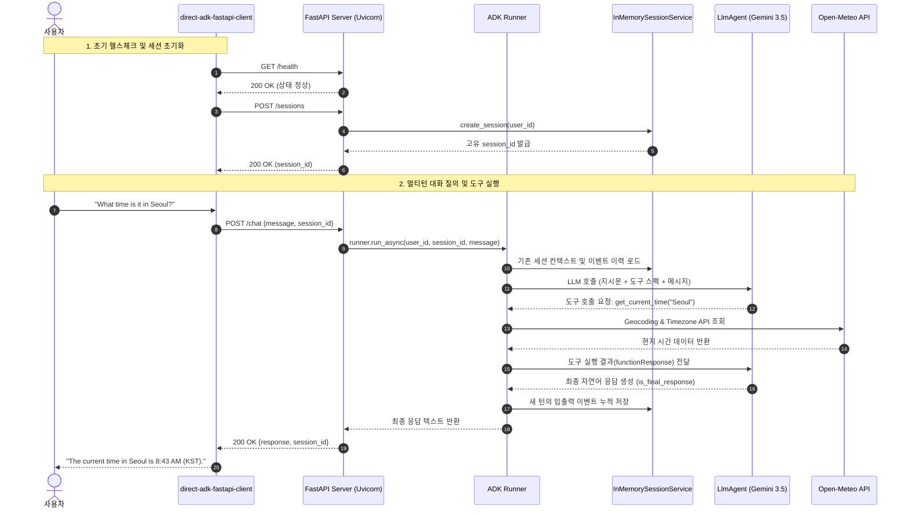

# Direct ADK (Agent Development Kit)

Google ADK(Agent Development Kit)를 직접(Direct) 사용하여 에이전트를 구축하고 제어하는 실습 및 예제 프로젝트입니다.
`Agent` / `LlmAgent`, `Runner`, `InMemorySessionService`, `InMemoryMemoryService`, `PlanReActPlanner` 등의 ADK 핵심 컴포넌트를 직접 조합하여 다양한 에이전트 아키텍처와 웹 서비스(FastAPI) 확장을 구현합니다.

---

## 📁 프로젝트 파일 구조

```
Direct_ADK/
├── 📄 설정 및 문서
│   ├── .env                                  # 환경 변수 (Gemini API 키 설정)
│   ├── README-KR.md                          # 프로젝트 가이드 및 학습 문서
│   └── _path.py                              # common 패키지 및 에이전트 import 경로 설정
│
├── 🔹 기본 실행 방식 비교 (Sync vs Async)
│   ├── direct-adk-simple-sync.py             # [동기] ADK 기초 동기식 에이전트 실행 예제
│   └── direct-adk-simple-async.py            # [비동기] ADK 표준 비동기 에이전트 실행 예제
│
├── 🔹 메모리 & 세션 관리
│   ├── direct-agent-ref-session.py           # [장기 기억] MemoryService & 다중 세션 기억 회상
│   ├── direct-adk-working_memory.py          # [작업 기억] 항공권 예약 및 ToolContext.state 단발 실행
│   ├── direct-adk-working_memory-Chat.py     # [작업 기억] 여행 예약 챗봇 및 세션 상태 누적 대화형 데모
│   ├── run_memory_layers.py                  # [메모리 계층] Session(단기) vs Memory(장기) 구조 비교
│   └── Session_management/                   # [세션 제어 디렉터리]
│       ├── direct-adk-agent-rewindsession.py # Runner.rewind_async를 이용한 세션 상태 롤백/복원
│       ├── workflow.md                       # 세션 관리 및 Rewind 워크플로 설명 문서
│       └── .env                              # 세션 관리 테스트용 환경 변수
│
├── 🔹 실전 대화형 에이전트 & 웹 서비스 확장
│   ├── direct-adk-agent.py                   # [도구 에이전트] 고정 도시(서울, 뉴욕 등) 날씨·시간 조회
│   ├── direct-adk-agent_mod.py               # [도구 에이전트] Open-Meteo 전 세계 실시간 날씨·시간 조회
│   ├── direct-adk-agent_mod-context.py       # [컨텍스트 분석] 매 LLM 호출 시 전체 Context Window(시스템/히스토리/응답) 표출
│   ├── direct-adk-fastapi-server.py          # [FastAPI 서버] Uvicorn + FastAPI + ADK Agent REST API
│   └── direct-adk-fastapi-client.py          # [FastAPI 클라이언트] 멀티턴 대화형 터미널 클라이언트
│
└── 🔹 이벤트 & 워크플로 분석
    ├── direct-agent-reference.py             # [이벤트 핸들링] Tool Call, 응답, 상태 변화 이벤트 상세 분석
    ├── run_events.py                         # [이벤트 생명주기] 단일 요청의 전체 이벤트 흐름 관찰
    └── run_workflow_events.py                # [워크플로 라우팅] ADK 2.0 Workflow 분기 및 노드 이벤트 관찰
```

---

## 📊 코드 파일별 기능 및 실행 방법 요약표

| 번호 | 파일명 | 유형 / 기능 분류 | 핵심 기능 및 설명 | 실행 방법 (CLI 명령) |
|:---:|---|---|---|---|
| **1** | `direct-adk-simple-sync.py` | 기초 (동기식) | `Runner.run()`을 이용한 동기식 실행 기본 예제. `types.Content` 생성 및 이벤트 순회 | `python direct-adk-simple-sync.py`<br>`(또는 uv run direct-adk-simple-sync.py)` |
| **2** | `direct-adk-simple-async.py` | 기초 (비동기식) | `Runner.run_async()` 비동기 제너레이터를 사용한 표준 비동기 실행 예제. Non-blocking I/O 처리 | `python direct-adk-simple-async.py`<br>`(또는 uv run direct-adk-simple-async.py)` |
| **3** | `direct-agent-reference.py` | 이벤트 분석 | Tool Call, Tool Result, 스트리밍 텍스트, 상태 변화 등 ADK 내부 Event 구조 모니터링 | `python direct-agent-reference.py` |
| **4** | `direct-agent-ref-session.py` | 장기 기억 (Memory) | `InMemoryMemoryService`와 `load_memory_tool`로 세션 1의 지식을 세션 2에서 회상 | `python direct-agent-ref-session.py` |
| **5** | `direct-adk-agent.py` | 실전 에이전트 | 서울, 뉴욕 등 도시 날씨/시간 조회 도구를 바인딩한 터미널 대화형 에이전트 | `python direct-adk-agent.py` |
| **6** | `direct-adk-agent_mod.py` | 실전 에이전트 (전 세계) | Open-Meteo Geocoding/Forecast API 연동으로 전 세계 임의 도시의 실시간 날씨/시간 자동 조회 | `python direct-adk-agent_mod.py` |
| **7** | `direct-adk-agent_mod-context.py` | 컨텍스트 분석 (Plugin) | `BasePlugin`을 통해 매 LLM 호출 시 모델에 전달되는 전체 Context Window(시스템 프롬프트, 도구 스펙, 대화 히스토리, Tool 결과) 및 토큰 사용량 실시간 시각화 | `python direct-adk-agent_mod-context.py` |
| **8** | `direct-adk-fastapi-server.py` | 웹 API 서버 (FastAPI) | `direct-adk-agent_mod.py`를 Uvicorn + FastAPI REST API로 확장 (`/health`, `/sessions`, `/chat`) | `python direct-adk-fastapi-server.py` |
| **9** | `direct-adk-fastapi-client.py` | 웹 클라이언트 (CLI) | FastAPI 서버와 HTTP 통신하는 대화형 터미널 클라이언트 (멀티턴 세션 유지) | `python direct-adk-fastapi-client.py` |
| **10** | `direct-adk-working_memory.py` | 작업 기억 (단발성) | `ToolContext.state`를 활용한 항공권 예약 도구 및 세션 Working Memory 상태 단발 테스트 | `python direct-adk-working_memory.py` |
| **11** | `direct-adk-working_memory-Chat.py` | 작업 기억 (대화형) | Working Memory에 사용자 예약 상태를 턴마다 누적/조회하는 대화형 여행 예약 챗봇 | `python direct-adk-working_memory-Chat.py` |
| **12** | `Session_management/direct-adk-agent-rewindsession.py` | 세션 롤백 (Rewind) | `Runner.rewind_async()`를 호출하여 특정 invocation 시점 이전으로 세션 State 롤백 | `python Session_management/direct-adk-agent-rewindsession.py` |
| **13** | `run_events.py` | 이벤트 생명주기 | 사용자 요청 1건에 대해 도구 호출, Runner 실행, 모델 응답의 전체 이벤트 라이프사이클 관찰 | `python run_events.py` |
| **14** | `run_memory_layers.py` | 이중 계층 메모리 | 단기 세션(Session State)과 장기 기억(Memory Service)의 저장 범위, 생명주기, 검색 방식 비교 | `python run_memory_layers.py [offline\|llm\|all]` |
| **15** | `run_workflow_events.py` | 워크플로 라우팅 | ADK 2.0 `Workflow`의 노드 분기(route) 및 이벤트 흐름 관찰 (LLM 불필요) | `python run_workflow_events.py` |
| **16** | `_path.py` | 공통 헬퍼 | 상위 실습 루트(`common` 패키지) 및 에이전트 경로를 `sys.path`에 추가하고 `.env` 로드 | 모듈 import용 (직접 실행 불필요) |

---

## ⚡ 동기(Sync) vs 비동기(Async) 방식 비교 및 장단점

Google ADK는 동기식(`runner.run`)과 비동기식(`runner.run_async`) 두 가지 실행 방식을 모두 지원합니다.

### 1. 주요 차이점

| 구분 | 동기 (Synchronous) | 비동기 (Asynchronous) |
|---|---|---|
| **실행 함수** | `runner.run(...)` | `runner.run_async(...)` |
| **세션 생성** | `asyncio.run(session_service.create_session(...))` | `await session_service.create_session(...)` |
| **이벤트 순회** | `for event in events:` (동기 이터레이터) | `async for event in runner.run_async(...):` (비동기 제너레이터) |
| **I/O 처리 방식** | 블로킹 (응답 완료까지 스레드 정지) | 논블로킹 (I/O 대기 중 다른 작업 병행 가능) |
| **권장 파일** | `direct-adk-simple-sync.py` | `direct-adk-simple-async.py`, `direct-adk-fastapi-server.py` |

---

### 2. 장단점 분석

#### 🔹 동기(Sync) 방식
- **장점**:
  - **구현 단순성**: `async/await` 키워드나 이벤트 루프 관리 없이 순차적으로 코드가 직관적입니다.
  - **단발성 스크립트에 적합**: 간단한 테스트, CLI 도구, 배치 스크립트 작성 시 빠르게 작성 가능합니다.
- **단점**:
  - **블로킹(Blocking) 발생**: LLM API 호출 및 외부 툴 대기 시간 동안 프로세스가 멈춥니다.
  - **동시성(Concurrency) 한계**: 여러 사용자의 동시 요청을 효율적으로 처리하기 어렵습니다.

#### 🔹 비동기(Async) 방식 (ADK 권장 표준)
- **장점**:
  - **논블로킹(Non-blocking) I/O**: LLM 호출, 외부 API 통신 대기 중에도 다른 코루틴을 처리할 수 있어 고성능 동시성 처리가 가능합니다.
  - **웹 프레임워크와의 통합**: FastAPI, Tornado 등 모던 비동기 웹 서버 백엔드와 유기적으로 결합됩니다.
  - **실시간 스트리밍**: 실시간 토큰 스트리밍 UI 및 백그라운드 이벤트 처리에 최적화되어 있습니다.
- **단점**:
  - **코드 복잡도**: `async def`, `await`, `asyncio.run()` 등 비동기 문법 구조와 실행 흐름에 대한 이해가 필요합니다.

---

### 3. 언제 어떤 방식을 써야 할까?

- **동기 방식 권장**: 빠른 알고리즘 검증, 1회성 CLI 스크립트, 데이터 분석 노트북 환경
- **비동기 방식 권장**: 웹 서버/API 서버 배포, 실시간 챗봇 스트리밍, 다중 에이전트 동시 통신(A2A)

---

## 🚀 사전 준비

### 1. 환경 변수 설정 (`.env`)

`.env` 파일에 Gemini API 키를 설정합니다.

```env
GEMINI_API_KEY=your_api_key_here
GOOGLE_GENAI_USE_VERTEXAI=False
```

> Gemini API 키는 [Google AI Studio](https://aistudio.google.com/app/apikey)에서 무료로 발급받을 수 있습니다.

### 2. 의존성 설치

```bash
uv sync
```

---

## 🛠️ 주요 예제 파일 안내

### 1. `direct-adk-simple-sync.py` (동기 실행)
ADK의 가장 기초적인 동기식 실행 예제입니다.

```bash
uv run direct-adk-simple-sync.py
```

```python
user_msg = types.Content(role="user", parts=[types.Part.from_text(text="Why is the sky blue?")])
events = runner.run(user_id=user_id, session_id=session1.id, new_message=user_msg)

for event in events:
    if event.is_final_response() and event.content and event.content.parts:
        text = "".join(p.text for p in event.content.parts if hasattr(p, "text") and p.text)
        print("Session 1 Response:", text)
```

---

### 2. `direct-adk-simple-async.py` (비동기 실행)
ADK의 권장 비동기 실행 표준 패턴입니다.

```bash
uv run direct-adk-simple-async.py
```

```python
async def main():
    session1 = await session_service.create_session(app_name="my_adk_app", user_id=user_id)
    user_message = types.Content(role="user", parts=[types.Part.from_text(text="Why is the sky blue?")])
    
    async for event in runner.run_async(
        user_id=user_id,
        session_id=session1.id,
        new_message=user_message
    ):
        if event.is_final_response():
            if event.content and event.content.parts:
                response_text = "".join(p.text for p in event.content.parts if hasattr(p, "text") and p.text)
                print("Session 1 Response:", response_text)

if __name__ == "__main__":
    asyncio.run(main())
```

---

### 3. `direct-agent-ref-session.py` (장기 기억 및 세션 연계)
- `InMemoryMemoryService`와 `load_memory_tool`을 사용하여 이전 세션의 대화 내용을 장기 기억(Memory)에 저장하고, 새로운 세션(세션 2)에서 이전 대화를 회상하는 예제입니다.

```bash
uv run direct-agent-ref-session.py
```

---

### 4. `direct-agent-reference.py` (이벤트 분석)
- `Event.get_function_calls()`, `Event.get_function_responses()`, `event.actions.state_delta` 등을 통해 ADK 러너가 방출하는 내부 이벤트 전체를 상세히 모니터링합니다.

```bash
uv run direct-agent-reference.py
```

---

### 5. `direct-adk-agent.py` & `direct-adk-agent_mod.py` (도구 연동 에이전트)
- **`direct-adk-agent.py`**: 날씨와 시간 조회 도구가 바인딩된 기본 대화형 에이전트입니다.
- **`direct-adk-agent_mod.py`**: Open-Meteo Geocoding 및 Forecast 무료 API를 결합하여 전 세계 임의의 도시명을 위도/경도/타임존으로 자동 변환해 실시간 날씨와 현지 시각을 조회합니다. Function Calling과 일반 대화를 자연스럽게 통합 지원합니다.

```bash
uv run direct-adk-agent_mod.py
```

---

### 6. `direct-adk-agent_mod-context.py` (Context Window 원본 그대로 실시간 표출 및 분석)
`direct-adk-agent_mod.py`를 확장하여, **매번 LLM 모델(Gemini)을 호출할 때 모델로 전달되는 전체 Context Window(시스템 프롬프트, 도구 스펙, 대화 히스토리 및 Tool 입출력 전체)를 원본 그대로(Raw JSON)** 터미널에 실시간으로 시각화하는 예제입니다.

- **작동 원리**: ADK의 `BasePlugin`을 상속받은 `ContextDisplayPlugin`을 정의하고 `Runner(plugins=[...])`에 주입합니다.
- **`before_model_callback`**: 모델 호출 직전의 `LlmRequest`를 가로채어 다음 정보를 **그대로** 표출합니다.
  - 📌 **시스템 프롬프트 (System Instruction)**: 개발자가 지정한 지시문 및 에이전트 내부 메타데이터 원본
  - 🛠️ **바인딩된 도구 목록 (Available Tools)**: `get_weather`, `get_current_time` 등 모델이 호출 가능한 도구 스펙 및 docstring
  - 📜 **누적 대화 히스토리 (Context Messages)**: 사용자 입력(`user`), 모델 응답(`model`), 도구 호출(`function_call`), 도구 반환값(`function_response`)을 포함한 전체 Content 객체의 **원본 JSON 리스트**
- **`after_model_callback`**: 모델 응답 직후의 `LlmResponse`를 가로채어 다음 정보를 **그대로** 표출합니다.
  - 📥 **모델 생성 결과 (Raw Model Output)**: 생성된 텍스트 파트 또는 `function_call` 파트의 **원본 JSON 객체**
  - 📊 **토큰 소비량 (Token Usage)**: Prompt Tokens, Output Tokens, Total Tokens

```bash
python direct-adk-agent_mod-context.py
```

#### 🔹 Context Window 원본 표출 예시 (서울 날씨 질의 시 2회 호출 흐름)
1. **1차 LLM 호출 (도구 호출 판단)**:
   - **Context Window**: 시스템 프롬프트 + 사용자 입력 원본 JSON
   ```json
   [
     {
       "role": "user",
       "parts": [{"text": "What is the weather in Seoul?"}]
     }
   ]
   ```
   - **모델 출력 (Raw JSON)**:
   ```json
   {
     "role": "model",
     "parts": [{
       "function_call": {"name": "get_weather", "args": {"city": "Seoul"}}
     }]
   }
   ```
2. **Runner의 도구 실행**:
   - Open-Meteo API를 호출하여 날씨 데이터 획득
3. **2차 LLM 호출 (최종 자연어 요약 답변 생성)**:
   - **Context Window (이전 히스토리 + Tool 응답 누적 원본 JSON)**:
   ```json
   [
     {
       "role": "user",
       "parts": [{"text": "What is the weather in Seoul?"}]
     },
     {
       "role": "model",
       "parts": [{
         "function_call": {"name": "get_weather", "args": {"city": "Seoul"}}
       }]
     },
     {
       "role": "user",
       "parts": [{
         "function_response": {
           "name": "get_weather",
           "response": {"status": "success", "report": "Weather in Seoul: Overcast..."}
         }
       }]
     }
   ]
   ```
   - **모델 출력 (최종 답변 Raw JSON)**:
   ```json
   {
     "role": "model",
     "parts": [{"text": "The current weather in Seoul is overcast with a temperature of 6.6°C..."}]
   }
   ```

#### 🔍 Deep Dive: "thought_signature"의 정체와 작동 원리

Gemini 2.5 / 3.0 / 3.5 모델에서 Function Calling이나 Reasoning(Thinking)을 수행할 때 JSON 출력 내에 다음과 같은 바이너리 필드가 나타납니다:

```json
{
  "function_call": {
    "name": "get_weather",
    "args": {"city": "Seoul"}
  },
  "thought_signature": "b'\\x12\\xd7\\x01\\n\\xd4\\x01\\x01i\\x14}\\x13\\x9cg\\x8d...'"
}
```

##### 1. "thought_signature"란 무엇인가?
Google GenAI SDK(`google.genai.types.Part.thought_signature`)에 공식 정의된 **암호화 무결성 서명 토큰(Cryptographic Integrity Token)**입니다.
- **포맷**: Protobuf로 직렬화된 불투명(Opaque) 바이트 배열 (약 200~350 bytes)
- **생성 주체**: 사용자 로컬 코드가 아닌, **Google Gemini 백엔드 서버**에서 직접 발급

##### 2. 핵심 역할 및 존재 이유
- **추론 및 도구 호출 위·변조 방지 (Tamper-proofing & Anti-Prompt Injection)**:
  - 에이전트의 멀티턴 대화 루프에서는 `[사용자 질문 → 모델의 도구 호출 및 추론 → Runner의 도구 실행 결과]`를 하나의 대화 히스토리로 묶어 다음 턴에 다시 Gemini 모델로 전달(Context Window)합니다.
  - 만약 중간에 악의적인 사용자나 클라이언트가 모델이 마치 그런 생각을 한 것처럼 **가짜 추론(Fake Thought)이나 악성 도구 파라미터(`rm -rf` 등)를 위조하여 히스토리에 주입**하면, 모델은 자신이 직접 도출한 결론인 줄 착각하여 치명적인 오작동(Prompt Injection)을 일으킵니다.
  - 이를 차단하기 위해 Google 백엔드는 자신이 생성한 추론(Thinking)과 도구 호출(Function Call)에 비공개 키로 **디지털 암호화 서명(`thought_signature`)**을 각인합니다.
- **스테이트리스(Stateless) API 무결성 검증**:
  - 다음 턴에 컨텍스트가 들어올 때, Google 서버는 동봉된 `thought_signature`를 자체 검증하여 "이 도구 호출과 추론이 변조되지 않은 정품 Gemini 생성물인가?"를 검증한 후에만 안전하게 다음 답변을 생성합니다.

##### 3. 바이너리 코드와 해석 내용 사례

| 구분 | 실제 데이터 및 바이너리 구조 | 해석 및 의미 |
|---|---|---|
| **바이너리 원본 (Python Bytes)** | `b'\x12\xd7\x01\n\xd4\x01\x01i\x14}\x13\x9cg\x8d...'` | Google 내부 Protobuf 서명 메시지 |
| **Hex 인코딩** | `12d7010ad4010169147d139c678dc1f0...` | 길이 약 220 bytes의 암호화 다이제스트 |
| **Protobuf 와이어 분석** | • `0x12`: 필드 번호 2 (Length-delimited bytes)<br>• `0xd7 0x01`: 페이로드 길이 215 바이트 (Varint)<br>• 페이로드 내부: 모델 ID, 타임스탬프, 도구 호출 해시 + 전자 서명 | "이 도구 호출(`get_weather`)과 인자(`Seoul`)는 Gemini 3.5 Flash가 직접 생성함"을 보증하는 **디지털 인감도장** |
| **매핑되는 실제 추론 내용<br>(Thinking Mode 활성화 시 표출)** | `part.thought == True`<br>`"Okay, here's my thought process regarding the user's request: The user wants to know current weather in 'Seoul'. Therefore, my immediate course of action is to call the get_weather tool with city='Seoul'."` | 서명(`thought_signature`)이 보호하고 있는 **실제 내부 추론(Chain-of-Thought) 텍스트** |

> 💡 **Tip**: 기본 설정에서는 Google 서버가 추론 텍스트를 숨기고 서명(`thought_signature`)만 반환하지만, `direct-adk-agent_mod-context.py`처럼 `ThinkingConfig(include_thoughts=True)`를 활성화하면 위 표의 실제 추론 원문까지 모두 터미널에서 함께 확인할 수 있습니다.

---

### 7. `direct-adk-fastapi-server.py` & `direct-adk-fastapi-client.py` (Uvicorn + FastAPI 서버 및 터미널 클라이언트 확장)
`direct-adk-agent_mod.py`의 고성능 전 세계 날씨·시간 에이전트를 모던 웹 API 백엔드로 확장한 구성입니다.

```
[대화형 터미널 클라이언트]
 (direct-adk-fastapi-client.py)
            │  HTTP POST /chat (JSON)
            ▼
[FastAPI + Uvicorn 웹 서버] (direct-adk-fastapi-server.py)
 ├── GET  /health              # 서버 및 에이전트 헬스체크
 ├── POST /sessions            # 멀티턴 컨텍스트 세션 생성
 ├── GET  /sessions/{id}       # 세션 상태 및 이벤트 이력 조회
 └── POST /chat                # ADK runner.run_async 비동기 실행 및 답변 반환
            │
            ▼
[Google ADK LlmAgent] ──> [Open-Meteo API / Gemini 3.5 Flash]
```

#### 🔹 주요 특징
1. **완전한 비동기 I/O 파이프라인**: FastAPI 엔드포인트 내에서 `runner.run_async` 비동기 제너레이터를 구동하여 동시 요청 처리 시 병목이 발생하지 않습니다.
2. **세션 기반 멀티턴 대화 유지**: 클라이언트 요청마다 고유 `session_id`를 전달하여 이전 대화 흐름을 자연스럽게 이어갑니다.
3. **간편한 분리 실행**: 서버는 Uvicorn 데몬으로 백그라운드에 구동하고, 클라이언트는 독립된 터미널에서 대화형 CLI로 접속합니다.

#### 🔹 실행 방법

**1단계: 터미널 1에서 FastAPI 서버 실행**
```bash
python direct-adk-fastapi-server.py
# 또는 uvicorn CLI 직접 실행
# uvicorn direct-adk-fastapi-server:app --host 127.0.0.1 --port 8000
```
> 서버가 시작되면 `http://127.0.0.1:8000`에서 요청을 수신합니다.

**2단계: 터미널 2에서 대화형 클라이언트 실행**
```bash
python direct-adk-fastapi-client.py
```

#### 🔹 대화 예시
```text
=================================================================
  💬 ADK Agent FastAPI Interactive Client
  Target Server: http://127.0.0.1:8000
=================================================================
  Active Session : session_07b7919d
  Commands       : Type 'quit', 'exit', or 'q' to end.
  Capabilities   : Weather, time, and general QA (multi-turn chat)
=================================================================

🧑 You: What time is it in Seoul right now?
🤖 Agent: The current time in Seoul is 8:43 AM (KST).

🧑 You: How about the weather there?
🤖 Agent: Seoul is currently experiencing clear skies with a temperature of around 12°C.

🧑 You: quit
Ending session. Goodbye!
```

---

### 8. `direct-adk-working_memory-Chat.py` & `direct-adk-working_memory.py` (Working Memory 상태 관리)
- `ToolContext.state`를 활용하여 사용자 맞춤 정보(예: 항공권 예약 번호, 예약 상태 등)를 에이전트의 단기 작업 기억(Working Memory)에 누적하고, 대화 진행 중 이를 조회 및 업데이트하는 데모입니다.
- **`direct-adk-working_memory.py`**: 1회성 예약 실행 및 최종 State/History 출력
- **`direct-adk-working_memory-Chat.py`**: 다회 대화 루프(`input()`)를 돌며 매 턴마다 변경된 State(`💾 State Updated`)를 실시간으로 출력하는 챗봇 데모

```bash
uv run direct-adk-working_memory-Chat.py
```

---

## 🌐 'Uvicorn + FastAPI' 기반 Agent API_Server 동작구조

`direct-adk-fastapi-server.py`와 `direct-adk-fastapi-client.py`는 단일 터미널 스크립트 형태의 에이전트를 모던 웹 아키텍처(클라이언트-서버 모델)로 분리·확장한 시스템입니다.  
Uvicorn ASGI 서버 위에서 구동되는 FastAPI와 Google ADK의 `Runner.run_async()` 비동기 엔진을 결합하여, 실시간 도구 호출(Tool Calling)과 멀티턴 세션 관리를 웹 API 서비스로 제공합니다.

### 1. 시스템 아키텍처 다이어그램



### 2. 세부 동작 프로세스

1. **서버 부트스트랩 및 에이전트 바인딩 (`direct-adk-fastapi-server.py`)**:
   - `LlmAgent`에 Gemini 3.5 Flash 모델과 2가지 도구(`get_weather`, `get_current_time`)를 바인딩합니다.
   - `InMemorySessionService` 인스턴스를 생성하고, 이를 주입한 `Runner` 객체를 준비합니다.
   - Uvicorn이 FastAPI 애플리케이션을 호스팅하며 `http://127.0.0.1:8000`에서 클라이언트 요청을 수신 대기합니다.

2. **클라이언트 접속 및 세션 핸드셰이크 (`direct-adk-fastapi-client.py`)**:
   - 클라이언트 실행 시 `GET /health`를 호출하여 서버 가동 여부를 검증합니다.
   - `POST /sessions`를 통해 서버에 고유 세션(`session_id`) 생성을 요청하여 반환받습니다. 이후 모든 대화 요청에 이 `session_id`를 동봉함으로써 **멀티턴 대화 컨텍스트가 유지**됩니다.

3. **비동기 질의 처리 파이프라인 (Non-blocking Async Pipeline)**:
   - 사용자가 터미널에 메시지를 입력하면 클라이언트가 `POST /chat` 엔드포인트로 JSON 페이로드를 전송합니다.
   - FastAPI 핸들러는 요청을 수신한 즉시 `runner.run_async(...)` 비동기 제너레이터를 구동합니다.
   - LLM 응답 대기 및 외부 REST API(Open-Meteo) 호출 중에도 이벤트 루프가 차단(Block)되지 않으므로, 여러 클라이언트의 동시 요청을 효율적으로 처리합니다.

4. **도구 자동 호출(Function Calling) 및 이벤트 처리**:
   - 모델이 사용자의 질문(예: 특정 도시의 날씨 또는 시간)을 분석하여 도구 호출이 필요하다고 판단하면 `functionCall` 이벤트를 발생시킵니다.
   - Runner가 도구(`get_weather` / `get_current_time`)를 실행하여 Open-Meteo 무료 API로부터 좌표와 실시간 기상/시각 정보를 획득합니다.
   - 도구 실행 결과는 `functionResponse`로 모델에 다시 전달되며, 모델은 이를 종합하여 자연스러운 최종 답변(`is_final_response`)을 생성합니다.

5. **세션 상태 누적 및 응답 반환**:
   - 발생한 모든 대화 이벤트는 `InMemorySessionService`에 순차적으로 기록되어 세션이 유지되는 동안 이전 질문과 맥락을 기억합니다.
   - FastAPI는 최종 추출된 텍스트 응답을 JSON 객체(`ChatResponse`)로 래핑하여 클라이언트에 응답하고, 클라이언트는 이를 터미널에 출력합니다.

### 3. REST API 엔드포인트 규격

| 메서드 | 엔드포인트 | 요청 본문 (Request Body) | 응답 본문 (Response Body) | 설명 |
|---|---|---|---|---|
| `GET` | `/health` | 없음 | `{"status": "healthy", "agent": "...", ...}` | 서버 상태 및 바인딩된 에이전트/모델 정보 확인 |
| `POST` | `/sessions` | `{"user_id": "user01"}` (선택) | `{"session_id": "session_...", "status": "created"}` | 새로운 독립 대화 세션 생성 |
| `GET` | `/sessions/{id}` | 없음 | `{"session_id": "...", "event_count": 4, "state": {}}` | 특정 세션의 이벤트 수 및 Working Memory 상태 조회 |
| `POST` | `/chat` | `{"message": "...", "session_id": "...", "user_id": "..."}` | `{"response": "...", "session_id": "..."}` | 에이전트 질의 처리 및 답변 반환 (미지정 시 세션 자동 생성) |

### 4. 구조적 장점 및 확장성
- **관심사 분리(SoC)**: 에이전트 로직(ADK Runner/Agent)과 사용자 인터페이스(터미널 클라이언트)가 HTTP API를 통해 완전히 분리되어, 차후 웹 프론트엔드(React, Vue)나 Slack/Discord 봇 등으로 클라이언트를 자유롭게 교체할 수 있습니다.
- **고성능 비동기 아키텍처**: Uvicorn(ASGI)과 ADK의 `run_async`를 연계하여 동기식 I/O 병목을 제거하고 높은 동시성 처리가 가능합니다.
- **상태 격리**: 사용자 및 세션별로 분리된 상태 관리를 통해 다중 사용자가 동시에 질의하더라도 컨텍스트 혼선이 발생하지 않습니다.

---

## 💡 핵심 주의사항 & ADK 팁

1. **`Runner.run()` / `run_async()` 입력 파라미터**:
   - `prompt="텍스트"`가 아닌 `new_message=types.Content(role="user", parts=[types.Part.from_text(text="...")])` 형식을 사용해야 합니다.
2. **응답 데이터 추출**:
   - `runner.run()`과 `runner.run_async()`는 결과 문자열을 바로 반환하지 않고 **Event 스트림**을 반환하므로, `event.is_final_response()` 검사와 `event.content.parts` 파싱 과정을 거쳐 최종 텍스트를 추출합니다.
3. **API 키 자동 인식**:
   - `.env` 파일에 `GEMINI_API_KEY`를 정의하고 `load_dotenv(override=True)`를 실행하면 `Agent` 인스턴스 생성 시 자동으로 키를 참조합니다.
4. **FastAPI 웹 서버 연동 시 비동기 권장**:
   - FastAPI 핸들러는 비동기(`async def`)로 작성하고, ADK 실행 시 `runner.run_async()`를 사용하여 이벤트 루프 블로킹을 방지해야 동시 다발적인 사용자 요청을 고성능으로 처리할 수 있습니다.

---

## 🔗 관련 문서

- [Google ADK 공식 문서](https://google.github.io/adk-docs/)
- [Google AI Studio API Key 관리](https://aistudio.google.com/app/apikey)
- [Open-Meteo 무료 날씨 API](https://open-meteo.com/)
- [FastAPI 공식 문서](https://fastapi.tiangolo.com/)
- [Uvicorn 공식 문서](https://www.uvicorn.org/)
