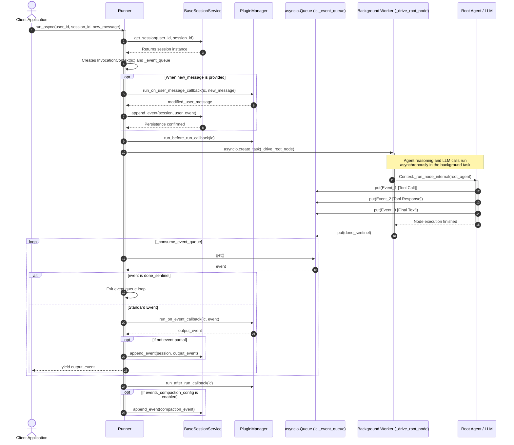

# Google ADK `Runner` Architecture and Operational Mechanics

`from google.adk.runners import Runner`

In the Google Agent Development Kit (ADK), **`Runner`** is the **Central Orchestration Engine** responsible for executing agents and workflows, managing session persistence, binding memory and artifact services, controlling the plugin lifecycle, and streaming generated events.

---

## 1. Core Responsibilities of `Runner`

`Runner` does not merely forward prompts to an LLM; it manages the full infrastructure and lifecycle demanded by production-grade agentic applications:

1. **Agent & Workflow Execution Orchestration**
   - Dispatches and drives `BaseAgent` instances (e.g., `LlmAgent`, `Agent`), hierarchical sub-agent trees, and graph-based workflows (`Workflow`, `BaseNode`).
   - Resolves sub-agent routing, function-call delegation, and task isolation scopes across multi-turn interactions.
2. **Session & Event Persistence**
   - Coordinates with `BaseSessionService` to atomically persist user requests and agent output events (`Event`).
   - Supports seamless session resumption, historical turn lookup, and non-destructive session rollbacks (`rewind_async`).
3. **External Service Integration**
   - **Memory Service (`BaseMemoryService`)**: Queries long-term memories and injects personalized historical context.
   - **Artifact Service (`BaseArtifactService`)**: Stores and versions multimodal payloads, binaries, uploaded files, and generated code artifacts.
   - **Credential Service (`BaseCredentialService`)**: Injects authentication tokens and manages OAuth credentials for third-party tools.
4. **Decoupled Asynchronous Event Streaming**
   - Employs an internal `asyncio.Queue` to decouple node execution (`_drive_root_node`) from event consumption (`_consume_event_queue`), guaranteeing non-blocking real-time streaming.
5. **Plugin & Hook Lifecycle Management**
   - Triggers `before_run`, `on_user_message`, `on_event`, `after_run`, and `on_run_error` lifecycle callbacks via `PluginManager`.
6. **Session Compaction & Context Optimization**
   - Performs token-based or sliding-window event compaction at turn completion to prevent LLM context window overflows.

---

## 2. Class Diagram

The Mermaid class diagram below illustrates the structural relationships between `Runner`, `InMemoryRunner`, and its collaborating components in the Google ADK ecosystem.

```mermaid
classDiagram
    direction TB

    class Runner {
        +str app_name
        +BaseAgent | BaseNode agent
        +App app
        +BaseSessionService session_service
        +BaseMemoryService memory_service
        +BaseArtifactService artifact_service
        +BaseCredentialService credential_service
        +PluginManager plugin_manager
        +bool auto_create_session
        +run_async(user_id, session_id, new_message, run_config) AsyncGenerator~Event~
        +run(user_id, session_id, new_message, run_config) Generator~Event~
        +run_live(live_request_queue, run_config) AsyncGenerator~Event~
        +run_debug(user_messages, run_config) list~Event~
        +rewind_async(user_id, session_id, rewind_before_invocation_id)
        +close()
    }

    class InMemoryRunner {
        +__init__(agent, node, app_name, plugins, app)
    }

    class App {
        +str name
        +BaseAgent root_agent
        +list~BasePlugin~ plugins
        +ContextCacheConfig context_cache_config
        +ResumabilityConfig resumability_config
        +EventsCompactionConfig events_compaction_config
    }

    class BaseAgent {
        <<abstract>>
        +str name
        +str description
        +list~BaseAgent~ sub_agents
        +run_async(ctx) AsyncGenerator~Event~
        +run_live(ctx) AsyncGenerator~Event~
    }

    class LlmAgent {
        +str model
        +str instruction
        +str mode
        +list~BaseToolset~ toolsets
    }

    class Workflow {
        +dict nodes
        +run_node(node, node_input)
    }

    class BaseSessionService {
        <<interface>>
        +get_session(app_name, user_id, session_id, config) Session
        +create_session(app_name, user_id, session_id) Session
        +append_event(session, event) Event
        +flush()
    }

    class InMemorySessionService {
        -dict _sessions
    }

    class BaseMemoryService {
        <<interface>>
        +search_memory(query, user_id) list
    }

    class BaseArtifactService {
        <<interface>>
        +save_artifact(app_name, user_id, session_id, filename, artifact)
        +load_artifact(app_name, user_id, session_id, filename, version)
    }

    class PluginManager {
        +list~BasePlugin~ plugins
        +run_before_run_callback(invocation_context)
        +run_on_user_message_callback(invocation_context, user_message)
        +run_on_event_callback(invocation_context, event)
        +run_after_run_callback(invocation_context)
        +run_on_run_error_callback(invocation_context, error)
        +close()
    }

    class InvocationContext {
        +Session session
        +BaseAgent agent
        +str user_id
        +str invocation_id
        +RunConfig run_config
        +types.Content user_content
        +PluginManager plugin_manager
        +asyncio.Queue _event_queue
    }

    class Session {
        +str id
        +str app_name
        +str user_id
        +dict state
        +list~Event~ events
    }

    class Event {
        +str id
        +str invocation_id
        +str author
        +float timestamp
        +types.Content content
        +EventActions actions
        +bool partial
        +is_final_response() bool
        +get_function_calls() list
        +get_function_responses() list
    }

    class RunConfig {
        +dict custom_metadata
        +list~Modality~ response_modalities
        +GetSessionConfig get_session_config
    }

    Runner <|-- InMemoryRunner : Extends
    Runner *-- App : Encapsulates
    Runner o-- BaseAgent : Drives root agent
    Runner o-- BaseSessionService : Session persistence
    Runner o-- BaseMemoryService : Memory retrieval
    Runner o-- BaseArtifactService : Artifact storage
    Runner o-- PluginManager : Lifecycle dispatch
    BaseSessionService <|.. InMemorySessionService : Implements
    BaseAgent <|-- LlmAgent : Inherits
    BaseAgent <|-- Workflow : Inherits
    Runner ..> InvocationContext : Creates & provides
    InvocationContext o-- Session : References
    InvocationContext o-- RunConfig : References
    Session *-- Event : History log
    Runner ..> Event : Streams yield
```



---

## 3. Operational Flow and Execution Sequence (`run_async`)

The sequence diagram below details the operational stages executed during an invocation of `Runner.run_async()`.



---

## 4. Key Runner Methods

### ① `run_async(...)`
- **Signature**:
  ```python
  async def run_async(
      self,
      *,
      user_id: str,
      session_id: str,
      invocation_id: Optional[str] = None,
      new_message: Optional[types.Content] = None,
      state_delta: Optional[dict[str, Any]] = None,
      run_config: Optional[RunConfig] = None,
      yield_user_message: bool = False,
  ) -> AsyncGenerator[Event, None]
  ```
- **Description**: The primary production entrypoint. Returns an asynchronous generator that streams `Event` objects as they are produced.
- **Key Details**:
  - Setting `yield_user_message=True` yields the newly persisted user message event before emitting agent response events.
  - Passes tool calls, tool responses, thought chunks, and final text responses in sequential order.
  - Accepting an `invocation_id` allows resuming an interrupted or paused turn (e.g., Human-in-the-Loop workflows).

### ② `run(...)` (Synchronous Wrapper)
- **Description**: Synchronous convenience generator for local unit testing and prototyping.
- **Mechanics**:
  - Spawns a dedicated background OS thread running a new `asyncio.run(_invoke_run_async())` event loop.
  - Channels produced events through a thread-safe `queue.Queue` and yields them to the caller on the main thread.

### ③ `run_live(...)` (Bidirectional Real-Time Streaming)
- **Description**: Streams bidirectional multimodal audio/video interactions (e.g., Gemini Multimodal Live API).
- **Mechanics**:
  - Consumes live audio/video chunks from a `LiveRequestQueue` and yields audio and transcription events.
  - To prevent database bloat, large binary media chunks are written directly to `BaseArtifactService`, storing only a file reference (`file_data`) inside session events.

### ④ `run_debug(...)` (Rapid Prototyping Helper)
- **Description**: Lightweight helper enabling direct testing with plain string prompts without manually constructing sessions or `types.Content`.
- **Mechanics**:
  - Automatically manages `debug_session_id` and logs formatted, colored events to standard output (`print_event`). Returns a consolidated `list[Event]`.

### ⑤ `rewind_async(...)` (Time-Travel Session Rewind)
- **Description**: Reverts the session state and artifact versions to an earlier invocation (`rewind_before_invocation_id`).
- **Mechanics**:
  - Rather than destructively deleting history, it calculates the reverse delta of `session.state` and artifact versions, and appends a compensation `Event` containing `state_delta` and `artifact_delta`.

### ⑥ `close()` & Context Manager Support
- Supports `async with Runner(...) as runner:`. Upon exit, gracefully closes active toolsets (`_cleanup_toolsets`), terminates plugins (`plugin_manager.close()`), and flushes pending writes in session stores (`session_service.flush()`).

---

## 5. `InMemoryRunner` vs `Runner`

| Feature | `Runner` | `InMemoryRunner` |
| :--- | :--- | :--- |
| **Target Environment** | Enterprise Production | Local testing, unit tests, fast prototyping |
| **Session Service** | Custom backend (PostgreSQL, Redis, Spanner, etc.) | Pre-wired `InMemorySessionService` |
| **Memory Service** | Custom long-term vector/graph store | Pre-wired `InMemoryMemoryService` |
| **Artifact Service** | Cloud Storage (GCS, S3) or persistent disks | Pre-wired `InMemoryArtifactService` |
| **Persistence** | Durable across service restarts | Discarded on process termination |
| **Usage** | `Runner(agent=..., session_service=...)` | `InMemoryRunner(agent=...)` |

---

## 6. Practical Example (`direct-adk-simple-async.py`)

```python
import asyncio
from dotenv import load_dotenv
from google.adk.agents import Agent
from google.adk.runners import Runner
from google.adk.sessions import InMemorySessionService
from google.adk.memory import InMemoryMemoryService
from google.genai import types

load_dotenv(override=True)

# 1. Define Agent
agent = Agent(
    name="memory_assistant",
    model="gemini-3.8-flash",
    instruction="You are a helpful and accurate assistant."
)

# 2. Define Infrastructure Services
session_service = InMemorySessionService()
memory_service = InMemoryMemoryService()

# 3. Initialize Runner (Orchestrator)
runner = Runner(
    agent=agent,
    app_name="my_adk_app",
    session_service=session_service,
    memory_service=memory_service,
    auto_create_session=True
)

async def main():
    user_id = "user_01"
    session_id = "session_101"

    # Explicit session creation (or leverage auto_create_session)
    session = await session_service.create_session(
        app_name="my_adk_app",
        user_id=user_id,
        session_id=session_id
    )

    user_message = types.Content(
        role="user",
        parts=[types.Part.from_text(text="Why is the sky blue?")]
    )

    # 4. Asynchronously execute Runner and consume event stream
    async for event in runner.run_async(
        user_id=user_id,
        session_id=session.id,
        new_message=user_message
    ):
        if event.is_final_response():
            print("Response:", event.text)

    # 5. Clean up resources
    await runner.close()

if __name__ == "__main__":
    asyncio.run(main())
```

