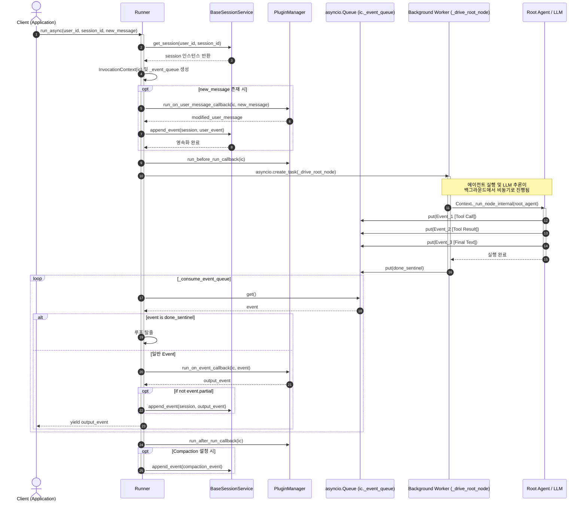

# Google ADK `Runner` 아키텍처 및 동작 구조 가이드

`from google.adk.runners import Runner`

Google Agent Development Kit (ADK)에서 **`Runner`**는 에이전트 및 워크플로우의 실행, 대화 세션 상태 관리, 메모리/아티팩트 서비스 연동, 플러그인 생명주기 제어 및 이벤트 스트리밍을 총괄하는 **핵심 오케스트레이션 엔진(Central Orchestration Engine)**입니다.

---

## 1. `Runner`의 핵심 역할 및 책임

`Runner`는 단순히 LLM을 호출하는 브릿지가 아니라, 프로덕션 환경의 에이전트 런타임에 필요한 인프라와 제어 흐름을 통합 관리합니다:

1. **에이전트 실행 오케스트레이션 (Agent Execution)**
   - `BaseAgent`(예: `LlmAgent`, `Agent`), 서브 에이전트 트리, 또는 그래프 기반 워크플로우(`Workflow`, `BaseNode`)를 구동합니다.
   - 멀티 에이전트 환경에서 에이전트 간 제어권 전이(Transfer/Delegation) 및 태스크 스코프 격리를 조정합니다.
2. **세션 및 대화 이력 영속화 (Session & Event Persistence)**
   - `BaseSessionService`를 통해 사용자 메시지와 에이전트 생성 이벤트(`Event`)를 원자적으로 기록합니다.
   - 세션 복구(Resume), 히스토리 자동 조회, 타임 트래블 롤백(`rewind_async`)을 지원합니다.
3. **외부 서비스 통합 (Service Integration)**
   - **메모리 서비스 (`BaseMemoryService`)**: 장기 기억(Long-term memory) 검색 및 컨텍스트 주입.
   - **아티팩트 서비스 (`BaseArtifactService`)**: 멀티모달 파일, 바이너리, 코드 실행 결과물 저장 및 버전 관리.
   - **인증 서비스 (`BaseCredentialService`)**: 도구 및 외부 API 호출에 필요한 인증 토큰/자격 증명 관리.
4. **이벤트 스트리밍 및 큐잉 (Event Streaming & Decoupling)**
   - 에이전트 노드 실행(`_drive_root_node`)과 이벤트 소비(`_consume_event_queue`)를 `asyncio.Queue`로 분리하여 비동기 논블로킹 스트리밍을 보장합니다.
5. **플러그인 및 라이프사이클 훅 (Plugin Lifecycle)**
   - `PluginManager`를 통해 `before_run`, `on_user_message`, `on_event`, `after_run`, `on_run_error` 콜백을 적재적소에 실행합니다.
6. **세션 압축 및 컨텍스트 최적화 (Compaction & Cache)**
   - 호출 완료 후 슬라이딩 윈도우 또는 토큰 기반 이벤트 압축(`compaction`)을 수행하여 컨텍스트 윈도우 초과를 방지합니다.

---

## 2. 주요 클래스 구조 (Class Diagram)

`Runner` 및 연관 컴포넌트 간의 관계를 나타낸 Mermaid 클래스 다이어그램입니다.

```mermaid
classDiagram
    direction TB

    class Runner {
        +str app_name
        +BaseAgent | BaseNode agent
        +App app
        +BaseSessionService session_service
        +BaseMemoryService memory_service
        +BaseArtifactService artifact_service
        +BaseCredentialService credential_service
        +PluginManager plugin_manager
        +bool auto_create_session
        +run_async(user_id, session_id, new_message, run_config) AsyncGenerator~Event~
        +run(user_id, session_id, new_message, run_config) Generator~Event~
        +run_live(live_request_queue, run_config) AsyncGenerator~Event~
        +run_debug(user_messages, run_config) list~Event~
        +rewind_async(user_id, session_id, rewind_before_invocation_id)
        +close()
    }

    class InMemoryRunner {
        +__init__(agent, node, app_name, plugins, app)
    }

    class App {
        +str name
        +BaseAgent root_agent
        +list~BasePlugin~ plugins
        +ContextCacheConfig context_cache_config
        +ResumabilityConfig resumability_config
        +EventsCompactionConfig events_compaction_config
    }

    class BaseAgent {
        <<abstract>>
        +str name
        +str description
        +list~BaseAgent~ sub_agents
        +run_async(ctx) AsyncGenerator~Event~
        +run_live(ctx) AsyncGenerator~Event~
    }

    class LlmAgent {
        +str model
        +str instruction
        +str mode
        +list~BaseToolset~ toolsets
    }

    class Workflow {
        +dict nodes
        +run_node(node, node_input)
    }

    class BaseSessionService {
        <<interface>>
        +get_session(app_name, user_id, session_id, config) Session
        +create_session(app_name, user_id, session_id) Session
        +append_event(session, event) Event
        +flush()
    }

    class InMemorySessionService {
        -dict _sessions
    }

    class BaseMemoryService {
        <<interface>>
        +search_memory(query, user_id) list
    }

    class BaseArtifactService {
        <<interface>>
        +save_artifact(app_name, user_id, session_id, filename, artifact)
        +load_artifact(app_name, user_id, session_id, filename, version)
    }

    class PluginManager {
        +list~BasePlugin~ plugins
        +run_before_run_callback(invocation_context)
        +run_on_user_message_callback(invocation_context, user_message)
        +run_on_event_callback(invocation_context, event)
        +run_after_run_callback(invocation_context)
        +run_on_run_error_callback(invocation_context, error)
        +close()
    }

    class InvocationContext {
        +Session session
        +BaseAgent agent
        +str user_id
        +str invocation_id
        +RunConfig run_config
        +types.Content user_content
        +PluginManager plugin_manager
        +asyncio.Queue _event_queue
    }

    class Session {
        +str id
        +str app_name
        +str user_id
        +dict state
        +list~Event~ events
    }

    class Event {
        +str id
        +str invocation_id
        +str author
        +float timestamp
        +types.Content content
        +EventActions actions
        +bool partial
        +is_final_response() bool
        +get_function_calls() list
        +get_function_responses() list
    }

    class RunConfig {
        +dict custom_metadata
        +list~Modality~ response_modalities
        +GetSessionConfig get_session_config
    }

    Runner <|-- InMemoryRunner : 상속
    Runner *-- App : 구성(Wrap)
    Runner o-- BaseAgent : 실행 대상(Agent)
    Runner o-- BaseSessionService : 세션 영속화
    Runner o-- BaseMemoryService : 기억 검색
    Runner o-- BaseArtifactService : 아티팩트 관리
    Runner o-- PluginManager : 수명주기 훅
    BaseSessionService <|.. InMemorySessionService : 구현
    BaseAgent <|-- LlmAgent : 상속
    BaseAgent <|-- Workflow : 상속
    Runner ..> InvocationContext : 생성 및 주입
    InvocationContext o-- Session : 참조
    InvocationContext o-- RunConfig : 참조
    Session *-- Event : 이력 보관
    Runner ..> Event : 스트리밍 생성(Yield)
```



---

## 3. 핵심 동작 구조 및 실행 시퀀스 (`run_async`)

`Runner.run_async()`가 호출되었을 때 내부에서 실행되는 단계별 라이프사이클입니다.



---

## 4. `Runner`의 핵심 메서드 상세 분석

### ① `run_async(...)`
- **시그니처**:
  ```python
  async def run_async(
      self,
      *,
      user_id: str,
      session_id: str,
      invocation_id: Optional[str] = None,
      new_message: Optional[types.Content] = None,
      state_delta: Optional[dict[str, Any]] = None,
      run_config: Optional[RunConfig] = None,
      yield_user_message: bool = False,
  ) -> AsyncGenerator[Event, None]
  ```
- **역할**: 프로덕션 표준 진입점. 비동기 제너레이터를 반환하여 실시간으로 생성되는 `Event`를 스트리밍합니다.
- **특징**:
  - `yield_user_message=True` 설정 시 에이전트의 응답뿐 아니라 방금 세션에 저장된 사용자 메시지 이벤트도 첫 번째 이벤트로 함께 yield합니다.
  - LLM의 Function Call, Function Response, 최종 텍스트 응답이 순차적으로 전달됩니다.
  - `invocation_id`를 전달하면 인터럽트되었던 이전 턴을 복구(Resume)할 수 있습니다.

### ② `run(...)` (동기식 테스트 래퍼)
- **역할**: 동기 스크립트나 로컬 단위 테스트 편의를 위해 제공되는 동기 제너레이터입니다.
- **내부 동작**:
  - 백그라운드 스레드(`threading.Thread`)를 생성하고 내부에서 새 `asyncio.run(_invoke_run_async())` 이벤트 루프를 구동합니다.
  - 비동기 스트림에서 수신한 이벤트를 스레드 안전(Thread-safe) 큐인 `queue.Queue`에 넣고, 메인 스레드에서 `yield`로 전달합니다.

### ③ `run_live(...)` (양방향 실시간 모달리티 스트리밍)
- **역할**: Gemini Live API와 같은 저지연 오디오/비디오 실시간 상호작용을 처리합니다.
- **특징**:
  - `LiveRequestQueue`를 통해 사용자 음성/비디오 청크를 스트리밍 입력받고, 모델의 오디오 스트림과 텍스트 전사(Transcription) 이벤트를 즉시 yield합니다.
  - 대용량 바이너리 오디오는 세션 DB에 직접 저장하지 않고, `BaseArtifactService`에 파일로 저장한 뒤 레퍼런스(`file_data`)만 세션 이벤트에 기록합니다.

### ④ `run_debug(...)` (신속한 디버깅 및 실험용)
- **역할**: 세션 생성이나 복잡한 파라미터 구성 없이 문자열 프롬프트만으로 에이전트를 즉시 테스트합니다.
- **특징**:
  - `session_id='debug_session_id'`를 자동으로 생성 또는 재사용하며, 이벤트를 컬러 콘솔 로그(`print_event`)로 시각화합니다.
  - 모든 수집된 이벤트를 `list[Event]`로 한 번에 반환합니다.

### ⑤ `rewind_async(...)` (세션 타임 트래블 및 상태 롤백)
- **역할**: 대화 세션의 특정 시점(`rewind_before_invocation_id`) 이전으로 세션을 되돌립니다.
- **내부 원리**:
  1. 목표 시점까지의 세션 `events`를 역산하여 당시의 `state`와 `artifact` 버전을 계산합니다.
  2. 현재 상태와의 차이(역 델타)를 계산합니다.
  3. 세션 히스토리를 물리적으로 삭제하는 대신, **역 델타(`state_delta`, `artifact_delta`)를 담은 롤백 `Event`를 세션 끝에 append**하여 상태를 안전하게 이전 시점으로 복원합니다.

### ⑥ `close()` 및 비동기 컨텍스트 매니저
- `async with runner:` 구문을 지원하며, 종료 시 등록된 툴셋(`_cleanup_toolsets`), 플러그인(`plugin_manager.close()`), 세션 버퍼(`session_service.flush()`)를 안전하게 정리합니다.

---

## 5. `InMemoryRunner` vs `Runner`

| 비교 항목 | `Runner` | `InMemoryRunner` |
| :--- | :--- | :--- |
| **목적** | 엔터프라이즈 프로덕션 환경 | 로컬 테스트, 단위 테스트, 프로토타이핑 |
| **세션 저장소** | 커스텀 구현체 주입 (DB, Redis, Vertex AI 등) | 내장 `InMemorySessionService` 자동 주입 |
| **메모리 저장소** | 커스텀 장기 기억 서비스 연동 가능 | 내장 `InMemoryMemoryService` 자동 주입 |
| **아티팩트 저장소** | Cloud Storage, 로컬 디렉토리 등 주입 | 내장 `InMemoryArtifactService` 자동 주입 |
| **종료 시 데이터 보존** | 영구 저장소에 보존 | 프로세스 종료 시 메모리 소멸 |
| **코드 예시** | `Runner(agent=..., session_service=...)` | `InMemoryRunner(agent=...)` |

---

## 6. 프로덕션 활용 예제 (`direct-adk-simple-async.py`)

```python
import asyncio
from dotenv import load_dotenv
from google.adk.agents import Agent
from google.adk.runners import Runner
from google.adk.sessions import InMemorySessionService
from google.adk.memory import InMemoryMemoryService
from google.genai import types

load_dotenv(override=True)

# 1. 에이전트 정의
agent = Agent(
    name="memory_assistant",
    model="gemini-3.8-flash",
    instruction="친절하고 정확하게 답변하는 AI 어시스턴트입니다."
)

# 2. 인프라 서비스 정의
session_service = InMemorySessionService()
memory_service = InMemoryMemoryService()

# 3. Runner 생성 (오케스트레이터)
runner = Runner(
    agent=agent,
    app_name="my_adk_app",
    session_service=session_service,
    memory_service=memory_service,
    auto_create_session=True  # 세션 자동 생성 활성화
)

async def main():
    user_id = "user_01"
    session_id = "session_101"

    # 세션 명시적 생성 (또는 auto_create_session 옵션 활용)
    session = await session_service.create_session(
        app_name="my_adk_app",
        user_id=user_id,
        session_id=session_id
    )

    user_message = types.Content(
        role="user",
        parts=[types.Part.from_text(text="하늘이 파란 이유는 무엇인가요?")]
    )

    # 4. Runner 비동기 실행 및 이벤트 스트리밍 수신
    async for event in runner.run_async(
        user_id=user_id,
        session_id=session.id,
        new_message=user_message
    ):
        # 최종 응답만 필터링하여 출력
        if event.is_final_response():
            print("응답 본문:", event.text)

    # 5. 리소스 정리
    await runner.close()

if __name__ == "__main__":
    asyncio.run(main())
```

