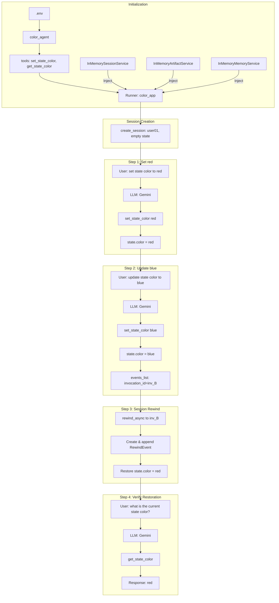
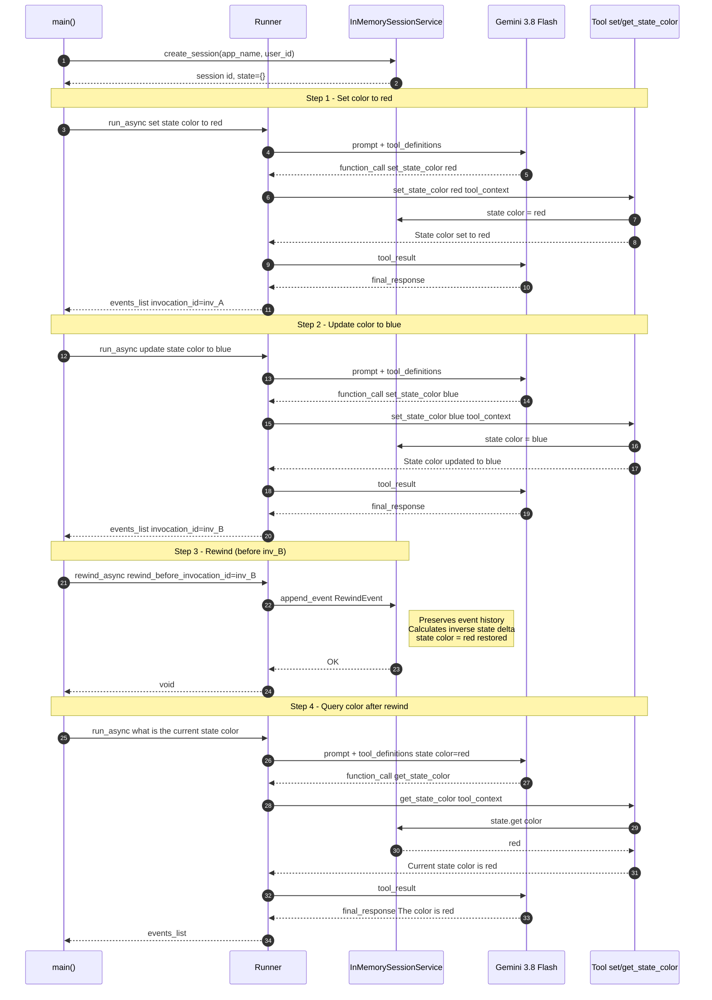
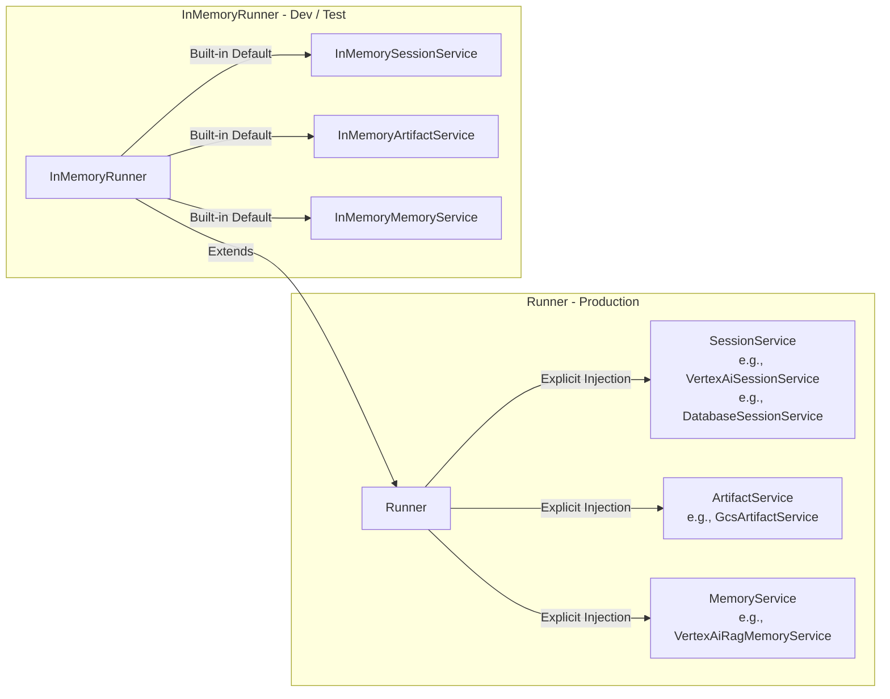
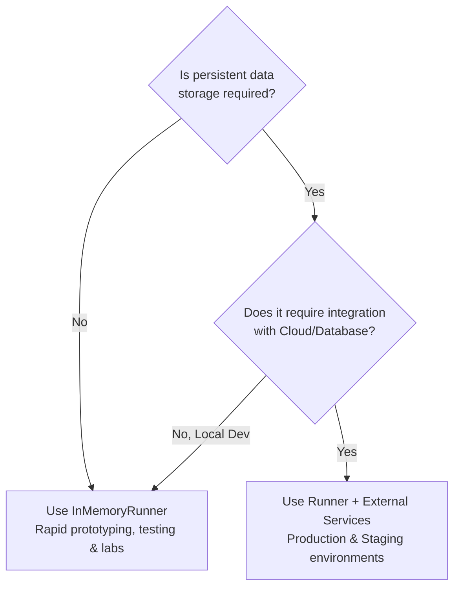

# ADK Runner + Session Rewind Architecture & Workflow

## File Overview

[`direct-adk-agent-rewindsession.py`](./direct-adk-agent-rewindsession.py) is a hands-on script demonstrating the **Runner** and **Session Rewind** capabilities provided by the Google Agent Development Kit (ADK).

> **Core Concepts**
> - `Runner` : A general-purpose runner that executes agents with injected session, artifact, and memory services.
> - `Session State (Working Memory)` : A mutable, in-memory state (`dict`) shared between the Agent and its Tools within a single session.
> - `Session Rewind` : The ability to rollback session state to a point prior to a specified `invocation_id`.

---

## Overall Workflow

```
asyncio.run(main())
        |
        +-- [Create Session] runner.session_service.create_session()
        |         State: {}
        |
        +-- [Step 1] call_agent_async("set state color to red")
        |         --> LLM --> set_state_color("red") --> State: {color: "red"}
        |
        +-- [Step 2] call_agent_async("update state color to blue")
        |         --> LLM --> set_state_color("blue") --> State: {color: "blue"}
        |         <-- events_list (contains invocation_id)
        |
        +-- [Step 3] runner.rewind_async(rewind_before_invocation_id=<blue_invoc_id>)
        |         --> Generate Rewind Event & append to session history
        |         --> Restore State: {color: "red"}
        |
        +-- [Step 4] call_agent_async("what is the current state color?")
                  --> LLM --> get_state_color() --> Returns "red"
```

---

## Component Architecture (Mermaid)



---

## Sequence Diagram (Mermaid)



---

## Core Classes & Functions

| Component | Responsibility |
|---|---|
| `Runner` | Agent execution environment. Injects session, artifact, and memory services to drive agent execution and manage sessions. |
| `runner.session_service` | Handles session CRUD operations (`create_session`, `get_session`, `append_event`). |
| `runner.run_async()` | Executes a single conversational turn, returning an asynchronous stream of events. |
| `runner.rewind_async()` | Rolls back session State and Artifacts to a state prior to the specified `invocation_id`. |
| `ToolContext.state` | Interface allowing Tools to read and write the session Working Memory. |
| `Event.invocation_id` | Unique ID assigned to each `run_async()` invocation turn (used as the anchor for Rewind). |
| `call_agent_async()` | Helper wrapper around `run_async()`. Collects events $\rightarrow$ outputs final response $\rightarrow$ returns `events_list`. |

---

## Rewind Operating Mechanics

```
Event History (Chronological Order)
──────────────────────────────────────────────────────
[inv_A] UserMsg: "set color to red"
[inv_A] ToolCall: set_state_color("red")
[inv_A] ToolResult: color='red'
[inv_A] FinalResponse: "Color set to red."
──────────────────────────────────────────────────────
[inv_B] UserMsg: "update color to blue"
[inv_B] ToolCall: set_state_color("blue")
[inv_B] ToolResult: color='blue'
[inv_B] FinalResponse: "Color updated to blue."
──────────────────────────────────────────────────────
[rewind] RewindEvent(rewind_before_invocation_id=inv_B)
         --> Calculates reverse state delta of all events after inv_B
         --> Restores state["color"] to "red"
──────────────────────────────────────────────────────

Note: The historical event logs are NOT physically deleted.
A RewindEvent is appended to the session, and during subsequent
LLM prompt construction, events after inv_B are logically disregarded.
```

---

## Execution Environment & Setup

### 1. Environment Variable Configuration (`.env`)

Configuration for Vertex AI Express Mode and the `gemini-3.8-flash` model:

```env
# Enable Vertex AI Express Mode
GOOGLE_GENAI_USE_VERTEXAI=TRUE
GOOGLE_CLOUD_PROJECT=ssu-agent-vertex-509708

# gemini-3.8-flash is deployed to the global endpoint; global location is required
GOOGLE_CLOUD_LOCATION=global

# Vertex AI Express Mode Authentication Keys
GOOGLE_API_KEY=AQ.Ab8RN6...
GEMINI_API_KEY=AQ.Ab8RN6...
```

> [!NOTE]
> - When invoking `gemini-3.8-flash` via Vertex AI, configure `GOOGLE_CLOUD_LOCATION=global` instead of a specific region (such as `us-central1`) to prevent 404 NOT_FOUND errors.
> - Keys with the `AQ.` prefix are Vertex AI Express Mode authentication keys and require `GOOGLE_GENAI_USE_VERTEXAI=TRUE`.

### 2. Execution Command

```bash
# Sync dependency packages
uv sync

# Run the script
uv run .\direct-adk-agent-rewindsession.py
```

### 3. Actual Execution Console Output

```text
=== [Session Created] ID: 09a486c6-b40a-4ad1-8378-25959862685c ===
Initial Session State: {}

--- [Step 1] Set state color to red ---

[User] set state color to red
[Agent] The state color has been set to 'red'.
>> State Check: {'color': 'red'}

--- [Step 2] Update state color to blue ---

[User] update state color to blue
[Agent] The state color has been changed to 'blue'.
>> State Check: {'color': 'blue'}

[Target Invocation ID]: e-9a9df7b0-8a21-45f1-bd63-b9b1b107cc8e
--- [Step 3] Execute rewind_async (Roll back blue update) ---
>> Session Rewind Completed!
>> Restored State after Rewind (color should be red): {'color': 'red'}

--- [Step 4] Query Agent for Current Color after Rewind ---

[User] what is the current state color?
[Agent] The current state color is 'red'.
```

---

## Comparison: Runner vs InMemoryRunner

### Summary at a Glance

| | `Runner` | `InMemoryRunner` |
|---|---|---|
| **Nature** | General-purpose Production Runner | Lightweight Runner for testing & learning |
| **Service Injection** | Explicitly specified (Required) | Built-in in-memory implementations used automatically |
| **Persistence** | Connectable to external DBs & cloud storage | Data lost upon process termination |
| **Primary Use Cases** | Production, Cloud Run, Vertex AI | Local development, unit tests, lecture labs |

---

### Constructor Signature Comparison

```python
# Runner — Requires explicit injection of services
Runner(
    agent=agent,
    app_name="my_app",
    session_service=session_service,     # Required
    artifact_service=artifact_service,   # Optional
    memory_service=memory_service,       # Optional
)

# InMemoryRunner — No services required; automatically constructed internally
InMemoryRunner(
    agent=agent,
    app_name="my_app",
)
```

### Internal Architecture (`InMemoryRunner` Source)

```python
class InMemoryRunner(Runner):
    def __init__(self, agent, *, app_name=None, ...):
        super().__init__(
            agent=agent,
            app_name=app_name,
            session_service=InMemorySessionService(),    # Automatic
            artifact_service=InMemoryArtifactService(),  # Automatic
            memory_service=InMemoryMemoryService(),      # Automatic
        )
```

> `InMemoryRunner` is a direct **subclass** of `Runner`.
> It inherits all functionality (`run_async`, `rewind_async`, etc.) intact,
> merely automating the service initialization boilerplate.

---

### Architecture Diagram (Mermaid)



---

### Code Implementation Patterns (Production Runner Pattern)

[`direct-adk-agent-rewindsession.py`](./direct-adk-agent-rewindsession.py) follows the production-standard pattern using **`Runner` + explicit service injection**. The comparison with the legacy `InMemoryRunner` approach is as follows:

```python
# Legacy InMemoryRunner approach (Lightweight wrapper)
from google.adk.runners import InMemoryRunner

runner = InMemoryRunner(agent=agent, app_name="color_app")


# Production-standard Runner approach (Applied in current script)
from google.adk.runners import Runner
from google.adk.sessions import InMemorySessionService
from google.adk.artifacts import InMemoryArtifactService
from google.adk.memory import InMemoryMemoryService

runner = Runner(
    agent=agent,
    app_name="color_app",
    session_service=InMemorySessionService(),
    artifact_service=InMemoryArtifactService(),
    memory_service=InMemoryMemoryService(),
)
```

All **subsequent call invocations** (`run_async`, `rewind_async`, etc.) **remain completely identical**.

---

### Decision Matrix: When to Use Which?



| Scenario | Recommended Approach |
|---|---|
| Lecture labs / Rapid prototyping | `InMemoryRunner` |
| Unit testing (requires session isolation) | `InMemoryRunner` |
| Staging / Production server deployment | `Runner` + External SessionService |
| Vertex AI Agent Engine integration | `Runner` + `VertexAiSessionService` |
| Session persistence in relational/NoSQL DB | `Runner` + Custom SessionService |

