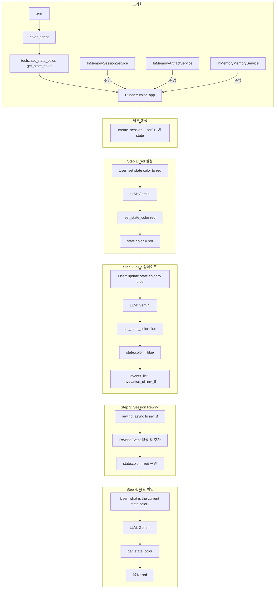
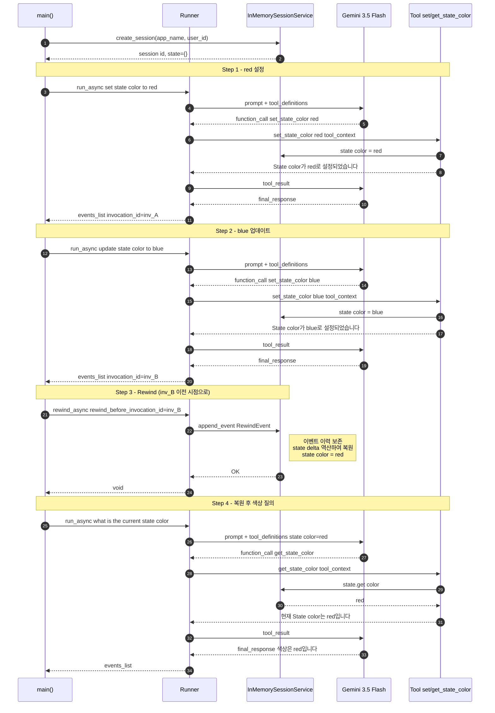
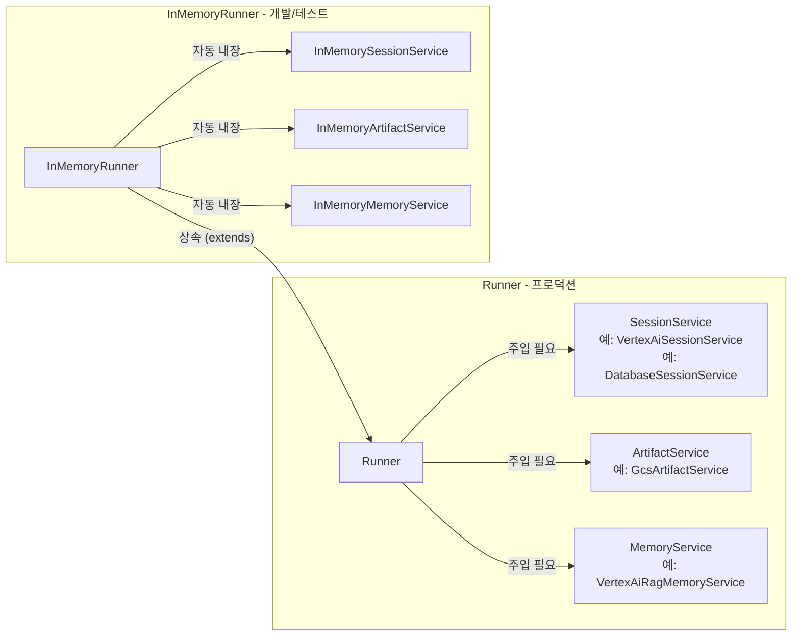
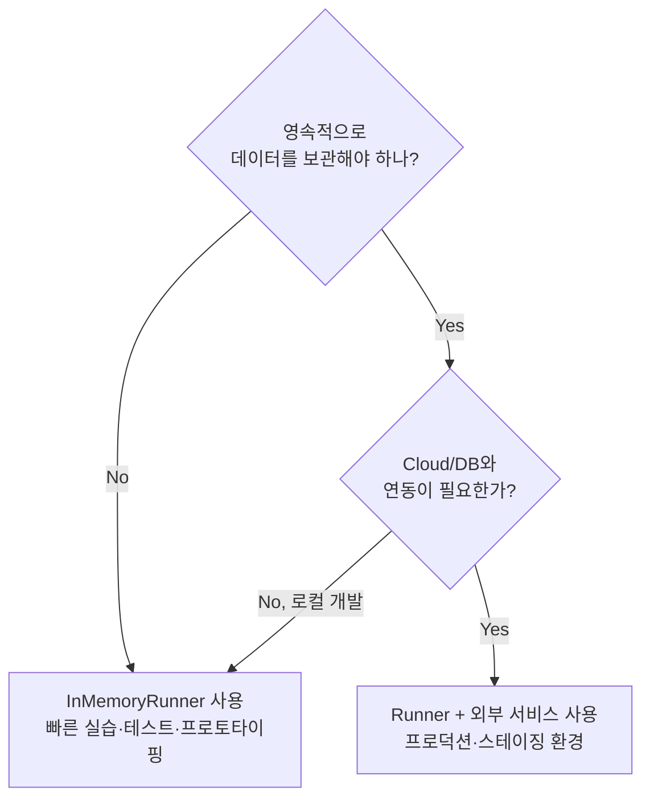

# ADK Runner + Session Rewind 동작 구조

## 파일 개요

[`direct-adk-agent-rewindsession.py`](./direct-adk-agent-rewindsession.py)는 Google Agent Development Kit(ADK)의
**Runner**와 **Session Rewind** 기능을 실습하는 스크립트입니다.

> **핵심 개념**
> - `Runner` : 세션·아티팩트·메모리 서비스를 주입받아 에이전트를 실행하는 범용 Runner
> - `Session State (Working Memory)` : 하나의 세션 내에서 Agent와 Tool이 공유하는 휘발성 상태(dict)
> - `Session Rewind` : 특정 `invocation_id` 이전 시점으로 세션 상태를 롤백하는 기능

---

## 전체 동작 흐름

```
asyncio.run(main())
        |
        +-- [세션 생성] runner.session_service.create_session()
        |         State: {}
        |
        +-- [Step 1] call_agent_async("set state color to red")
        |         --> LLM --> set_state_color("red") --> State: {color: "red"}
        |
        +-- [Step 2] call_agent_async("update state color to blue")
        |         --> LLM --> set_state_color("blue") --> State: {color: "blue"}
        |         <-- events_list (invocation_id 포함)
        |
        +-- [Step 3] runner.rewind_async(rewind_before_invocation_id=<blue_invoc_id>)
        |         --> Rewind Event 생성, 이벤트 이력에 추가
        |         --> State: {color: "red"} 복원
        |
        +-- [Step 4] call_agent_async("what is the current state color?")
                  --> LLM --> get_state_color() --> "red" 반환
```

---

## 컴포넌트 구조 (Mermaid)



---

## 시퀀스 다이어그램 (Mermaid)



---

## 핵심 클래스 및 함수 설명

| 컴포넌트 | 역할 |
|---|---|
| `Runner` | Agent 실행 환경. 세션/아티팩트/메모리 서비스를 주입받아 에이전트 실행 및 세션 관리 |
| `runner.session_service` | 세션 CRUD 담당 (`create_session`, `get_session`, `append_event`) |
| `runner.run_async()` | 단일 대화 턴 실행. 비동기 이벤트 스트림 반환 |
| `runner.rewind_async()` | 지정 `invocation_id` 이전 시점으로 세션 State/Artifacts 롤백 |
| `ToolContext.state` | Tool이 세션 Working Memory를 읽고 쓰는 인터페이스 |
| `Event.invocation_id` | 하나의 `run_async()` 호출 단위에 부여되는 고유 ID (Rewind 기준점으로 사용) |
| `call_agent_async()` | `run_async()` 래퍼. 이벤트 수집 → 최종 응답 출력 → `events_list` 반환 |

---

## Rewind 동작 원리

```
이벤트 이력 (시간 순서)
──────────────────────────────────────────────────────
[inv_A] UserMsg: "set color to red"
[inv_A] ToolCall: set_state_color("red")
[inv_A] ToolResult: color='red'
[inv_A] FinalResponse: "red로 설정되었습니다."
──────────────────────────────────────────────────────
[inv_B] UserMsg: "update color to blue"
[inv_B] ToolCall: set_state_color("blue")
[inv_B] ToolResult: color='blue'
[inv_B] FinalResponse: "blue로 업데이트되었습니다."
──────────────────────────────────────────────────────
[rewind] RewindEvent(rewind_before_invocation_id=inv_B)
         --> inv_B 이후 모든 state delta 역산
         --> state["color"] 를 "red" 로 복원
──────────────────────────────────────────────────────

주의: 이벤트 이력 자체는 삭제되지 않음.
RewindEvent가 추가되어 LLM 프롬프트 구성 시
inv_B 이후 이벤트를 논리적으로 무시함.
```

---

## 실행 환경 및 방법

### 1. 환경 변수 설정 (`.env`)

Vertex AI Express Mode 및 `gemini-3.5-flash` 모델을 사용하는 설정입니다:

```env
# Vertex AI Express Mode 활성화
GOOGLE_GENAI_USE_VERTEXAI=TRUE
GOOGLE_CLOUD_PROJECT=ssu-agent-vertex-509708

# gemini-3.5-flash 모델은 global 엔드포인트에 배포되어 있으므로 global 설정 필수
GOOGLE_CLOUD_LOCATION=global

# Vertex AI Express Mode 인증 키
GOOGLE_API_KEY=AQ.Ab8RN6...
GEMINI_API_KEY=AQ.Ab8RN6...
```

> [!NOTE]
> - `gemini-3.5-flash` 모델을 Vertex AI에서 호출할 때는 리전(`us-central1` 등)이 아닌 `GOOGLE_CLOUD_LOCATION=global`로 설정해야 404 NOT_FOUND 에러를 방지할 수 있습니다.
> - `AQ.` 접두사 키는 Vertex AI Express Mode 인증 키이므로 `GOOGLE_GENAI_USE_VERTEXAI=TRUE`로 지정해야 합니다.

### 2. 실행 명령어

```bash
# 의존성 패키지 동기화
uv sync

# 스크립트 실행
uv run .\direct-adk-agent-rewindsession.py
```

### 3. 실제 실행 출력 결과

```text
=== [세션 생성 완료] ID: 09a486c6-b40a-4ad1-8378-25959862685c ===
초기 세션 State: {}

--- [Step 1] State color를 red로 설정 ---

[사용자] set state color to red
[에이전트] 상태 색상이 'red'로 설정되었습니다.
>> State 확인: {'color': 'red'}

--- [Step 2] State color를 blue로 업데이트 ---

[사용자] update state color to blue
[에이전트] 상태 색상이 'blue'로 변경되었습니다.
>> State 확인: {'color': 'blue'}

[대상 Invocation ID]: e-9a9df7b0-8a21-45f1-bd63-b9b1b107cc8e
--- [Step 3] rewind_async 실행 (blue 업데이트 취소) ---
>> 세션 Rewind 완료!
>> Rewind 후 복원된 State (color는 red여야 함): {'color': 'red'}

--- [Step 4] Rewind 후 에이전트에게 현재 색상 질의 ---

[사용자] what is the current state color?
[에이전트] 현재 상태 색상은 'red'입니다.
```

---

## Runner vs InMemoryRunner 비교

### 한 줄 요약

| | `Runner` | `InMemoryRunner` |
|---|---|---|
| **성격** | 범용 프로덕션 Runner | 테스트·실습용 경량 Runner |
| **서비스 주입** | 직접 지정 (필수) | 내장 In-Memory 구현체 자동 사용 |
| **영속성** | 외부 DB·스토리지 연결 가능 | 프로세스 종료 시 모든 데이터 소멸 |
| **주 용도** | 운영 환경, Cloud Run, Vertex AI | 로컬 개발, 단위 테스트, 강의 실습 |

---

### 생성자 시그니처 비교

```python
# Runner — 3개 서비스를 직접 주입해야 함
Runner(
    agent=agent,
    app_name="my_app",
    session_service=session_service,     # 필수
    artifact_service=artifact_service,   # 선택
    memory_service=memory_service,       # 선택
)

# InMemoryRunner — 서비스 불필요, 내부에서 자동 생성
InMemoryRunner(
    agent=agent,
    app_name="my_app",
)
```

### 내부 구조 (InMemoryRunner 소스)

```python
class InMemoryRunner(Runner):
    def __init__(self, agent, *, app_name=None, ...):
        super().__init__(
            agent=agent,
            app_name=app_name,
            session_service=InMemorySessionService(),    # 자동
            artifact_service=InMemoryArtifactService(),  # 자동
            memory_service=InMemoryMemoryService(),      # 자동
        )
```

> `InMemoryRunner`는 `Runner`의 **서브클래스**입니다.
> 모든 기능(`run_async`, `rewind_async` 등)을 그대로 상속하며,
> 서비스 초기화 코드만 자동화한 것입니다.

---

### 아키텍처 비교 (Mermaid)



---

### 코드 구현 형태 (Runner 프로덕션 패턴 적용)

현재 [`direct-adk-agent-rewindsession.py`](./direct-adk-agent-rewindsession.py)는 프로덕션 표준인 **`Runner` + 명시적 서비스 주입** 방식으로 작성되어 있습니다. 기존 `InMemoryRunner` 방식과의 차이는 다음과 같습니다:

```python
# 기존 InMemoryRunner 방식 (경량 래퍼)
from google.adk.runners import InMemoryRunner

runner = InMemoryRunner(agent=agent, app_name="color_app")


# 현재 스크립트에 적용된 Runner 방식 (프로덕션 표준)
from google.adk.runners import Runner
from google.adk.sessions import InMemorySessionService
from google.adk.artifacts import InMemoryArtifactService
from google.adk.memory import InMemoryMemoryService

runner = Runner(
    agent=agent,
    app_name="color_app",
    session_service=InMemorySessionService(),
    artifact_service=InMemoryArtifactService(),
    memory_service=InMemoryMemoryService(),
)
```

`run_async`, `rewind_async` 등 **이후 호출 방식은 완전히 동일**합니다.

---

### 언제 무엇을 사용할까?



| 상황 | 권장 |
|---|---|
| 강의 실습 / 빠른 프로토타이핑 | `InMemoryRunner` |
| 단위 테스트 (세션 격리 필요) | `InMemoryRunner` |
| 스테이징·운영 서버 배포 | `Runner` + 외부 SessionService |
| Vertex AI Agent Engine 연동 | `Runner` + `VertexAiSessionService` |
| 세션 데이터 DB 저장 필요 | `Runner` + 커스텀 SessionService |
