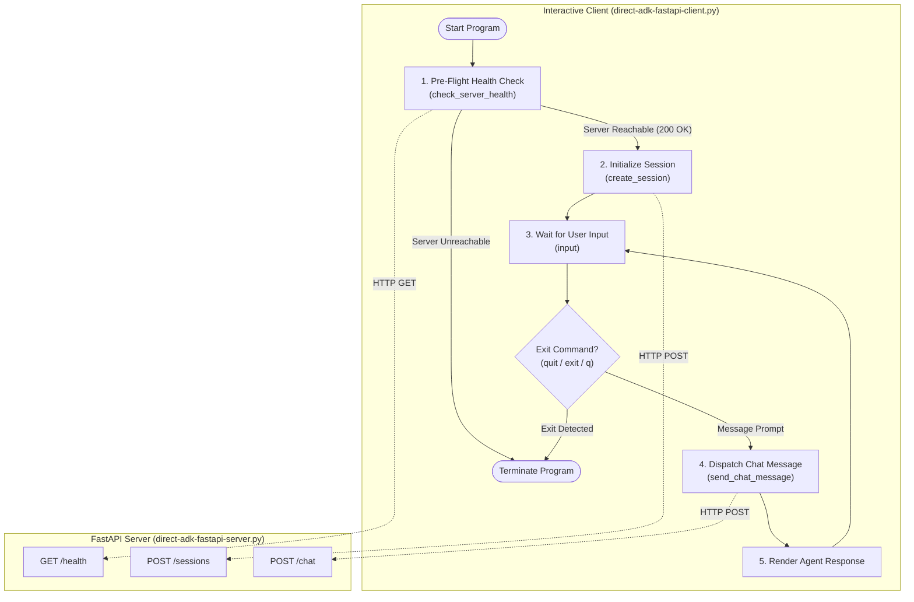
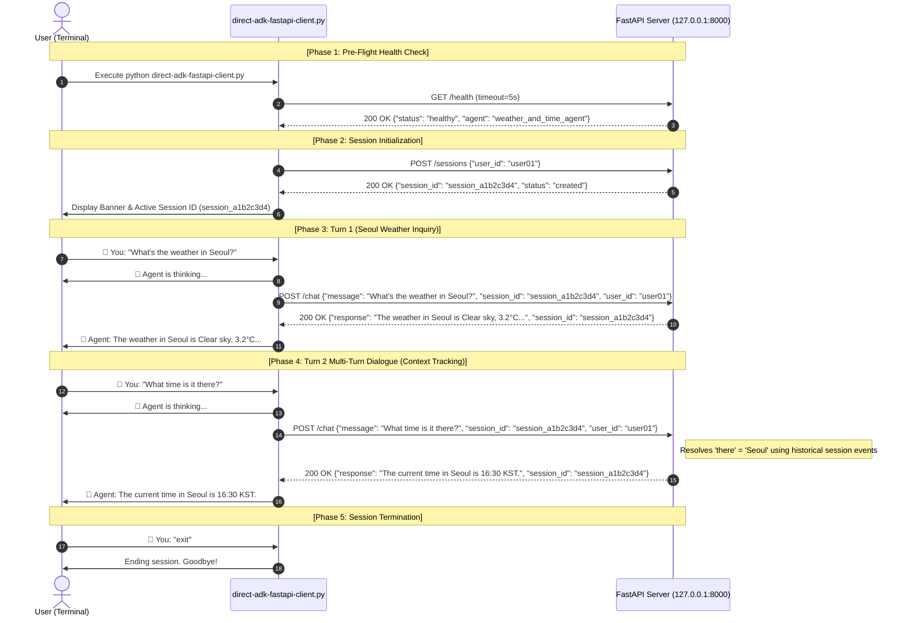

# direct-adk-fastapi-client — Operational Architecture & Workflow Guide

This document details the operational architecture and conversational workflow of [`direct-adk-fastapi-client.py`](./direct-adk-fastapi-client.py), a lightweight interactive REPL client that connects to [`direct-adk-fastapi-server.py`](./direct-adk-fastapi-server.py) over HTTP.

---

## 1. Overview & Core Concepts

[`direct-adk-fastapi-client.py`](./direct-adk-fastapi-client.py) is a standalone command-line REPL (Read-Eval-Print Loop) client written in Python. It allows developers and users to interactively test and converse with the FastAPI-backed ADK agent without needing a web browser or frontend UI framework.

> **Key Capabilities**
> - **Pre-Flight Health Verification (`check_server_health`)**: Checks `/health` on the server before entering the prompt loop, guiding the user if the server is offline.
> - **Session Management & Context Tracking (`create_session` & `session_id`)**: Acquires an active session ID from the server's `/sessions` endpoint and maintains it across multiple conversational turns to preserve conversational context.
> - **Interactive REPL Loop**: Displays thinking status ("Agent is thinking..."), ignores empty inputs, and safely handles termination keywords (`quit`, `exit`, `q`) and keyboard interrupts (`Ctrl+C`).

---

## 2. System Architecture & Communication Flow



---

## 3. Conversational Interaction Sequence Diagram



---

## 4. Key Functions Implementation Breakdown

### 1) `check_server_health(base_url: str) -> bool`
Validates connectivity with the FastAPI server before launching the interactive prompt loop:
```python
def check_server_health(base_url: str) -> bool:
    try:
        resp = requests.get(f"{base_url}/health", timeout=5)
        return resp.status_code == 200
    except requests.RequestException:
        return False
```

### 2) `create_session(base_url: str, user_id: str) -> str`
Requests an official session from the server. If the server does not respond, it falls back to `"default_session"` gracefully:
```python
def create_session(base_url: str, user_id: str) -> str:
    try:
        resp = requests.post(f"{base_url}/sessions", json={"user_id": user_id}, timeout=5)
        if resp.status_code == 200:
            return resp.json().get("session_id")
    except requests.RequestException:
        pass
    return "default_session"
```

### 3) `send_chat_message(base_url, message, session_id, user_id) -> tuple[str, str]`
Dispatches a structured JSON payload to `/chat` and returns the synthesized response text alongside the verified `session_id`:
```python
def send_chat_message(base_url: str, message: str, session_id: str, user_id: str) -> tuple[str, str]:
    payload = {
        "message": message,
        "session_id": session_id,
        "user_id": user_id,
    }
    resp = requests.post(f"{base_url}/chat", json=payload, timeout=60)
    if resp.status_code == 200:
        data = resp.json()
        return data.get("response", "(No response)"), data.get("session_id", session_id)
    else:
        return f"[Server Error {resp.status_code}]: {resp.text}", session_id
```

---

## 5. Execution & Usage Guide

### 1) Start the Server (Terminal 1)
```bash
# Execute from part02_architecture directory
uv run Direct_ADK/direct-adk-fastapi-server.py
```

### 2) Run the Client (Terminal 2)
```bash
# Execute from part02_architecture directory
uv run Direct_ADK/direct-adk-fastapi-client.py
```

Alternatively, override the target server URL using the `SERVER_URL` environment variable:
```bash
SERVER_URL="http://192.168.0.10:8000" python Direct_ADK/direct-adk-fastapi-client.py
```

### 3) Sample Conversation Output
```text
=================================================================
  💬 ADK Agent FastAPI Interactive Client
  Target Server: http://127.0.0.1:8000
=================================================================
  Active Session : session_4c8d19a2
  Commands       : Type 'quit', 'exit', or 'q' to end.
  Capabilities   : Weather, time, and general QA (multi-turn chat)
=================================================================

🧑 You: Current time and weather in Tokyo?
🤖 Agent: In Tokyo, the current local time is 2026-11-19 16:30 JST.
The weather is Clear sky with a temperature of 14.5°C, humidity of 48%, and wind speed of 2.1 m/s.

🧑 You: What about Paris?
🤖 Agent: In Paris, the current local time is 2026-11-19 08:30 CET.
The weather is Overcast with a temperature of 7.2°C, humidity of 85%, and wind speed of 3.4 m/s.

🧑 You: q
Ending session. Goodbye!
```

---

## 6. Related File Links
- 📄 [direct-adk-fastapi-client.py](./direct-adk-fastapi-client.py): Interactive client source code
- 📄 [direct-adk-fastapi-server.py](./direct-adk-fastapi-server.py): Backend FastAPI server source code
- 📄 [direct-adk-fastapi-server-workflow-README-EN.md](./direct-adk-fastapi-server-workflow-README-EN.md): Server operational workflow guide

