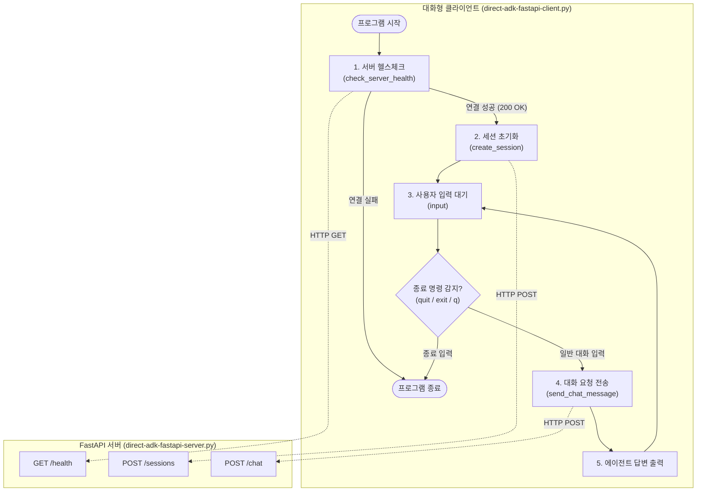
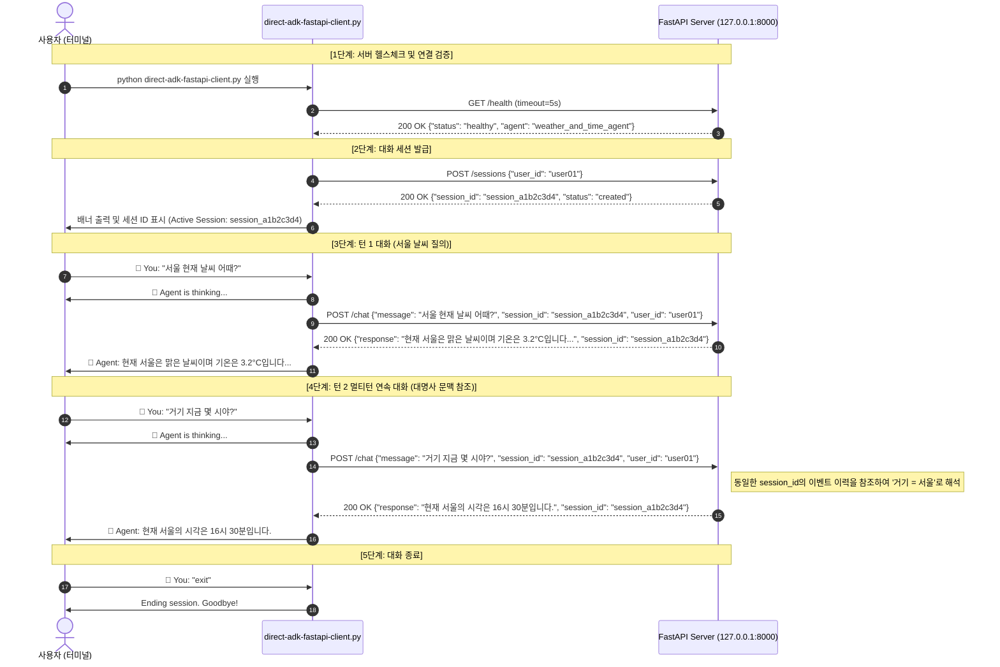

# direct-adk-fastapi-client — 동작 구조 및 워크플로우 가이드

본 문서는 [`direct-adk-fastapi-server.py`](./direct-adk-fastapi-server.py)와 HTTP로 통신하여 터미널 환경에서 대화형으로 ADK 에이전트를 테스트할 수 있는 대화형 클라이언트인 [`direct-adk-fastapi-client.py`](./direct-adk-fastapi-client.py)의 동작 원리와 워크플로우를 설명합니다.

---

## 1. 개요 및 핵심 개념

[`direct-adk-fastapi-client.py`](./direct-adk-fastapi-client.py)는 별도의 웹 브라우저나 복잡한 프론트엔드 구축 없이, 커맨드라인 환경에서 FastAPI 백엔드 에이전트와 즉시 실시간 멀티턴 대화를 나눌 수 있도록 설계된 순수 Python 기반 경량 REPL(Read-Eval-Print Loop) 클라이언트입니다.

> **핵심 기능**
> - **사전 서버 연결성 검증 (`check_server_health`)** : 대화 루프 진입 전 서버의 `/health` 엔드포인트를 호출하여 서버 기동 여부를 확인하고 가이드 제공
> - **자동 세션 할당 및 문맥 보존 (`create_session` & `session_id`)** : 서버의 `/sessions` 엔드포인트에서 고유 세션 ID를 발급받아 모든 질의마다 재전송함으로써 연속 대화 문맥 유지
> - **인터랙티브 REPL 루프** : 생각 중 상태 표시("Agent is thinking..."), 빈 입력 무시, 종료 명령어(`quit`, `exit`, `q`) 및 인터럽트(Ctrl+C) 안전 처리

---

## 2. 전체 통신 아키텍처 및 흐름



---

## 3. 대화 세션 상호작용 시퀀스 다이어그램



---

## 4. 주요 함수 구현 분석

### 1) `check_server_health(base_url: str) -> bool`
FastAPI 서버의 기동 여부를 사전에 파악합니다. 연결 불가 시 터미널에 서버 실행 명령어를 안내하고 안전하게 프로세스를 종료합니다.
```python
def check_server_health(base_url: str) -> bool:
    try:
        resp = requests.get(f"{base_url}/health", timeout=5)
        return resp.status_code == 200
    except requests.RequestException:
        return False
```

### 2) `create_session(base_url: str, user_id: str) -> str`
서버로부터 새로운 세션 ID를 생성받습니다. 서버가 응답하지 않을 경우 로컬 기본값 `"default_session"`으로 폴백하여 예외 없이 동작합니다.
```python
def create_session(base_url: str, user_id: str) -> str:
    try:
        resp = requests.post(f"{base_url}/sessions", json={"user_id": user_id}, timeout=5)
        if resp.status_code == 200:
            return resp.json().get("session_id")
    except requests.RequestException:
        pass
    return "default_session"
```

### 3) `send_chat_message(base_url, message, session_id, user_id) -> tuple[str, str]`
서버의 `/chat` 엔드포인트로 JSON 페이로드를 전송하고, 에이전트의 답변 텍스트와 최신 `session_id`를 튜플 형태로 반환합니다:
```python
def send_chat_message(base_url: str, message: str, session_id: str, user_id: str) -> tuple[str, str]:
    payload = {
        "message": message,
        "session_id": session_id,
        "user_id": user_id,
    }
    resp = requests.post(f"{base_url}/chat", json=payload, timeout=60)
    if resp.status_code == 200:
        data = resp.json()
        return data.get("response", "(No response)"), data.get("session_id", session_id)
    else:
        return f"[Server Error {resp.status_code}]: {resp.text}", session_id
```

---

## 5. 실행 및 사용 가이드

### 1) 선행 작업: 서버 구동 (Terminal 1)
```bash
# part02_architecture 폴더에서 서버 실행
uv run Direct_ADK/direct-adk-fastapi-server.py
```

### 2) 클라이언트 실행 (Terminal 2)
```bash
# part02_architecture 폴더에서 클라이언트 실행
uv run Direct_ADK/direct-adk-fastapi-client.py
```

또는 환경 변수 `SERVER_URL`을 통해 다른 포트나 원격 서버를 지정할 수 있습니다:
```bash
SERVER_URL="http://192.168.0.10:8000" python Direct_ADK/direct-adk-fastapi-client.py
```

### 3) 실제 대화 터미널 출력 예시
```text
=================================================================
  💬 ADK Agent FastAPI Interactive Client
  Target Server: http://127.0.0.1:8000
=================================================================
  Active Session : session_4c8d19a2
  Commands       : Type 'quit', 'exit', or 'q' to end.
  Capabilities   : Weather, time, and general QA (multi-turn chat)
=================================================================

🧑 You: 도쿄 현재 시간과 날씨 알려줘
🤖 Agent: 현재 도쿄의 시각은 2026년 11월 19일 16시 30분(JST)입니다.
날씨는 맑은 하늘이며 기온은 14.5°C, 습도는 48%, 풍속은 2.1 m/s입니다.

🧑 You: 거기 내일 비 올 확률은?
🤖 Agent: 현재 제공된 도구로는 실시간 현재 날씨만 조회가 가능하며, 내일의 상세 강수 확률 예보는 지원하지 않습니다. 다만 현재 도쿄는 맑은 고기압 영향권에 있습니다.

🧑 You: q
Ending session. Goodbye!
```

---

## 6. 관련 파일 링크
- 📄 [direct-adk-fastapi-client.py](./direct-adk-fastapi-client.py) : 클라이언트 소스 코드
- 📄 [direct-adk-fastapi-server.py](./direct-adk-fastapi-server.py) : 백엔드 FastAPI 서버 소스 코드
- 📄 [direct-adk-fastapi-server-workflow-README-KR.md](./direct-adk-fastapi-server-workflow-README-KR.md) : 서버 동작 구조 설명서

