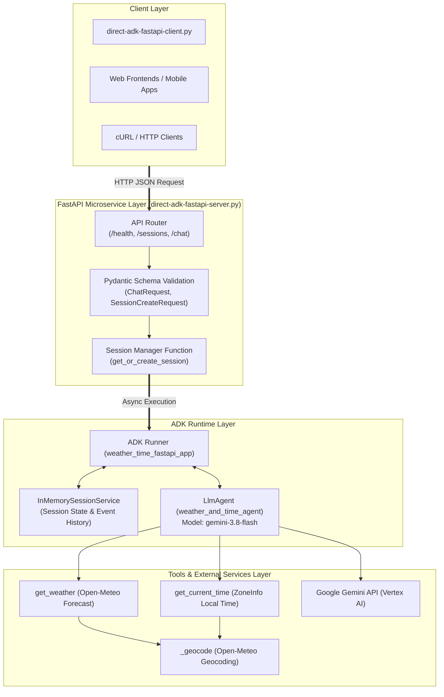
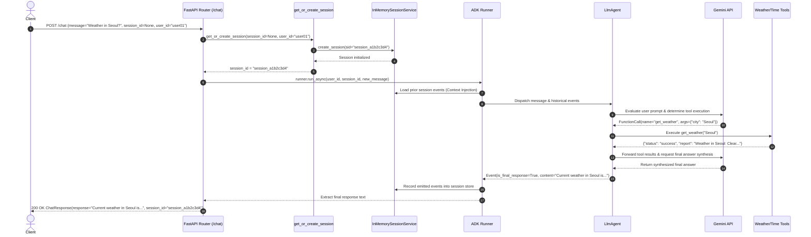

# direct-adk-fastapi-server — Operational Architecture & Workflow Guide

This document details the operational architecture and workflow of [`direct-adk-fastapi-server.py`](./direct-adk-fastapi-server.py), which packages Google Agent Development Kit's (ADK) `LlmAgent` and `Runner` into a high-performance asynchronous REST API microservice using FastAPI.

---

## 1. Overview & Core Concepts

[`direct-adk-fastapi-server.py`](./direct-adk-fastapi-server.py) transitions an ADK agent from a standalone command-line script into a production-ready HTTP microservice. It exposes endpoints that allow web applications, mobile frontends, and terminal clients to engage in multi-turn conversations and trigger live tools (weather reports, local times) via standard HTTP requests.

> **Key Components**
> - **`FastAPI` Web Framework**: Provides asynchronous request handling (Async/Await), automatic OpenAPI (Swagger) documentation, and Pydantic-based input validation.
> - **`LlmAgent (weather_and_time_agent)`**: An agent powered by `gemini-3.8-flash` equipped with natural language instructions and two dedicated tools (`get_weather`, `get_current_time`).
> - **`Runner` & `InMemorySessionService`**: The ADK runtime engine that manages session lifecycles, event history tracking (`events`), and asynchronous event dispatching (`run_async`).

---

## 2. System Architecture



---

## 3. Conversation Processing Lifecycle (Sequence Diagram)

The following diagram illustrates how the server processes a conversation turn when a client calls `/chat`:



---

## 4. Key Endpoints & Implementation Logic

### 1) Health Check (`GET /health`)
Returns the operational status, app identifier, and active LLM model of the underlying ADK agent.
```python
@app.get("/health")
async def health_check():
    return {
        "status": "healthy",
        "app_name": APP_NAME,
        "agent": agent.name,
        "model": agent.model,
    }
```

### 2) Explicit Session Creation (`POST /sessions`)
Allows clients to explicitly pre-allocate a session ID before initiating conversation.
* **Request**: `SessionCreateRequest(user_id="user01")`
* **Response**: `SessionCreateResponse(session_id="session_xxx", user_id="user01", status="created")`

### 3) Session Inspection (`GET /sessions/{session_id}`)
Retrieves session metadata, including the cumulative event count (`event_count`) and state variables (`state`), for debugging and telemetry.

### 4) Conversation Turn (`POST /chat`)
Consumes the ADK Runner's asynchronous generator to process user queries into agent responses:
```python
@app.post("/chat", response_model=ChatResponse)
async def chat(req: ChatRequest):
    user_id = req.user_id or DEFAULT_USER_ID
    session_id = await get_or_create_session(req.session_id, user_id)

    content = types.Content(role="user", parts=[types.Part(text=req.message)])
    response_text = ""

    # Consume the ADK asynchronous event generator
    async for event in runner.run_async(user_id=user_id, session_id=session_id, new_message=content):
        if event.is_final_response():
            if event.content and event.content.parts:
                texts = [p.text for p in event.content.parts if hasattr(p, "text") and p.text]
                if texts:
                    response_text = "\n".join(texts).strip()

    return ChatResponse(response=response_text or "(No response)", session_id=session_id)
```

---

## 5. Execution & Verification Guide

### 1) Start the Server
Launch the server using `uv run` or standard `python`:
```bash
# Execute from part02_architecture directory
uv run Direct_ADK/direct-adk-fastapi-server.py
```
Upon startup, the console displays:
```text
=================================================================
  🚀 Starting ADK Agent FastAPI Server on http://127.0.0.1:8000
=================================================================
INFO:     Started server process
INFO:     Waiting for application startup.
INFO:     Application startup complete.
INFO:     Uvicorn running on http://127.0.0.1:8000 (Press CTRL+C to quit)
```

### 2) Swagger UI API Documentation
Open `http://127.0.0.1:8000/docs` in your web browser to access the auto-generated Swagger UI and test endpoints directly.

### 3) Quick Testing via cURL
```bash
# 1. Health check
curl -X GET http://127.0.0.1:8000/health

# 2. Weather query with automatic session creation
curl -X POST http://127.0.0.1:8000/chat \
  -H "Content-Type: application/json" \
  -d '{"message": "What is the weather and local time in Paris?"}'
```

---

## 6. Related File Links
- 📄 [direct-adk-fastapi-server.py](./direct-adk-fastapi-server.py): FastAPI server source code
- 📄 [direct-adk-fastapi-client.py](./direct-adk-fastapi-client.py): Dedicated interactive terminal client source code
- 📄 [direct-adk-fastapi-client-workflow-README-EN.md](./direct-adk-fastapi-client-workflow-README-EN.md): Client operational workflow guide

