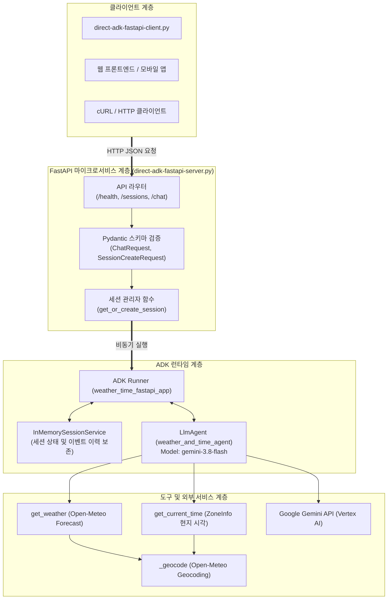
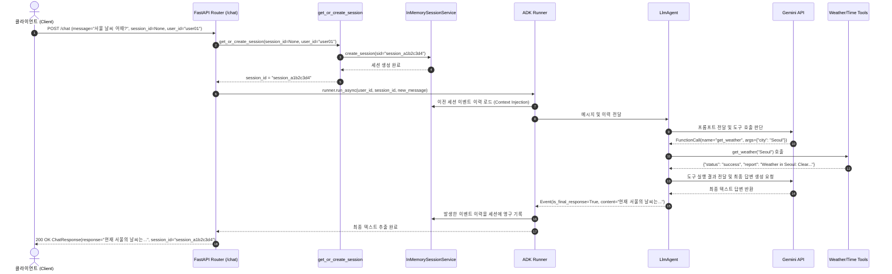

# direct-adk-fastapi-server — 동작 구조 및 워크플로우 가이드

본 문서는 Google Agent Development Kit(ADK)의 `LlmAgent`와 `Runner`를 FastAPI 기반의 고성능 비동기 REST API 서버로 패키징한 [`direct-adk-fastapi-server.py`](./direct-adk-fastapi-server.py)의 시스템 아키텍처 및 동작 구조를 상세히 설명합니다.

---

## 1. 개요 및 핵심 개념

[`direct-adk-fastapi-server.py`](./direct-adk-fastapi-server.py)는 ADK 에이전트를 독립 실행형 Python 스크립트에서 엔터프라이즈 환경의 표준 마이크로서비스로 전환하는 구현체입니다. 표준 HTTP 프로토콜을 통해 웹, 모바일 애플리케이션 및 터미널 클라이언트가 에이전트와 멀티턴 대화를 수행하고, 실시간 날씨·시간 조회 도구를 실행할 수 있도록 라우팅합니다.

> **핵심 컴포넌트**
> - **`FastAPI` 웹 프레임워크** : 비동기 요청 처리(Async/Await), 자동 OpenAPI(Swagger) 문서 생성, Pydantic 기반 입력 데이터 유효성 검증 제공
> - **`LlmAgent (weather_and_time_agent)`** : `gemini-3.8-flash` 기반 에이전트로 지시문(Instruction)과 두 개의 전용 도구(`get_weather`, `get_current_time`)를 탑재
> - **`Runner` & `InMemorySessionService`** : 대화 세션의 생성, 이벤트 이력(`events`) 추적, 비동기 이벤트 스트림(`run_async`) 디스패치를 관장하는 ADK 런타임 엔진

---

## 2. 전체 시스템 아키텍처



---

## 3. 대화 처리 생명주기 (Sequence Diagram)

클라이언트가 `/chat` 엔드포인트를 호출할 때의 서버 내부 처리 과정입니다:



---

## 4. 핵심 엔드포인트 명세 및 구현 로직

### 1) 헬스체크 (`GET /health`)
서버와 바인딩된 ADK 에이전트의 구동 상태 및 모델 정보를 반환합니다.
```python
@app.get("/health")
async def health_check():
    return {
        "status": "healthy",
        "app_name": APP_NAME,
        "agent": agent.name,
        "model": agent.model,
    }
```

### 2) 명시적 세션 생성 (`POST /sessions`)
새로운 대화 세션을 사전에 할당합니다. 클라이언트는 이 세션 ID를 보관하여 연속 대화를 시작할 수 있습니다.
* **Request**: `SessionCreateRequest(user_id="user01")`
* **Response**: `SessionCreateResponse(session_id="session_xxx", user_id="user01", status="created")`

### 3) 세션 상세 조회 (`GET /sessions/{session_id}`)
특정 세션에 누적된 이벤트 개수(`event_count`)와 세션 상태(`state`)를 조회하여 대화 진행 상황을 모니터링합니다.

### 4) 대화 수행 (`POST /chat`)
ADK Runner를 비동기 제너레이터로 구동하여 사용자 질의에 대한 에이전트 답변을 완성합니다:
```python
@app.post("/chat", response_model=ChatResponse)
async def chat(req: ChatRequest):
    user_id = req.user_id or DEFAULT_USER_ID
    session_id = await get_or_create_session(req.session_id, user_id)

    content = types.Content(role="user", parts=[types.Part(text=req.message)])
    response_text = ""

    # ADK 비동기 실행 루프 소비
    async for event in runner.run_async(user_id=user_id, session_id=session_id, new_message=content):
        if event.is_final_response():
            if event.content and event.content.parts:
                texts = [p.text for p in event.content.parts if hasattr(p, "text") and p.text]
                if texts:
                    response_text = "\n".join(texts).strip()

    return ChatResponse(response=response_text or "(No response)", session_id=session_id)
```

---

## 5. 실행 및 검증 가이드

### 1) 서버 구동
상위 디렉터리 또는 `Direct_ADK` 디렉터리에서 실행합니다:
```bash
# part02_architecture 디렉터리에서 실행
uv run Direct_ADK/direct-adk-fastapi-server.py
```
성공적으로 시작되면 터미널에 다음과 같이 출력됩니다:
```text
=================================================================
  🚀 Starting ADK Agent FastAPI Server on http://127.0.0.1:8000
=================================================================
INFO:     Started server process
INFO:     Waiting for application startup.
INFO:     Application startup complete.
INFO:     Uvicorn running on http://127.0.0.1:8000 (Press CTRL+C to quit)
```

### 2) 인터랙티브 API 문서 (Swagger UI) 확인
웹 브라우저를 열고 `http://127.0.0.1:8000/docs`로 접속하면 FastAPI가 자동으로 생성한 대화형 Swagger UI를 통해 모든 엔드포인트를 브라우저에서 직접 테스트할 수 있습니다.

### 3) cURL을 이용한 빠른 테스트
```bash
# 1. 헬스체크
curl -X GET http://127.0.0.1:8000/health

# 2. 날씨 질의 (세션 자동 생성)
curl -X POST http://127.0.0.1:8000/chat \
  -H "Content-Type: application/json" \
  -d '{"message": "파리 현재 날씨와 현지 시각 알려줘"}'
```

---

## 6. 관련 파일 링크
- 📄 [direct-adk-fastapi-server.py](./direct-adk-fastapi-server.py) : FastAPI 서버 소스 코드
- 📄 [direct-adk-fastapi-client.py](./direct-adk-fastapi-client.py) : 전용 REPL 터미널 클라이언트 소스 코드
- 📄 [direct-adk-fastapi-client-workflow-README-KR.md](./direct-adk-fastapi-client-workflow-README-KR.md) : 클라이언트 동작 구조 설명서

