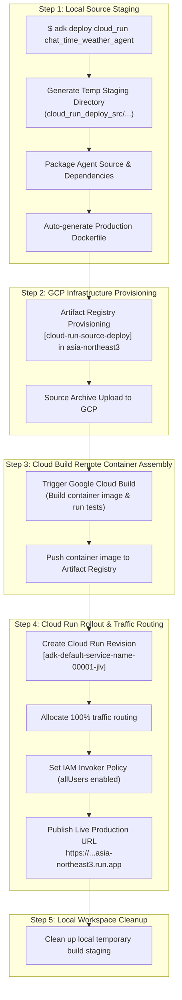

# Google Cloud Run Deployment Guide — `adk deploy cloud_run`

This document provides a detailed breakdown of deploying the local `chat_time_weather_agent` to **Google Cloud Run (Seoul Region: `asia-northeast3`)** as a fully managed serverless container microservice using the Google Agent Development Kit (ADK) CLI.

---

## 1. Deployment Summary

Google ADK provides native single-command deployment to Google Cloud Run, abstracting away manual Docker containerization and Kubernetes configurations.

| Parameter | Specification |
|---|---|
| **CLI Command** | `adk deploy cloud_run chat_time_weather_agent` |
| **Target Agent** | `part02_architecture/adk-based_Agent/chat_time_weather_agent` |
| **GCP Project ID** | `ssu-agent-vertex-509708` (Project Number: `1008280623664`) |
| **Target Region** | `asia-northeast3` (Seoul, South Korea) |
| **Service Name** | `adk-default-service-name` |
| **Active Revision** | `adk-default-service-name-00001-jlv` (100% traffic allocated) |
| **Service URL** | `https://adk-default-service-name-1008280623664.asia-northeast3.run.app` |
| **Access Policy** | Unauthenticated invocations allowed (`Allow unauthenticated: Yes`) |

---

## 2. End-to-End Deployment Architecture Flow



---

## 3. Step-by-Step Technical Lifecycle

### 1) Local Staging & Automated Dockerfile Generation
- The ADK CLI automatically initializes a temporary staging folder (`cloud_run_deploy_src/20261119_163407`).
- It copies the `chat_time_weather_agent` codebase (`agent.py`, `__init__.py`, etc.) and constructs an optimized `Dockerfile` configured to serve the ADK FastAPI engine.

### 2) Artifact Registry Provisioning
- For source-to-image deployments, the CLI provisions a dedicated Google Cloud Artifact Registry Docker repository (`cloud-run-source-deploy`) in the target region (`asia-northeast3`).

### 3) Permissions & Ingress Policy Prompts
- **Repository Creation Confirmation**: `Do you want to continue (Y/n)? y`
- **Public Ingress Authorization**: `Allow unauthenticated invocations to [adk-default-service-name] (y/N)? y`
  - Enables public client access to `/run` and `/health` endpoints without requiring pre-negotiated IAM bearer credentials.

### 4) Remote Container Compilation via Google Cloud Build
- The packaged source bundle is securely uploaded to Cloud Storage, triggering Google Cloud Build.
- Cloud Build compiles the Docker image, verifies dependencies, and pushes the final container image to Artifact Registry.

### 5) Cloud Run Revision Rollout & Traffic Allocation
- A new Cloud Run revision (`adk-default-service-name-00001-jlv`) is deployed.
- Traffic routing is updated to 100% on the new revision, and the official public HTTPS service URL is published.

### 6) Workspace Cleanup
- Upon deployment confirmation, the temporary staging directory on the local machine is purged.

---

## 4. Full Deployment Terminal Log

The complete terminal output recorded during the deployment turn:

```text
$ adk deploy cloud_run chat_time_weather_agent
Start generating Cloud Run source files in C:\Users\Public\Documents\ESTsoft\CreatorTemp\cloud_run_deploy_src\20261119_163407
Copying agent source code...
Copying agent source code completed.
Creating Dockerfile...
Creating Dockerfile complete: C:\Users\Public\Documents\ESTsoft\CreatorTemp\cloud_run_deploy_src\20261119_163407\Dockerfile
Deploying to Cloud Run...
Use default project: ssu-agent-vertex-509708
Deploying from source requires an Artifact Registry Docker repository to store built containers. A repository named [cloud-run-source-deploy] in region [asia-northeast3] will be created.

Do you want to continue (Y/n)?  y

Allow unauthenticated invocations to [adk-default-service-name] (y/N)?  y

Building using Dockerfile and deploying container to Cloud Run service [adk-default-service-name] in project [ssu-agent-vertex-509708] region [asia-northeast3]
⠶ Building and deploying new service... Uploading sources.
⠹ Building and deploying new service... Uploading sources.
✓ Building and deploying new service... Done.
  ⠶ Uploading sources...
  ⠹ Uploading sources...
  ✓ Uploading sources...
  ✓ Building Container... Logs are available at [ https://console.cloud.google.com/cloud-build/builds;region=asia-northeast3/9dfa5253-3800-4923-a99e-392b78b5c9a0?project=1008280623664 ].
  ✓ Creating Revision...
  ✓ Routing traffic...
  ✓ Setting IAM Policy...
Done.
Service [adk-default-service-name] revision [adk-default-service-name-00001-jlv] has been deployed and is serving 100 percent of traffic.
Service URL: https://adk-default-service-name-1008280623664.asia-northeast3.run.app
INFO: Display format: "none"


Updates are available for some Google Cloud CLI components.  To install them,
please run:
  $ gcloud components update


To take a quick anonymous survey, run:
  $ gcloud survey

Cleaning up the temp folder: C:\Users\Public\Documents\ESTsoft\CreatorTemp\cloud_run_deploy_src\20261119_163407
```

---

## 5. Verification & Testing

### 1) Verification with cURL
```bash
# Verify health check
curl https://adk-default-service-name-1008280623664.asia-northeast3.run.app/health

# Verify deployed applications
curl https://adk-default-service-name-1008280623664.asia-northeast3.run.app/list-apps
```

### 2) Interactive Chat with `cloud_run_agent.py`
Launch the interactive terminal client pointing directly to the deployed Cloud Run instance:
```bash
python part02_architecture/adk-based_Agent/cloud_run_agent.py \
  --url https://adk-default-service-name-1008280623664.asia-northeast3.run.app
```

---

## 6. Related Documentation Links
- 📄 [cloud_run_agent.py](./cloud_run_agent.py): Dedicated interactive client for Cloud Run
- 📄 [cloud_run_README-EN.md](./cloud_run_README-EN.md): Cloud Run client architectural and operational guide
- 📄 [chat_time_weather_agent/agent.py](./chat_time_weather_agent/agent.py): Deployed agent source code

