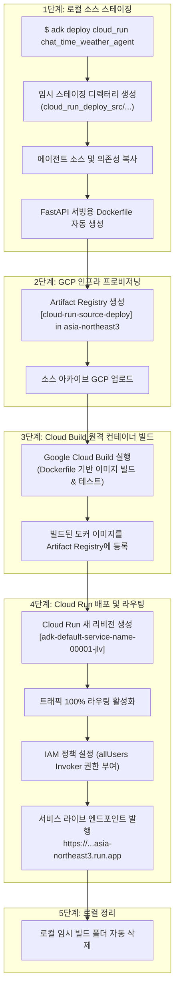

# Google Cloud Run 배포 가이드 — `adk deploy cloud_run`

본 문서는 Google Agent Development Kit(ADK) CLI의 `adk deploy cloud_run` 명령어를 활용하여 로컬 에이전트인 `chat_time_weather_agent`를 **Google Cloud Run (서울 리전 `asia-northeast3`)**에 완전 관리형 서버리스 컨테이너 서비스로 배포한 전체 과정, 아키텍처 및 결과 분석을 정리한 가이드입니다.

---

## 1. 배포 개요

Google ADK는 복잡한 도커 빌드나 쿠버네티스 설정 없이, 단 하나의 명령어로 로컬 ADK 에이전트를 패키징하고 Google Cloud Run에 배포할 수 있는 네이티브 배포 도구를 제공합니다.

| 항목 | 상세 정보 |
|---|---|
| **배포 명령어** | `adk deploy cloud_run chat_time_weather_agent` |
| **대상 에이전트** | `part02_architecture/adk-based_Agent/chat_time_weather_agent` |
| **GCP 프로젝트** | `ssu-agent-vertex-509708` (프로젝트 번호: `1008280623664`) |
| **배포 리전** | `asia-northeast3` (대한민국 서울) |
| **서비스명** | `adk-default-service-name` |
| **배포 리비전** | `adk-default-service-name-00001-jlv` (트래픽 100% 서빙) |
| **서비스 엔드포인트 URL** | `https://adk-default-service-name-1008280623664.asia-northeast3.run.app` |
| **공개 접근 권한** | 미인증 호출 허용 (`Allow unauthenticated invocations: Yes`) |

---

## 2. 전체 배포 파이프라인 (Architecture Flow)



---

## 3. 단계별 배포 상세 설명

### 1) 임시 스테이징 및 Dockerfile 자동 생성
- 명령어 실행 시 ADK CLI가 임시 폴더(`cloud_run_deploy_src/20261119_163407`)를 생성합니다.
- `chat_time_weather_agent`의 소스 코드(`agent.py`, `__init__.py` 등)를 복사한 후, 컨테이너 실행 환경에 최적화된 `Dockerfile`을 자동으로 구성합니다.

### 2) Artifact Registry 저장소 자동 생성
- Cloud Run 소스 기반 배포(Source-to-Image)를 위해 컨테이너 이미지를 저장할 Artifact Registry Docker 저장소(`cloud-run-source-deploy`)가 대상 리전(`asia-northeast3`)에 자동 생성됩니다.

### 3) 권한 프롬프트 및 설정
- **Artifact Registry 생성 동의**: `Do you want to continue (Y/n)? y`
- **퍼블릭 접근 설정**: `Allow unauthenticated invocations to [adk-default-service-name] (y/N)? y`
  - 이를 통해 외부 클라이언트나 웹 프론트엔드에서 API 키 또는 토큰 없이 자유롭게 `/run`, `/health` 엔드포인트를 호출할 수 있습니다.

### 4) Google Cloud Build 원격 컨테이너 빌드
- 로컬 소스가 GCP로 업로드되고, Cloud Build 파이프라인에서 도커 컨테이너 빌드가 수행됩니다.
- 빌드 로그는 Cloud Build 콘솔 링크에서 실시간으로 확인할 수 있습니다.

### 5) Cloud Run 리비전 생성 및 100% 트래픽 라우팅
- 빌드된 이미지를 기반으로 새 서비스 리비전 `adk-default-service-name-00001-jlv`가 프로비저닝됩니다.
- 트래픽 100%가 해당 리비전으로 라우팅되고, 엔드포인트 URL이 최종 발행됩니다.

### 6) 로컬 임시 파일 정리
- 배포가 완료되면 로컬 디스크에 생성되었던 임시 스테이징 파일들이 자동으로 정리(Clean up)됩니다.

---

## 4. 원본 배포 터미널 로그 전문

다음은 배포 실행 당시의 전체 터미널 출력 기록입니다:

```text
$ adk deploy cloud_run chat_time_weather_agent
Start generating Cloud Run source files in C:\Users\Public\Documents\ESTsoft\CreatorTemp\cloud_run_deploy_src\20261119_163407
Copying agent source code...
Copying agent source code completed.
Creating Dockerfile...
Creating Dockerfile complete: C:\Users\Public\Documents\ESTsoft\CreatorTemp\cloud_run_deploy_src\20261119_163407\Dockerfile
Deploying to Cloud Run...
Use default project: ssu-agent-vertex-509708
Deploying from source requires an Artifact Registry Docker repository to store built containers. A repository named [cloud-run-source-deploy] in region [asia-northeast3] will be created.

Do you want to continue (Y/n)?  y

Allow unauthenticated invocations to [adk-default-service-name] (y/N)?  y

Building using Dockerfile and deploying container to Cloud Run service [adk-default-service-name] in project [ssu-agent-vertex-509708] region [asia-northeast3]
⠶ Building and deploying new service... Uploading sources.
⠹ Building and deploying new service... Uploading sources.
✓ Building and deploying new service... Done.
  ⠶ Uploading sources...
  ⠹ Uploading sources...
  ✓ Uploading sources...
  ✓ Building Container... Logs are available at [ https://console.cloud.google.com/cloud-build/builds;region=asia-northeast3/9dfa5253-3800-4923-a99e-392b78b5c9a0?project=1008280623664 ].
  ✓ Creating Revision...
  ✓ Routing traffic...
  ✓ Setting IAM Policy...
Done.
Service [adk-default-service-name] revision [adk-default-service-name-00001-jlv] has been deployed and is serving 100 percent of traffic.
Service URL: https://adk-default-service-name-1008280623664.asia-northeast3.run.app
INFO: Display format: "none"


Updates are available for some Google Cloud CLI components.  To install them,
please run:
  $ gcloud components update


To take a quick anonymous survey, run:
  $ gcloud survey

Cleaning up the temp folder: C:\Users\Public\Documents\ESTsoft\CreatorTemp\cloud_run_deploy_src\20261119_163407
```

---

## 5. 배포된 서비스 검증 및 접근 방법

### 1) cURL을 이용한 빠른 상태 점검
```bash
# 헬스체크
curl https://adk-default-service-name-1008280623664.asia-northeast3.run.app/health

# 배포된 에이전트 목록 확인
curl https://adk-default-service-name-1008280623664.asia-northeast3.run.app/list-apps
```

### 2) 대화형 클라이언트(`cloud_run_agent.py`)를 통한 실시간 대화
프로젝트에 준비된 대화형 클라이언트를 실행하여 배포된 서비스를 즉시 테스트할 수 있습니다:
```bash
# cloud_run_agent.py 실행
python part02_architecture/adk-based_Agent/cloud_run_agent.py \
  --url https://adk-default-service-name-1008280623664.asia-northeast3.run.app
```

---

## 6. 관련 파일 및 링크
- 📄 [cloud_run_agent.py](./cloud_run_agent.py) : Cloud Run 전용 대화형 터미널 클라이언트
- 📄 [cloud_run_README-KR.md](./cloud_run_README-KR.md) : Cloud Run 클라이언트 아키텍처 및 상세 가이드
- 📄 [chat_time_weather_agent/agent.py](./chat_time_weather_agent/agent.py) : 배포된 에이전트 소스 코드

