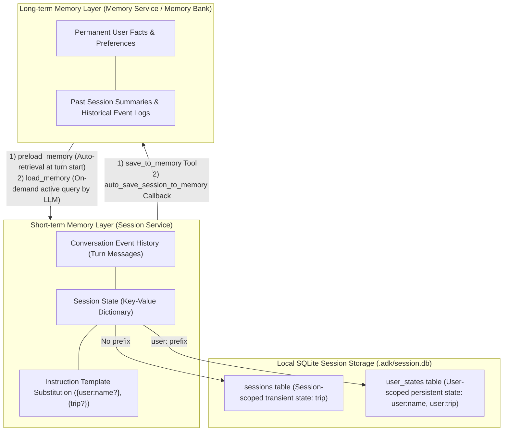

# adk-based_Agent — Google ADK Agent Project Collection

This project directory contains standard agent packages built with the **Google Agent Development Kit (ADK)**. Each agent is structured as an independent Python package following ADK specification, ready to run and test via terminal CLI, web GUI, or programmatic Runners.

---

## 1. Included Agent Folders

| Folder | Agent Role | Core Architecture & Tools | Key Learning Points |
|---|---|---|---|
| [**`chat_time_weather_agent`**](./chat_time_weather_agent/README-EN.md) | World city time & weather assistant and general chatter | Open-Meteo API integration, `geocode`, `get_current_time`, `get_weather`, offline fallback DB | • Tool auto-routing vs direct LLM response branch<br>• IANA Timezone and WMO weather code resolution<br>• PEP 8 & `AgentLoader` compliant folder design |
| [**`memory_layers_agent`**](./memory_layers_agent/README-EN.md) | Dual-layer memory (Short-term Session vs Long-term Memory) assistant | Session State (`user:name`, `trip`), Memory Service (`preload_memory`, `load_memory`) | • Session State prefix (`user:`, `temp:`, unqualified) scopes<br>• Prompt injection via `{key?}` template substitution<br>• Cross-session persistent knowledge accumulation & retrieval |

---

## 2. Directory Structure

```text
adk-based_Agent/
├── chat_time_weather_agent/          # Time, weather, and general conversation agent
│   ├── __init__.py                  # Exposes agent module and root_agent
│   ├── agent.py                     # Tool implementations and agent definition
│   ├── README-KR.md                 # Korean detailed documentation
│   └── README-EN.md                 # English detailed documentation
├── memory_layers_agent/             # Dual-layer memory agent
│   ├── __init__.py                  # Exposes agent module and root_agent
│   ├── agent.py                     # State tools and root_agent definition
│   ├── README-KR.md                 # Korean detailed documentation
│   └── README-EN.md                 # English detailed documentation
├── README-KR.md                     # Comprehensive Korean guide for the project
└── README-EN.md                     # Comprehensive English guide (this document)
```

---

## 3. Prerequisites and Configuration

### 1) Package Installation
Install Google ADK and required libraries in a Python 3.10+ environment:

```bash
pip install google-adk python-dotenv
# or using uv
uv pip install google-adk python-dotenv
```

### 2) Environment Variables (`.env`) Configuration
Create a `.env` file in the parent folder (`part02_architecture` or workspace root):

```env
# Gemini Developer API Key (Default)
GEMINI_API_KEY=your_gemini_api_key_here

# Or when using Google Cloud Vertex AI
# GOOGLE_GENAI_USE_VERTEXAI=TRUE
# GOOGLE_CLOUD_PROJECT=your-gcp-project-id
# GOOGLE_CLOUD_LOCATION=us-central1

# Default Agent model (Optional)
ADK_MODEL=gemini-3.8-flash

# Offline testing mode (0: online API, 1: built-in offline data)
AGENT_OFFLINE=0
```

---

## 4. Execution and Testing Methods

The agents in this project can be executed at three different levels:

### Method 1: ADK CLI Interactive Mode (`adk run`)
Chat directly with the agents in your terminal:

```bash
# Run from within the adk-based_Agent directory

# 1) Run Time & Weather Agent
adk run chat_time_weather_agent

# 2) Run Dual-Layer Memory Agent
adk run memory_layers_agent
```

### Method 2: ADK Web Development UI (`adk web`)
Test visually in your browser using Google ADK's official web UI:

```bash
# Launch web server from within the adk-based_Agent directory
adk web --port 8008
```
Open `http://localhost:8008` in your browser, select your target agent (`chat_time_weather_agent` or `memory_layers_agent`) from the top-left dropdown, and start chatting.

### Method 3: Direct_ADK Integration Scripts
Observe internal event lifecycles and memory transitions in code using the test scripts located in the parent directory:

```bash
# Navigate to part02_architecture directory
cd ..

# 1) Observe request event lifecycle for chat_time_weather_agent
uv run Direct_ADK/run_events.py

# 2) Run dual-layer memory tests for memory_layers_agent (offline structure / Gemini integration)
uv run Direct_ADK/run_memory_layers.py offline
uv run Direct_ADK/run_memory_layers.py llm
uv run Direct_ADK/run_memory_layers.py all

# 3) Run complete multi-session lifecycle demo directly
uv run python adk-based_Agent/memory_layers_agent/agent.py
```

---

## 5. In-Depth Architecture: Dual-Layer & Long-Term Memory (Memory Service) in `memory_layers_agent`

`memory_layers_agent` implements Google ADK's dual-tier cognitive memory architecture, combining transient working memory (**Session Service**) with persistent cross-session knowledge (**Memory Service / Memory Bank**).



### 1) Session Service (Short-term) vs Memory Service (Long-term)

| Dimension | Session Service (Short-term) | Memory Service (Long-term) |
|---|---|---|
| **Scope & Role** | Transient working memory within an active conversation thread (Session) | Permanent user facts, preferences, and accumulated historical knowledge across sessions |
| **Managed Data** | Recent turn messages, tool execution outputs, and Session State variables | Structured knowledge, conversation summaries, user profile attributes, and past events |
| **Lifecycle** | Discarded upon conversation thread completion (persisted under session ID if DB backend is used) | Persisted permanently regardless of process restarts or thread completions |
| **Access Mechanism** | • Event history injected into conversational context<br>• `{key?}` template substitution in agent instructions<br>• Direct read/write via `tool_context.state` | • `preload_memory`: Automatic semantic search before LLM call based on user utterance keywords<br>• `load_memory`: Active on-demand search tool invoked by LLM when needed |

### 2) Session State Variable Prefix Scoping Rules

Google ADK partitions session state storage strictly based on dictionary key prefixes:

1. **`user:<key>` (User-Persistent Scope)**:
   - **Shared across all sessions** created by the same user (`user_id`).
   - In local CLI runs (`adk run`), it is stored as JSON in the `user_states` table inside `.adk/session.db`, surviving CLI exits and process restarts.
   - Examples: `user:name` (User name), `user:trip` (Persisted business trip itinerary).
2. **Unqualified / No Prefix (`<key>`) (Session-Isolated Scope)**:
   - Bound strictly to the current conversation session (`session_id`). When a new session begins, it resets to empty.
   - In local SQLite, it is saved under the specific session record in the `sessions` table.
   - Example: `trip` (Temporary trip context for the current session).
3. **`app:<key>` (Application-Global Scope)**:
   - Shared across all users and all sessions within the application (`app_name`).
4. **`temp:<key>` (Turn-Transient Scope)**:
   - Kept in memory only during the active turn execution and never persisted to the session database.

### 3) Migration Mechanism: Session to Long-term Memory

`memory_layers_agent` facilitates session data migration into the Memory Service through two mechanisms:

1. **Explicit Tool Call (`save_to_memory`)**:
   - When the user explicitly commands the agent to save or remember their plans (*"Save this itinerary"*, *"Remember this plan"*, *"Persist to long-term memory"*), the LLM calls the `save_to_memory` tool.
   - Internally, this executes `await tool_context.add_session_to_memory()`, indexing the entire conversation thread and finalized itinerary into the long-term memory bank immediately.
2. **Automatic Lifecycle Callback (`after_agent_callback`)**:
   - Configured via `after_agent_callback=auto_save_session_to_memory` in `agent.py`.
   - At the completion of each agent response turn, the callback asynchronously executes `await callback_context.add_session_to_memory()` in the background.
   - Even if the session disconnects unexpectedly, conversational facts are safely migrated to the long-term memory store.

### 4) Retrieval Mechanics: Ingesting Long-term Knowledge

Once migrated, memories are retrieved and supplied back to the agent via two built-in ADK tools:

1. **`preload_memory` (Automatic Pre-Retrieval)**:
   - At the start of each user turn, ADK extracts entities and keywords from the input utterance and queries the Memory Service.
   - Relevant memory snippets are automatically prepended to the prompt context before the LLM processes instructions.
2. **`load_memory` (On-Demand Active Search)**:
   - If the preloaded context is insufficient for deep details (e.g., specific tourist spots like "용두암" or dietary restrictions), the LLM autonomously triggers `load_memory(query="용두암")` using a single concise keyword to search the Memory Service.

### 5) Local CLI Environment Behavior & Hands-On Tips

- **`adk run` CLI Notes**:
  - `adk run` uses a local SQLite database (`.adk/session.db`) for session storage. As a result, state variables with the `user:` prefix (`user:name`, `user:trip`) persist across terminal restarts.
  - In contrast, the default CLI Memory Service operates in RAM (`InMemoryMemoryService`). Terminating the CLI process (`Aborted!` or `exit`) clears the in-memory long-term bank.
- **Testing Full Multi-Session Lifecycle in Code**:
  - To observe the full lifecycle—registering information in Session 1, migrating it to long-term memory, resetting session state, and successfully retrieving it in Session 2—run the standalone lifecycle script:
    ```bash
    uv run python adk-based_Agent/memory_layers_agent/agent.py
    ```
  - This executes a dual-session sequence sharing an `InMemoryMemoryService` instance, demonstrating seamless cross-session knowledge recall in your terminal.

---

## 6. Detailed Documentation Links
For detailed tool signatures, instruction prompt engineering, dialogue scenarios, and troubleshooting, please refer to the documentation in each folder:

- [chat_time_weather_agent Guide (Korean: README-KR.md)](./chat_time_weather_agent/README-KR.md) / [English (README-EN.md)](./chat_time_weather_agent/README-EN.md)
- [memory_layers_agent Guide (Korean: README-KR.md)](./memory_layers_agent/README-KR.md) / [English (README-EN.md)](./memory_layers_agent/README-EN.md)

