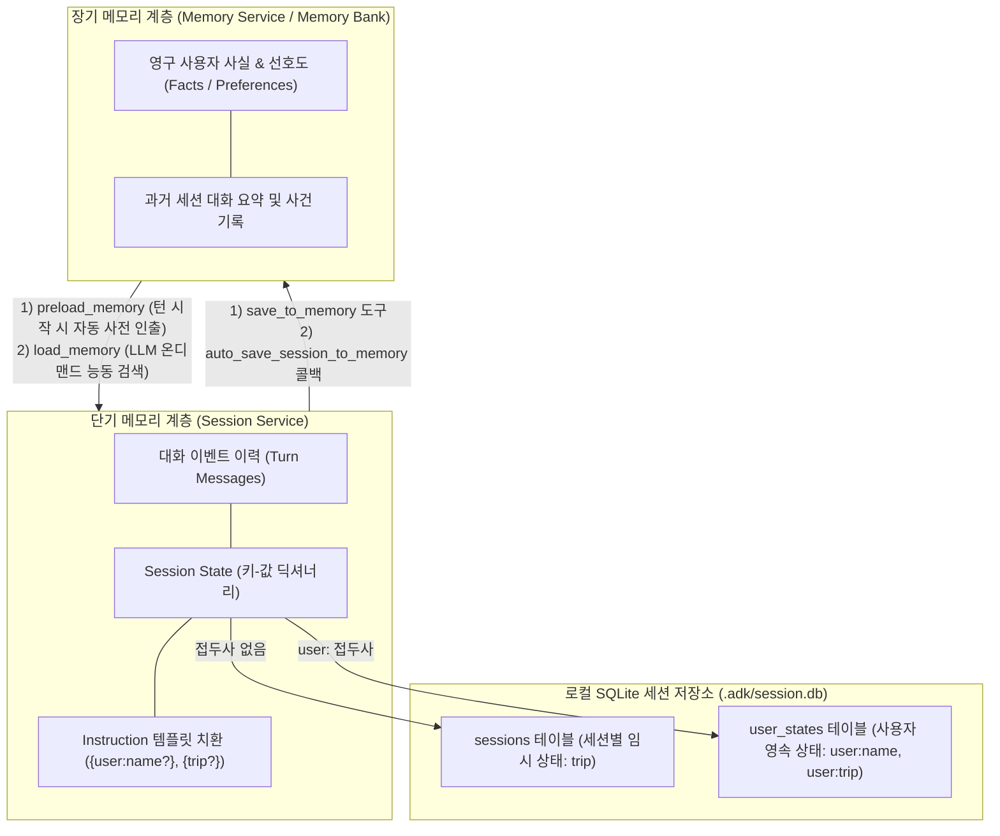

# adk-based_Agent — Google ADK 기반 에이전트 프로젝트 모음

본 프로젝트 디렉터리는 **Google Agent Development Kit (ADK)**를 활용하여 구현된 표준 ADK 에이전트 패키지들을 포함하고 있습니다. 각 에이전트는 독립된 Python 모듈 및 ADK 에이전트 규격으로 구성되어 있으며, 터미널 CLI, 웹 UI, 그리고 코드 기반 Runner를 통해 즉시 실행 및 테스트할 수 있습니다.

---

## 1. 포함된 하위 에이전트 폴더 목록

| 폴더명 | 에이전트 역할 | 핵심 아키텍처 및 도구 | 주요 학습 포인트 |
|---|---|---|---|
| [**`chat_time_weather_agent`**](./chat_time_weather_agent/README-KR.md) | 세계 도시 시간·날씨 조회 및 범용 대화 비서 | Open-Meteo API 연동, `geocode`, `get_current_time`, `get_weather`, 오프라인 폴백 DB | • 도구 자동 라우팅 vs LLM 직접 응답 분기<br>• IANA Timezone 및 WMO 기상 코드 변환<br>• PEP 8 및 `AgentLoader` 호환 폴더 설계 |
| [**`memory_layers_agent`**](./memory_layers_agent/README-KR.md) | 이중 계층 메모리 (단기 세션 vs 장기 기억) 비서 | Session State (`user:name`, `trip`), Memory Service (`preload_memory`, `load_memory`) | • Session State 접두사(`user:`, `temp:`, 일반) 스코프<br>• `{key?}` 템플릿 치환을 통한 State 주입<br>• 세션 간 영속 기억 축적 및 인출 메커니즘 |

---

## 2. 전체 디렉터리 구조

```text
adk-based_Agent/
├── chat_time_weather_agent/          # 시간·날씨 및 일반 대화 에이전트
│   ├── __init__.py                  # agent 모듈 및 root_agent 노출
│   ├── agent.py                     # 도구 구현 및 에이전트 정의
│   ├── README-KR.md                 # 한국어 상세 설명서
│   └── README-EN.md                 # 영문 상세 설명서
├── memory_layers_agent/             # 이중 계층 메모리 실습 에이전트
│   ├── __init__.py                  # agent 모듈 및 root_agent 노출
│   ├── agent.py                     # State 도구 및 root_agent 정의
│   ├── README-KR.md                 # 한국어 상세 설명서
│   └── README-EN.md                 # 영문 상세 설명서
├── README-KR.md                     # 프로젝트 전체 통합 한국어 가이드 (본 문서)
└── README-EN.md                     # 프로젝트 전체 통합 영문 가이드
```

---

## 3. 사전 환경 준비 및 설정

### 1) 필수 패키지 설치
Python 3.10 이상 환경에서 Google ADK 및 의존 라이브러리를 설치합니다:

```bash
pip install google-adk python-dotenv
# 또는 uv 사용 시
uv pip install google-adk python-dotenv
```

### 2) 환경 변수(`.env`) 설정
상위 폴더(`part02_architecture` 또는 워크스페이스 루트)에 `.env` 파일을 생성하고 다음과 같이 설정합니다:

```env
# Gemini Developer API 키 (기본)
GEMINI_API_KEY=your_gemini_api_key_here

# 또는 Google Cloud Vertex AI 사용 시
# GOOGLE_GENAI_USE_VERTEXAI=TRUE
# GOOGLE_CLOUD_PROJECT=your-gcp-project-id
# GOOGLE_CLOUD_LOCATION=us-central1

# 에이전트 기본 모델 (선택)
ADK_MODEL=gemini-3.8-flash

# 오프라인 테스트 모드 (0: 온라인 API, 1: 내장 오프라인 데이터)
AGENT_OFFLINE=0
```

---

## 4. 수행 및 실행 방법

본 프로젝트의 에이전트들은 다음 세 가지 수준에서 실행할 수 있습니다:

### 방법 1: ADK CLI 대화형 실행 (`adk run`)
터미널에서 에이전트와 직접 텍스트로 대화합니다:

```bash
# adk-based_Agent 디렉터리에서 실행

# 1) 시간·날씨 에이전트 실행
adk run chat_time_weather_agent

# 2) 이중 계층 메모리 에이전트 실행
adk run memory_layers_agent
```

### 방법 2: 웹 개발 UI 실행 (`adk web`)
Google ADK가 제공하는 공식 웹 인터페이스를 통해 브라우저에서 시각적으로 테스트합니다:

```bash
# adk-based_Agent 디렉터리에서 웹 서버 구동
adk web --port 8008
```
브라우저에서 `http://localhost:8008`로 접속한 후, 상단 드롭다운 메뉴에서 원하는 에이전트(`chat_time_weather_agent` 또는 `memory_layers_agent`)를 선택하여 대화를 진행합니다.

### 방법 3: Direct_ADK 연계 스크립트 실행
상위 `part02_architecture` 디렉터리에 위치한 검증 스크립트를 통해 에이전트의 내부 이벤트 생명주기 및 메모리 계층 전이를 코드로 관찰할 수 있습니다:

```bash
# part02_architecture 디렉터리로 이동
cd ..

# 1) chat_time_weather_agent의 이벤트 생명주기 관찰
uv run Direct_ADK/run_events.py

# 2) memory_layers_agent의 이중 계층 메모리(오프라인 구조 분석 / Gemini 연동 테스트) 실행
uv run Direct_ADK/run_memory_layers.py offline
uv run Direct_ADK/run_memory_layers.py llm
uv run Direct_ADK/run_memory_layers.py all

# 3) memory_layers_agent의 멀티 세션 이관 전체 생명주기 데모 직접 실행
uv run python adk-based_Agent/memory_layers_agent/agent.py
```

---

## 5. 핵심 심화 분석: `memory_layers_agent`의 이중 계층 및 장기 메모리(Memory Service) 구조

`memory_layers_agent`는 Google ADK가 제공하는 **단기 작업 기억(Session Service)**과 **장기 영속 기억(Memory Service)**을 결합한 지능형 메모리 아키텍처 실습 패키지입니다.



### 1) 단기 메모리(Session Service)와 장기 메모리(Memory Service) 비교

| 비교 차원 | Session Service (단기 메모리) | Memory Service (장기 메모리) |
|---|---|---|
| **역할 및 범위** | 단일 대화 스레드(Session) 내의 일시적인 작업 메모리 | 여러 세션을 넘나드는 영구적인 사실, 선호도, 과거 경험 기억 |
| **관리 대상 데이터** | 최근 발화 이력, 도구 실행 결과, Session State 변수 | 구조화된 지식, 대화 요약, 사용자 프로필, 세션 간 누적 사건 |
| **생명주기** | 세션 종료 시 기본 소멸 (DB 백엔드 사용 시 세션 키로 보존) | 프로세스 재시작이나 새 세션 시작과 무관하게 영구 보존 |
| **접근 방식** | • 대화 이벤트 이력 컨텍스트 자동 주입<br>• `{key?}` 지시문(Instruction) 템플릿 치환<br>• 도구 내부 `tool_context.state` 직접 읽기/쓰기 | • `preload_memory`: 사용자 발화 키워드 기반 자동 사전 검색<br>• `load_memory`: LLM이 필요 시 능동적으로 질의하는 검색 도구 |

### 2) Session State 변수 접두사(Prefix) 스코프 체계

Google ADK의 세션 상태는 딕셔너리 키에 부여된 접두사에 따라 저장 스코프가 엄격히 분리됩니다:

1. **`user:<key>` (사용자 영속 스코프)**:
   - 동일 사용자(`user_id`)가 생성한 **모든 세션 간에 지속적으로 공유**됩니다.
   - 로컬 CLI 환경(`adk run`)에서는 `.adk/session.db` 파일의 `user_states` 테이블에 JSON 문자열로 저장되어 프로세스를 종료했다가 다시 실행해도 값이 복원됩니다.
   - 예: `user:name` (사용자 성명), `user:trip` (영속 보존 출장 일정)
2. **접두사 없음 (`<key>`) (세션 격리 스코프)**:
   - 해당 대화 세션(`session_id`) 내부에서만 유효하며, 새 세션이 시작되면 완전히 초기화됩니다.
   - 로컬 SQLite에서는 `sessions` 테이블의 해당 세션 행에만 기록됩니다.
   - 예: `trip` (현재 세션의 임시 여행 일정)
3. **`app:<key>` (애플리케이션 전역 스코프)**:
   - 애플리케이션(`app_name`) 내의 모든 사용자와 모든 세션이 공유하는 전역 설정값입니다.
4. **`temp:<key>` (단일 턴 휘발성 스코프)**:
   - 단일 턴(Turn) 동안만 메모리에 임시 유지되며 영구 저장소에 기록되지 않습니다.

### 3) 단기 세션에서 장기 기억(Memory Service)으로의 이관 메커니즘

`memory_layers_agent`에서는 두 가지 방식으로 세션 데이터를 장기 기억으로 이관(Ingestion)합니다:

1. **명시적 도구 호출 (`save_to_memory`)**:
   - 사용자가 *"이 일정을 저장해줘"*, *"기억해줘"*, *"장기 메모리에 등록해줘"*라고 명시적으로 요청하면, LLM이 `save_to_memory` 도구를 호출합니다.
   - 내부적으로 `await tool_context.add_session_to_memory()`를 실행하여 현재 세션의 전체 대화 및 결정된 일정을 Memory Service의 메모리 뱅크에 즉시 색인화합니다.
2. **라이프사이클 콜백을 통한 자동 이관 (`after_agent_callback`)**:
   - `agent.py`의 `after_agent_callback=auto_save_session_to_memory`가 설정되어 있어, 매 턴 응답이 완료될 때마다 백그라운드에서 `await callback_context.add_session_to_memory()`를 호출합니다.
   - 대화 도중 세션이 비정상 종료되거나 새 세션으로 넘어가더라도 직전 대화 기록이 유실되지 않고 장기 기억으로 자동 누적됩니다.

### 4) 장기 기억 검색 및 인출(Retrieval) 메커니즘

장기 기억으로 이관된 데이터는 다음 두 가지 내장 도구를 통해 에이전트에게 공급됩니다:

1. **`preload_memory` (자동 사전 인출)**:
   - 사용자가 발화할 때마다, 해당 질의에 포함된 명사와 키워드를 기반으로 Memory Service를 사전에 검색합니다.
   - 검색된 과거 기억 청크(Memories)는 LLM이 지시문을 읽기 전 프롬프트 컨텍스트의 최상단에 자동으로 배치됩니다.
2. **`load_memory` (LLM 온디맨드 능동 검색)**:
   - 사전 주입된 정보만으로 답변하기 어려운 세부사항(예: 과거에 언급된 관광지, 특정 음식 취향 등)이 있을 경우, LLM이 능동적으로 `load_memory(query="용두암")`와 같이 단일 핵심 키워드로 장기 기억을 추가 조회합니다.

### 5) CLI 환경의 영속성 특성 및 실습 팁

- **`adk run` CLI 실행 시 주의사항**:
  - `adk run`은 세션 저장소로 디스크의 SQLite(`.adk/session.db`)를 사용하므로 `user:` 접두사 상태(`user:name`, `user:trip`)는 CLI 창을 닫아도 안전하게 유지됩니다.
  - 반면, CLI 환경의 기본 Memory Service는 프로세스 메모리(`InMemoryMemoryService`)에 상주하므로, 터미널 세션을 완전히 종료(`Aborted!` / `exit`)하면 장기 메모리 뱅크가 휘발됩니다.
- **멀티 세션 생명주기 전체 실습**:
  - 세션 종료 후 장기 메모리에서 과거 기억이 새 세션으로 온전히 인출되는 전체 과정을 테스트하려면 다음 스크립트를 직접 실행합니다:
    ```bash
    uv run python adk-based_Agent/memory_layers_agent/agent.py
    ```
  - 동일한 `InMemoryMemoryService`를 공유하는 두 개의 연속된 세션(Session 1: 일정 등록 및 장기 기억 이관 ➔ Session 2: 세션 리셋 후 장기 기억 인출)이 순차적으로 실행되는 동작을 터미널에서 즉시 검증할 수 있습니다.

---

## 6. 상세 문서 링크
각 에이전트의 세부 도구 파라미터, 프롬프트 엔지니어링 지시문, 대화 시나리오 및 트러블슈팅 가이드는 각 폴더의 문서를 참조하십시오:

- [chat_time_weather_agent 상세 설명서 (README-KR.md)](./chat_time_weather_agent/README-KR.md) / [English (README-EN.md)](./chat_time_weather_agent/README-EN.md)
- [memory_layers_agent 상세 설명서 (README-KR.md)](./memory_layers_agent/README-KR.md) / [English (README-EN.md)](./memory_layers_agent/README-EN.md)

