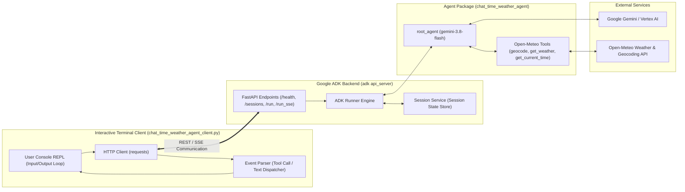
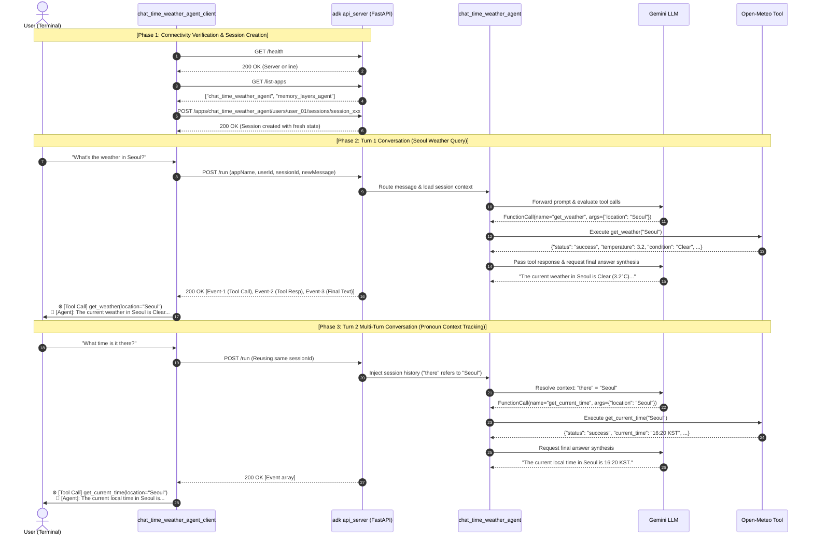

# chat_time_weather_agent_client — Operational Architecture & Workflow Guide

This document provides a comprehensive architectural and operational guide for interacting with Google Agent Development Kit's (ADK) official HTTP server (**`adk api_server`**) using the interactive console client [`chat_time_weather_agent_client.py`](./chat_time_weather_agent_client.py).

---

## 1. Overview & Core Concepts

`chat_time_weather_agent` is an ADK-based agent designed to query real-time weather and current local time for global cities via the Open-Meteo API. By serving this agent as a microservice using `adk api_server`, users and applications can interact with it over HTTP. [`chat_time_weather_agent_client.py`](./chat_time_weather_agent_client.py) serves as an interactive terminal client that demonstrates multi-turn session tracking, real-time tool invocation inspection, and SSE streaming.

> **Key Components**
> - **`adk api_server`**: A FastAPI-based REST/SSE microservice server provided by Google ADK. Responsible for agent execution endpoints (`/run`, `/run_sse`), session lifecycle management, and artifact/memory servicing.
> - **`chat_time_weather_agent_client.py`**: An interactive terminal client that accepts user console input, sends structured requests to `adk api_server`, parses agent events in real time, and renders tool execution details and text responses.
> - **REST Sync (`/run`) vs SSE Streaming (`/run_sse`)**: Supports both full-event JSON array delivery upon turn completion and progressive Server-Sent Events streaming (`data: {...}`).

---

## 2. System Architecture



---

## 3. Session & Turn Execution Sequence Diagram



---

## 4. Key Endpoints & Protocol Specifications

### 1) Health Check & App Discovery
* **`GET /health`**
  - Verifies HTTP connectivity with the server. If unreachable, the client displays startup troubleshooting advice and safely exits.
* **`GET /list-apps`**
  - Retrieves the list of active agent applications served by the server.
  - Example response: `["chat_time_weather_agent", "memory_layers_agent"]`
  - The client verifies that the requested `--app` exists, or auto-binds to the single available agent.

### 2) Session Initialization
* **`POST /apps/{app_name}/users/{user_id}/sessions/{session_id}`**
  - Request body: `{"state": {}}`
  - Initializes a persistent session ID so message events and session state are tracked across multiple dialogue turns.
  - Response body:
    ```json
    {
      "id": "session_07aca660",
      "appName": "chat_time_weather_agent",
      "userId": "user_01",
      "state": {},
      "events": [],
      "lastUpdateTime": 1795072578.73
    }
    ```

### 3) Turn Execution (REST /run vs SSE /run_sse)
* **Request Payload (Shared `RunAgentRequest`)**:
  ```json
  {
    "appName": "chat_time_weather_agent",
    "userId": "user_01",
    "sessionId": "session_07aca660",
    "newMessage": {
      "role": "user",
      "parts": [{"text": "What's the weather in Seoul?"}]
    }
  }
  ```

* **Synchronous REST Mode (`POST /run`)**:
  - Waits until the agent loop finishes, returning the full array of execution events (`list[Event]`) in a single JSON payload.
* **Streaming SSE Mode (`POST /run_sse`)**:
  - Uses `Content-Type: text/event-stream`. As each tool call or text token is emitted by the agent, lines prefixed with `data: {...}\n\n` are sent to the client progressively.

---

## 5. Event Parsing & Rendering Mechanism

`chat_time_weather_agent_client.py` examines the `content.parts` array in each received `Event` and dispatches based on the part type:

```python
for p in parts:
    # 1. Tool / Function Call Event
    if "functionCall" in p:
        fc = p["functionCall"]
        print(f"  ⚙️  [Tool Call] {fc['name']}({json.dumps(fc.get('args'))})")

    # 2. Tool Execution Output Event
    elif "functionResponse" in p and self.verbose:
        fr = p["functionResponse"]
        print(f"  📥 [Tool Resp] {fr['name']} -> {fr.get('response')}")

    # 3. Agent Conversational Text Event
    elif "text" in p and p.get("text"):
        print(f"\n🤖 [{author}]:\n{p['text'].strip()}")
```

---

## 6. Execution & Usage Guide

### 1) Start the Server (Terminal 1)
```bash
# Start api_server from the adk-based_Agent folder
cd part02_architecture/adk-based_Agent
adk api_server --port 8000
```

### 2) Launch the Client (Terminal 2)
```bash
# Run in default synchronous REST mode
python chat_time_weather_agent_client.py

# Run in SSE streaming mode
python chat_time_weather_agent_client.py --stream

# Run against a custom host or user identifier
python chat_time_weather_agent_client.py --url http://127.0.0.1:8000 --user guest_01
```

### 3) In-Chat Slash (/) Commands
| Command | Description |
|---|---|
| `/new` or `/reset` | Terminate the active session and create a fresh `session_id` |
| `/stream` | Toggle between REST sync mode (`/run`) and SSE streaming mode (`/run_sse`) |
| `/apps` | List all registered agent applications on the server |
| `/help` | Display command help |
| `exit` or `quit` | Exit the interactive client |

---

## 7. Related File Links
- 📄 [chat_time_weather_agent_client.py](./chat_time_weather_agent_client.py): Source code for the interactive client
- 📄 [chat_time_weather_agent/agent.py](./chat_time_weather_agent/agent.py): Backend agent and tool implementations
- 📄 [chat_time_weather_agent/README-EN.md](./chat_time_weather_agent/README-EN.md): Detailed specification for chat_time_weather_agent

