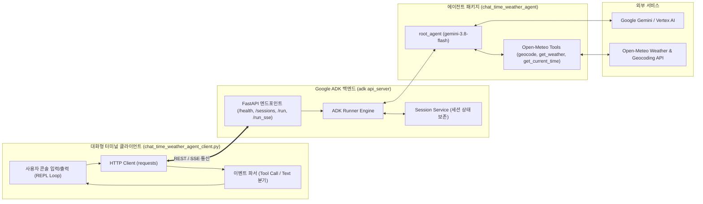
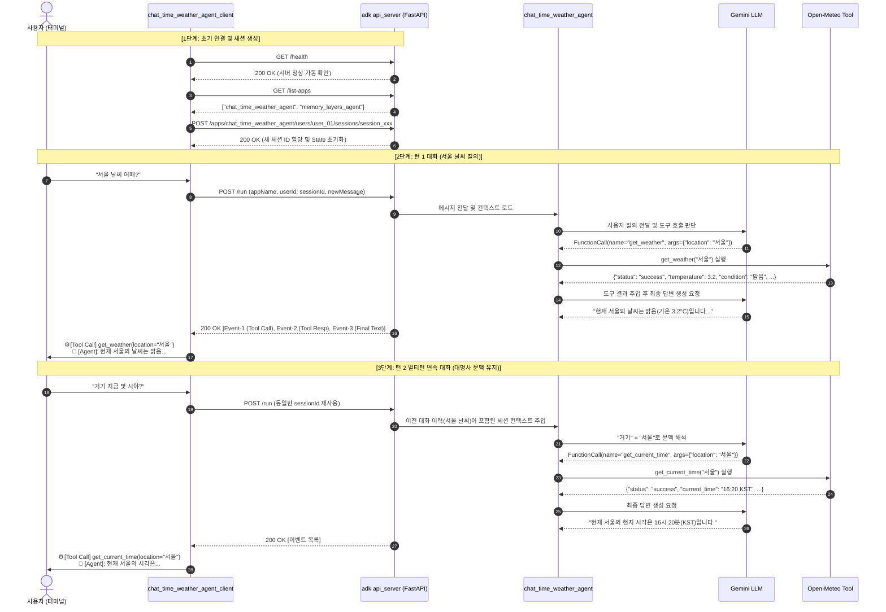

# chat_time_weather_agent_client — 동작 구조 및 워크플로우 가이드

본 문서는 Google Agent Development Kit(ADK)의 공식 HTTP 서버인 **`adk api_server`**와 대화형 터미널 클라이언트인 [`chat_time_weather_agent_client.py`](./chat_time_weather_agent_client.py)의 상호작용 아키텍처 및 동작 구조를 상세히 설명합니다.

---

## 1. 개요 및 핵심 개념

`chat_time_weather_agent`는 Open-Meteo API를 호출하여 전 세계 도시의 실시간 기상 상태 및 현지 시간을 안내하는 ADK 기반 에이전트입니다. 이를 `adk api_server`를 통해 백엔드 마이크로서비스로 구동하고, `chat_time_weather_agent_client.py`를 실행하여 멀티턴 대화, 실시간 도구 호출 시각화, 스트리밍 응답을 검증할 수 있습니다.

> **핵심 컴포넌트**
> - **`adk api_server`** : Google ADK가 내장한 FastAPI 기반 REST/SSE 마이크로서비스 서버. 에이전트 실행(`/run`, `/run_sse`), 세션 관리, 메모리/아티팩트 서빙을 담당.
> - **`chat_time_weather_agent_client.py`** : 사용자의 콘솔 입력을 받아 `adk api_server`와 통신하고, 에이전트의 내부 이벤트(Tool Call, Tool Response, 텍스트 답변)를 실시간으로 파싱하여 터미널에 렌더링하는 대화형 클라이언트.
> - **동기식 REST (`/run`) vs 스트리밍 SSE (`/run_sse`)** : 단일 턴 완료 후 전체 이벤트 배열을 받는 동기 모드와, 생성되는 즉시 한 줄씩 이벤트(`data: {...}`)를 스트리밍하는 모드 지원.

---

## 2. 전체 시스템 아키텍처



---

## 3. 대화 세션 및 턴 실행 시퀀스 다이어그램



---

## 4. 핵심 엔드포인트 및 통신 명세

### 1) 헬스체크 및 앱 검색
* **`GET /health`**
  - 서버 연결 상태를 검증합니다. 실패 시 클라이언트는 서버 구동 안내 메시지를 띄우고 안전하게 종료합니다.
* **`GET /list-apps`**
  - 서버가 서빙하고 있는 활성 에이전트 목록을 조회합니다.
  - 응답 예시: `["chat_time_weather_agent", "memory_layers_agent"]`
  - 클라이언트는 지정된 대상 앱(`--app`)이 목록에 있는지 확인하고, 단일 앱 서빙 시 자동으로 해당 앱으로 매핑합니다.

### 2) 세션 생성
* **`POST /apps/{app_name}/users/{user_id}/sessions/{session_id}`**
  - 요청 본문: `{"state": {}}`
  - 세션을 생성하여 대화 이력과 세션 상태(State)가 유지되도록 초기화합니다.
  - 응답 본문:
    ```json
    {
      "id": "session_07aca660",
      "appName": "chat_time_weather_agent",
      "userId": "user_01",
      "state": {},
      "events": [],
      "lastUpdateTime": 1795072578.73
    }
    ```

### 3) 대화 턴 실행 (REST /run vs SSE /run_sse)
* **요청 페이로드 (공통 `RunAgentRequest`)**:
  ```json
  {
    "appName": "chat_time_weather_agent",
    "userId": "user_01",
    "sessionId": "session_07aca660",
    "newMessage": {
      "role": "user",
      "parts": [{"text": "서울 날씨 어때?"}]
    }
  }
  ```

* **동기식 방식 (`POST /run`)**:
  - 에이전트의 전체 실행 루프가 완료된 후, 발생한 모든 이벤트 배열(`list[Event]`)을 단일 JSON으로 반환합니다.
* **스트리밍 방식 (`POST /run_sse`)**:
  - `Content-Type: text/event-stream` 형식으로 에이전트가 도구를 호출하거나 텍스트 청크를 생성할 때마다 `data: {...}\n\n` 라인을 순차적으로 클라이언트에 전송합니다.

---

## 5. 이벤트 파싱 및 시각화 메커니즘

`chat_time_weather_agent_client.py`는 수신된 각 `Event`의 `content.parts` 배열을 검사하여 다음 세 가지 유형으로 분기 처리합니다:

```python
for p in parts:
    # 1. 도구 호출 이벤트 (Function Call)
    if "functionCall" in p:
        fc = p["functionCall"]
        print(f"  ⚙️  [Tool Call] {fc['name']}({json.dumps(fc.get('args'))})")

    # 2. 도구 실행 결과 이벤트 (Function Response)
    elif "functionResponse" in p and self.verbose:
        fr = p["functionResponse"]
        print(f"  📥 [Tool Resp] {fr['name']} -> {fr.get('response')}")

    # 3. LLM 최종 대화 텍스트 이벤트
    elif "text" in p and p.get("text"):
        print(f"\n🤖 [{author}]:\n{p['text'].strip()}")
```

---

## 6. 사용 방법 및 명령어 가이드

### 1) 서버 구동 (Terminal 1)
```bash
# adk-based_Agent 폴더에서 api_server 구동
cd part02_architecture/adk-based_Agent
adk api_server --port 8000
```

### 2) 클라이언트 실행 (Terminal 2)
```bash
# 기본 동기 모드로 실행
python chat_time_weather_agent_client.py

# SSE 스트리밍 모드로 실행
python chat_time_weather_agent_client.py --stream

# 다른 포트나 호스트 지정 시
python chat_time_weather_agent_client.py --url http://127.0.0.1:8000 --user guest_01
```

### 3) 대화 중 지원 슬래시(/) 명령어
| 명령어 | 기능 설명 |
|---|---|
| `/new` 또는 `/reset` | 현재 세션을 닫고 새로운 `session_id`를 생성하여 대화 문맥 초기화 |
| `/stream` | REST 동기 모드(`/run`)와 실시간 SSE 스트리밍 모드(`/run_sse`) 간 토글 |
| `/apps` | 서버에 등록된 에이전트 애플리케이션 목록 출력 |
| `/help` | 지원 명령어 도움말 표시 |
| `exit` 또는 `quit` | 대화 세션 종료 및 프로그램 빠져나가기 |

---

## 7. 관련 파일 링크
- 📄 [chat_time_weather_agent_client.py](./chat_time_weather_agent_client.py) : 본 문서의 클라이언트 소스 코드
- 📄 [chat_time_weather_agent/agent.py](./chat_time_weather_agent/agent.py) : 백엔드 에이전트 및 도구 구현체
- 📄 [chat_time_weather_agent/README-KR.md](./chat_time_weather_agent/README-KR.md) : 에이전트 상세 설계서

