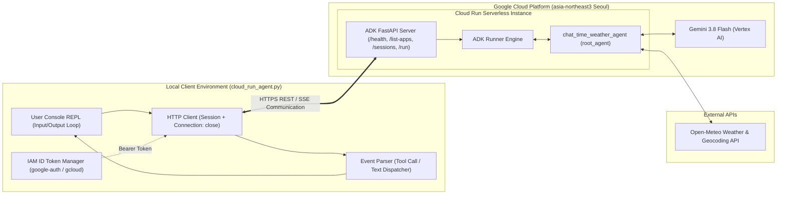
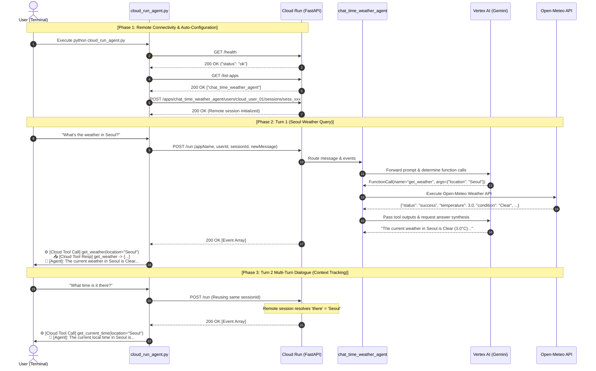

# Google Cloud Run ADK Agent — Interactive Client Guide

This document provides a comprehensive operational guide and architectural specification for [`cloud_run_agent.py`](./cloud_run_agent.py), an interactive console client designed to converse with Google Agent Development Kit (ADK) agent services deployed on Google Cloud Run (e.g., `https://adk-default-service-name-1008280623664.asia-northeast3.run.app`).

---

## 1. Overview & Core Concepts

Agents created with the Google Agent Development Kit (ADK) can be containerized and deployed seamlessly to serverless environments such as Google Cloud Run. Once deployed, the Cloud Run instance exposes FastAPI-compliant HTTP endpoints adhering to the `adk api_server` specification.

[`cloud_run_agent.py`](./cloud_run_agent.py) is a standalone command-line client that connects to any Cloud Run service URL to facilitate multi-turn dialogue, visualize live remote tool calling in real time, and manage session lifecycles.

> **Key Capabilities**
> - **Flexible Endpoint Binding**: Connects via CLI flags, environment variables, interactive startup prompts, or runtime `/url` commands.
> - **Cloud Run Network Resilience**: Enforces proactive header management (`Connection: close`) to avoid `SSLEOFError` and socket resets common to idle serverless instances.
> - **Automated Agent Discovery**: Automatically queries `/list-apps` on the remote service to identify and bind to deployed agents (e.g., `chat_time_weather_agent`).
> - **IAM ID Token Authentication (`--auth`)**: Retrieves and attaches Google Cloud ID tokens for private Cloud Run services that reject unauthenticated invocations.
> - **Dual Transport Support**: Supports both synchronous REST execution (`/run`) and streaming Server-Sent Events (`/run_sse`).

---

## 2. System Architecture



---

## 3. Interaction & Execution Sequence Diagram



---

## 4. Key Endpoints Specification

| Method | Endpoint Path | Role & Description |
|---|---|---|
| `GET` | `/health` | Health check endpoint returning Cloud Run container status |
| `GET` | `/list-apps` | Lists all ADK agents registered on this Cloud Run service |
| `POST` | `/apps/{app}/users/{user}/sessions/{sid}` | Allocates a persistent session ID and initializes remote state |
| `POST` | `/run` | Synchronous invocation returning a complete array of events |
| `POST` | `/run_sse` | Progressive Server-Sent Events streaming (`data: {...}` lines) |

---

## 5. Execution & Usage Guide

### 1) Execution Methods

```bash
# Method 1: Default execution (Press Enter at prompt to connect to default Cloud Run service)
python part02_architecture/adk-based_Agent/cloud_run_agent.py

# Method 2: Specify target URL via CLI flag
python part02_architecture/adk-based_Agent/cloud_run_agent.py \
  --url https://adk-default-service-name-1008280623664.asia-northeast3.run.app

# Method 3: Run with real-time SSE streaming mode
python part02_architecture/adk-based_Agent/cloud_run_agent.py --stream

# Method 4: Attach IAM ID token for private Cloud Run services
python part02_architecture/adk-based_Agent/cloud_run_agent.py --auth
```

### 2) CLI Options
* `--url`, `-u`: Target Cloud Run service URL (Default: `https://adk-default-service-name-1008280623664.asia-northeast3.run.app`)
* `--app`, `-a`: Target agent app name (Auto-detected from `/list-apps` if omitted)
* `--user`: User identifier for multi-turn session tracking (Default: `cloud_user_01`)
* `--stream`: Enable Server-Sent Events (SSE) streaming by default
* `--auth`: Attach Google Cloud ID token in Authorization header for private services
* `--quiet`: Suppress tool execution details and render only the final agent text

### 3) In-Chat Slash (/) Commands
| Command | Description |
|---|---|
| `/new` or `/reset` | Clear the current conversation and start a new session |
| `/url <new_url>` | Switch target service URL dynamically during runtime |
| `/stream` | Toggle between synchronous REST mode and SSE streaming mode |
| `/apps` | List all agent applications deployed on the connected Cloud Run service |
| `/help` | Display command help |
| `exit` or `quit` | Exit the client |

---

## 6. Live Verification Log (Seoul Region Cloud Run Instance)

The following transcript demonstrates an actual interactive session communicating with the live Google Cloud Run service:

```text
============================================================================
  ☁️  Google Cloud Run ADK Agent — Interactive Client
============================================================================
  • Service URL : https://adk-default-service-name-1008280623664.asia-northeast3.run.app
  • GCP Region  : asia-northeast3
  • Active App  : chat_time_weather_agent
  • User ID     : cloud_user_01
  • Mode        : REST Sync (/run)
============================================================================
🔍 Connecting to Cloud Run service... ✅ Online (HTTP 200 OK)
📦 Deployed Apps : ['chat_time_weather_agent'] (Selected: chat_time_weather_agent)
🔑 Active Session: sess_fd018383

[Available Commands]:
  /new or /reset : Start a new conversation session
  /url <new_url> : Switch to a different Cloud Run service URL
  /stream        : Toggle SSE streaming mode on/off
  /apps          : Query available agent apps on the service
  /help          : Show this command menu
  exit or quit   : Exit the interactive client
----------------------------------------------------------------------------

🧑 [You] > 서울 날씨 어때?
  ⚙️  [Cloud Tool Call] get_weather({"location": "서울"})
  📥 [Cloud Tool Resp] get_weather -> {'status': 'success', 'location': 'Seoul, South Korea', 'latitude': 37.566, 'longitude': 126.9784, 'condition': '맑음', 'temperature': 3.0, ...}

🤖 [chat_time_weather_agent]:
현재 서울의 날씨 정보입니다.

- **날씨 상태**: 맑음 ☀️
- **현재 기온**: 3.0°C (체감 온도: -1.4°C)
- **습도**: 53%
- **풍속**: 10.8 km/h

맑은 날씨지만 바람이 불어 체감 온도가 영하권으로 떨어져 있으니, 외출 시 따뜻하게 챙겨 입으시기 바랍니다!

🧑 [You] > 거기 지금 몇 시야?
  ⚙️  [Cloud Tool Call] get_current_time({"location": "서울"})
  📥 [Cloud Tool Resp] get_current_time -> {'status': 'success', 'location': 'Seoul, South Korea', 'current_time': '2026-11-19 16:43:00 KST', ...}

🤖 [chat_time_weather_agent]:
현재 서울의 시각은 2026년 11월 19일 오후 4시 43분(KST)입니다.

🧑 [You] > exit
Exiting Cloud Run client. Goodbye!
```

---

## 7. Troubleshooting Guide

1. **`SSLEOFError` or `Connection reset by peer`**:
   - Caused by idle socket expirations on serverless Cloud Run instances. `cloud_run_agent.py` automatically injects `Connection: close` to enforce fresh handshakes per invocation.
2. **Cold Start Latency on Initial Request**:
   - When scaling from 0 to 1 instance, a delay of 5 to 10 seconds may occur during initial container initialization. Subsequent turns respond within sub-second latencies.
3. **HTTP 401 Unauthorized / HTTP 403 Forbidden**:
   - Indicates that the Cloud Run service is private. Run `gcloud auth login` and launch with `--auth`:
     ```bash
     python cloud_run_agent.py --auth
     ```

---

## 8. Related File Links
- 📄 [cloud_run_agent.py](./cloud_run_agent.py): Cloud Run interactive client source code
- 📄 [chat_time_weather_agent/agent.py](./chat_time_weather_agent/agent.py): Backend agent and tool implementation deployed on Cloud Run
- 📄 [chat_time_weather_agent_client.py](./chat_time_weather_agent_client.py): Interactive client for local `adk api_server`

