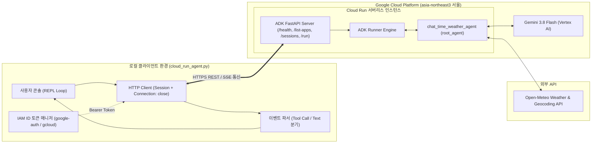
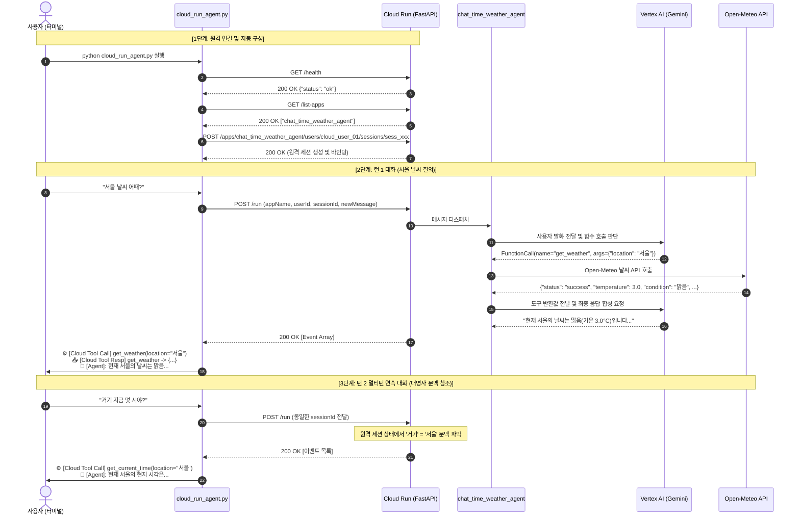

# Google Cloud Run ADK 에이전트 대화형 클라이언트 가이드

본 문서는 Google Cloud Run에 배포된 ADK 에이전트 서비스(예: `https://adk-default-service-name-1008280623664.asia-northeast3.run.app`)와 원격으로 통신하는 대화형 클라이언트 [`cloud_run_agent.py`](./cloud_run_agent.py)의 시스템 아키텍처 및 동작 구조를 설명합니다.

---

## 1. 개요 및 핵심 개념

Google Agent Development Kit(ADK)로 개발된 에이전트는 컨테이너화되어 Google Cloud Run과 같은 서버리스 클라우드 환경에 손쉽게 배포될 수 있습니다. 배포된 Cloud Run 서비스는 `adk api_server` 규격의 FastAPI 엔드포인트를 외부에 노출합니다.

[`cloud_run_agent.py`](./cloud_run_agent.py)는 임의의 Cloud Run 서비스 URL을 입력받아 원격 에이전트와 실시간 대화를 수행하고, 원격에서 실행되는 도구 호출(Tool Calling) 과정을 콘솔에 시각화해 주는 클라이언트입니다.

> **주요 특징**
> - **유연한 URL 바인딩** : CLI 인자, 환경 변수, 실행 시 대화형 프롬프트 및 대화 도중 `/url` 명령어를 통한 동적 엔드포인트 전환 지원
> - **Cloud Run 네트워크 최적화** : 서버리스 인스턴스의 유휴 연결 리셋으로 인한 `SSLEOFError`를 방지하는 헤더 관리(`Connection: close`)
> - **에이전트 자동 검색 (Auto-Discovery)** : 서버의 `/list-apps` 엔드포인트를 질의하여 배포된 에이전트(예: `chat_time_weather_agent`)를 자동 감지 및 연결
> - **IAM 인증 지원 (`--auth`)** : 비공개(Private) Cloud Run 서비스에 대한 Google Cloud ID 토큰 자동 발급 및 Bearer 인증 지원
> - **듀얼 모드 통신** : 동기식 REST 모드(`/run`) 및 실시간 SSE 스트리밍 모드(`/run_sse`)

---

## 2. 전체 시스템 아키텍처



---

## 3. 대화 세션 및 턴 실행 시퀀스 다이어그램



---

## 4. 핵심 엔드포인트 명세

| 메서드 | 엔드포인트 경로 | 역할 및 설명 |
|---|---|---|
| `GET` | `/health` | Cloud Run 서비스 상태 및 헬스체크 확인 |
| `GET` | `/list-apps` | 해당 Cloud Run 서비스에 배포된 ADK 에이전트 목록 조회 |
| `POST` | `/apps/{app}/users/{user}/sessions/{sid}` | 원격 세션 생성 및 대화 이력 메모리 공간 할당 |
| `POST` | `/run` | 동기식 질의 실행 (전체 실행 이벤트 목록을 배열로 반환) |
| `POST` | `/run_sse` | SSE 스트리밍 질의 실행 (`data: {...}` 라인 단위 실시간 스트리밍) |

---

## 5. 실행 방법 및 명령어 안내

### 1) 실행 방법

```bash
# 방법 1: 기본 실행 (URL 입력 프롬프트에서 엔터 입력 시 기본 Cloud Run 서비스로 연결)
python part02_architecture/adk-based_Agent/cloud_run_agent.py

# 방법 2: 명령줄 인자로 Cloud Run URL 지정
python part02_architecture/adk-based_Agent/cloud_run_agent.py \
  --url https://adk-default-service-name-1008280623664.asia-northeast3.run.app

# 방법 3: 실시간 SSE 스트리밍 모드로 실행
python part02_architecture/adk-based_Agent/cloud_run_agent.py --stream

# 방법 4: 비공개(Private) Cloud Run 서비스를 위한 IAM ID 토큰 인증 모드
python part02_architecture/adk-based_Agent/cloud_run_agent.py --auth
```

### 2) CLI 옵션 플래그
* `--url`, `-u`: 접속할 Cloud Run 서비스 URL (기본값: `https://adk-default-service-name-1008280623664.asia-northeast3.run.app`)
* `--app`, `-a`: 대상 에이전트 앱 이름 (지정하지 않을 경우 `/list-apps` 결과에서 자동 선택)
* `--user`: 세션 추적용 사용자 ID (기본값: `cloud_user_01`)
* `--stream`: 기본 통신을 Server-Sent Events(SSE) 스트리밍 모드로 설정
* `--auth`: 비공개 Cloud Run 서비스 접근을 위한 Google Cloud ID Token 첨부
* `--quiet`: 도구 호출 세부 정보를 숨기고 최종 에이전트 답변만 출력

### 3) 대화 중 지원 슬래시(/) 명령어
| 명령어 | 기능 설명 |
|---|---|
| `/new` 또는 `/reset` | 현재 세션을 초기화하고 새 대화 세션 시작 |
| `/url <새_URL>` | 대화 중 다른 Cloud Run 서비스 URL로 즉시 전환 |
| `/stream` | 동기 모드(`/run`)와 스트리밍 모드(`/run_sse`) 간 토글 |
| `/apps` | 현재 Cloud Run 서비스에 배포된 에이전트 애플리케이션 목록 조회 |
| `/help` | 사용 가능한 명령어 도움말 표시 |
| `exit` 또는 `quit` | 클라이언트 종료 |

---

## 6. 실제 동작 검증 로그 (서울 리전 Cloud Run 인스턴스)

다음은 실제 배포된 Cloud Run 서비스와 대화한 콘솔 로그입니다:

```text
============================================================================
  ☁️  Google Cloud Run ADK Agent — Interactive Client
============================================================================
  • Service URL : https://adk-default-service-name-1008280623664.asia-northeast3.run.app
  • GCP Region  : asia-northeast3
  • Active App  : chat_time_weather_agent
  • User ID     : cloud_user_01
  • Mode        : REST Sync (/run)
============================================================================
🔍 Connecting to Cloud Run service... ✅ Online (HTTP 200 OK)
📦 Deployed Apps : ['chat_time_weather_agent'] (Selected: chat_time_weather_agent)
🔑 Active Session: sess_fd018383

[Available Commands]:
  /new or /reset : Start a new conversation session
  /url <new_url> : Switch to a different Cloud Run service URL
  /stream        : Toggle SSE streaming mode on/off
  /apps          : Query available agent apps on the service
  /help          : Show this command menu
  exit or quit   : Exit the interactive client
----------------------------------------------------------------------------

🧑 [You] > 서울 날씨 어때?
  ⚙️  [Cloud Tool Call] get_weather({"location": "서울"})
  📥 [Cloud Tool Resp] get_weather -> {'status': 'success', 'location': 'Seoul, South Korea', 'latitude': 37.566, 'longitude': 126.9784, 'condition': '맑음', 'temperature': 3.0, ...}

🤖 [chat_time_weather_agent]:
현재 서울의 날씨 정보입니다.

- **날씨 상태**: 맑음 ☀️
- **현재 기온**: 3.0°C (체감 온도: -1.4°C)
- **습도**: 53%
- **풍속**: 10.8 km/h

맑은 날씨지만 바람이 불어 체감 온도가 영하권으로 떨어져 있으니, 외출 시 따뜻하게 챙겨 입으시기 바랍니다!

🧑 [You] > 거기 지금 몇 시야?
  ⚙️  [Cloud Tool Call] get_current_time({"location": "서울"})
  📥 [Cloud Tool Resp] get_current_time -> {'status': 'success', 'location': 'Seoul, South Korea', 'current_time': '2026-11-19 16:43:00 KST', ...}

🤖 [chat_time_weather_agent]:
현재 서울의 시각은 2026년 11월 19일 오후 4시 43분(KST)입니다.

🧑 [You] > exit
Exiting Cloud Run client. Goodbye!
```

---

## 7. 트러블슈팅 가이드

1. **`SSLEOFError` 또는 `Connection reset by peer` 발생 시**:
   - Cloud Run의 유휴 인스턴스 소켓 만료로 인한 문제입니다. `cloud_run_agent.py`는 `Connection: close` 헤더를 기본 적용하여 매 요청마다 깨끗한 SSL 핸드셰이크를 보장합니다.
2. **첫 번째 요청 시 지연(Cold Start)**:
   - Cloud Run 컨테이너 인스턴스가 0개에서 1개로 확장되는 콜드 스타트 중에는 약 5~10초의 대기 시간이 발생할 수 있습니다. 정상 동작이므로 기다리시면 응답이 수신됩니다.
3. **HTTP 401 Unauthorized / HTTP 403 Forbidden**:
   - Cloud Run 서비스가 미인증 호출을 허용하지 않는 비공개 상태입니다. `--auth` 플래그를 추가하여 `python cloud_run_agent.py --auth`로 실행하십시오. (`gcloud auth login` 필요)

---

## 8. 관련 파일 링크
- 📄 [cloud_run_agent.py](./cloud_run_agent.py) : Cloud Run 인터랙티브 클라이언트 소스 코드
- 📄 [chat_time_weather_agent/agent.py](./chat_time_weather_agent/agent.py) : Cloud Run에 배포된 백엔드 에이전트 소스 코드
- 📄 [chat_time_weather_agent_client.py](./chat_time_weather_agent_client.py) : 로컬 `adk api_server`용 인터랙티브 클라이언트

