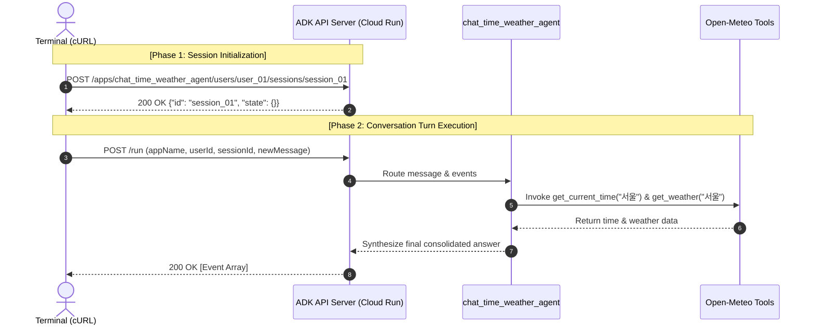

# Google Cloud Run ADK Agent cURL Integration & Troubleshooting Guide

This document details the standard calling conventions for querying the deployed Google Cloud Run ADK agent service (`https://adk-default-service-name-1008280623664.asia-northeast3.run.app`) or a local `adk api_server` (`http://127.0.0.1:8000`) using `curl` with the prompt **"서울 날씨와 시간은"** (Seoul weather and time). It also provides an in-depth root cause analysis and resolution for the common Windows terminal error `{"detail":"There was an error parsing the body"}`.

---

## 1. ADK Two-Step Communication Protocol Overview

Google ADK's backend API server follows a session-oriented architecture. To ensure conversational state and memory context are properly tracked, **Session Creation** must precede **Turn Execution**.



---

## 2. Root Cause Analysis: `{"detail":"There was an error parsing the body"}`

### Why It Occurs
In **Windows environments** (Git Bash, PowerShell, Command Prompt), passing a multiline JSON string wrapped in single quotes (`'`) to `curl -d` triggers argument distortion:

```bash
# ❌ Problematic command in Windows shells
curl -X POST "https://.../run" \
  -H "Content-Type: application/json" \
  -d '{
    "appName": "chat_time_weather_agent",
    ...
  }'
```

Because the Windows command-line argument parser does not treat single quotes as literal string delimiters, nested double quotes (`"`) and carriage-return newlines (`\r\n`) are stripped or mangled before `curl.exe` dispatches the payload over the network. Consequently, the FastAPI (Pydantic) server fails to decode the malformed JSON, responding with **`422 Unprocessable Entity`** or **`{"detail":"There was an error parsing the body"}`**.

---

## 3. Proven Solutions (Three Approaches)

### [Solution 1] Send Payload via a File (`-d @body.json`) — 🌟 Recommended

Using a file completely bypasses command-line quote escaping and character encoding issues on Windows.

```bash
# 1. Prerequisite: Create the session (run once)
curl -s -X POST "https://adk-default-service-name-1008280623664.asia-northeast3.run.app/apps/chat_time_weather_agent/users/user_01/sessions/session_01" \
  -H "Content-Type: application/json" \
  -d "{}"

# 2. Write the JSON payload to body.json
cat << 'EOF' > body.json
{
  "appName": "chat_time_weather_agent",
  "userId": "user_01",
  "sessionId": "session_01",
  "newMessage": {
    "role": "user",
    "parts": [
      {"text": "서울 날씨와 시간은"}
    ]
  }
}
EOF

# 3. Transmit payload using -d @body.json
curl -X POST "https://adk-default-service-name-1008280623664.asia-northeast3.run.app/run" \
  -H "Content-Type: application/json; charset=utf-8" \
  -d @body.json
```

---

### [Solution 2] Inline Command with Escaped Quotes (`\"`)

Convenient when you want to execute a single command directly in Git Bash or CMD without saving a temporary file:

```bash
curl -X POST "https://adk-default-service-name-1008280623664.asia-northeast3.run.app/run" \
  -H "Content-Type: application/json; charset=utf-8" \
  -d "{\"appName\":\"chat_time_weather_agent\",\"userId\":\"user_01\",\"sessionId\":\"session_01\",\"newMessage\":{\"role\":\"user\",\"parts\":[{\"text\":\"서울 날씨와 시간은\"}]}}"
```

---

### [Solution 3] One-Line Python Invocation

Bypasses all shell quoting and locale encoding quirks, directly returning the agent's synthesized response text:

```bash
python -c "import requests; print(requests.post('https://adk-default-service-name-1008280623664.asia-northeast3.run.app/run', json={'appName':'chat_time_weather_agent','userId':'user_01','sessionId':'session_01','newMessage':{'role':'user','parts':[{'text':'서울 날씨와 시간은'}]}}).text)"
```

---

## 4. Windows PowerShell Native Calling Method

When working in Windows PowerShell, using `Invoke-RestMethod` is much more reliable than `curl.exe`:

```powershell
$url = "https://adk-default-service-name-1008280623664.asia-northeast3.run.app"

# 1. Initialize session
Invoke-RestMethod -Uri "$url/apps/chat_time_weather_agent/users/user_01/sessions/session_01" `
  -Method Post -ContentType "application/json" -Body '{"state":{}}'

# 2. Build JSON payload
$body = @{
    appName = "chat_time_weather_agent"
    userId = "user_01"
    sessionId = "session_01"
    newMessage = @{
        role = "user"
        parts = @(@{ text = "서울 날씨와 시간은" })
    }
} | ConvertTo-Json -Depth 5

# 3. Transmit request and extract final response text
$resp = Invoke-RestMethod -Uri "$url/run" -Method Post -ContentType "application/json" -Body ([System.Text.Encoding]::UTF8.GetBytes($body))
$resp.content.parts | ForEach-Object { if ($_.text) { $_.text } }
```

---

## 5. Real-Time Streaming (SSE) Invocation (`/run_sse`)

To observe the agent executing tools and streaming text tokens progressively line-by-line, invoke `POST /run_sse` with the `curl -N` (no-buffer) flag:

```bash
curl -N -X POST "https://adk-default-service-name-1008280623664.asia-northeast3.run.app/run_sse" \
  -H "Content-Type: application/json; charset=utf-8" \
  -d @body.json
```

---

## 6. Live Response Verification (Seoul Region Cloud Run Instance)

When invoked correctly, the Cloud Run agent triggers both `get_current_time` and `get_weather` for Seoul, returning the following output:

```text
현재 서울의 최신 시각과 날씨 정보입니다.

### 🕒 현재 시각
- 현지 시각: 2026년 11월 19일 17:20:35 (KST)

### 🌤️ 현재 날씨
- 날씨 상태: 맑음
- 기온: 2.4°C (체감 온도: -1.8°C)
- 습도: 56%
- 풍속: 9.7 km/h

맑은 날씨이나 체감 온도는 영하로 내려가 있으니 외출 시 따뜻하게 입으세요!
```

---

## 7. Related File Links
- 📄 [chat_time_weather_agent_client.py](./chat_time_weather_agent_client.py): Interactive client for local `adk api_server`
- 📄 [cloud_run_agent.py](./cloud_run_agent.py): Dedicated interactive client for Cloud Run
- 📄 [Cloud_run_Deployment-EN.md](./Cloud_run_Deployment-EN.md): Google Cloud Run deployment guide

