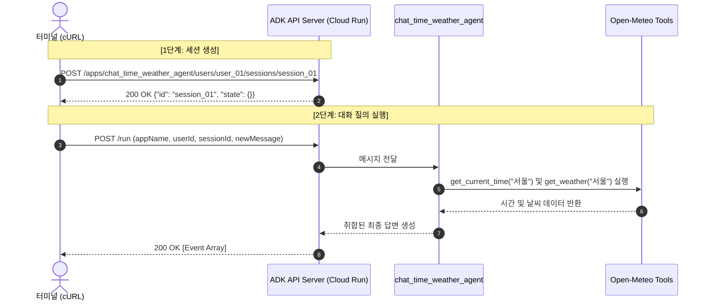

# Google Cloud Run ADK 에이전트 cURL 연동 및 트러블슈팅 가이드

본 문서는 Google Cloud Run에 배포된 ADK 에이전트 서비스(`https://adk-default-service-name-1008280623664.asia-northeast3.run.app`) 또는 로컬 `adk api_server`(`http://127.0.0.1:8000`)에 `curl` 명령어로 **"서울 날씨와 시간은"** 질의를 전송하는 표준 호출 규격과, Windows 터미널에서 자주 발생하는 본문 파싱 에러(`There was an error parsing the body`)의 원인 및 해결 방법을 정리한 가이드입니다.

---

## 1. ADK 2단계 통신 프로토콜 개요

Google ADK의 백엔드 API 서버는 세션 기반 아키텍처를 채택하고 있습니다. 따라서 대화 턴을 실행하기 전에 **세션 생성**이 선행되어야 안전하게 처리됩니다.



---

## 2. 발생 에러 분석: `{"detail":"There was an error parsing the body"}`

### 원인 분석
Git Bash, PowerShell, CMD 등 **Windows 환경의 터미널**에서 아래와 같이 작은따옴표(`'`)로 감싼 멀티라인 JSON을 `curl -d`에 직접 전달하면:

```bash
# ❌ Windows 환경에서 오류를 유발하는 구문
curl -X POST "https://.../run" \
  -H "Content-Type: application/json" \
  -d '{
    "appName": "chat_time_weather_agent",
    ...
  }'
```

Windows의 명령행 파서(Command Line Parser)는 작은따옴표를 문자열 리터럴로 취급하지 않기 때문에, 내부의 큰따옴표(`"`)와 줄바꿈(CRLF) 문자가 깨지거나 벗겨진 상태로 서버에 전달됩니다. 그 결과 FastAPI(Pydantic) 백엔드가 JSON 디코딩에 실패하여 **`422 Unprocessable Entity`** 또는 **`{"detail":"There was an error parsing the body"}`** 에러를 반환합니다.

---

## 3. 완벽한 해결 방법 (3가지 패턴)

### [해결 방법 1] 임시 JSON 파일 전송 (`-d @body.json`) — 🌟 가장 추천

따옴표 인코딩 충돌을 원천 차단하는 가장 깔끔하고 안전한 방법입니다.

```bash
# 1. 선행 작업: 세션 등록 (최초 1회)
curl -s -X POST "https://adk-default-service-name-1008280623664.asia-northeast3.run.app/apps/chat_time_weather_agent/users/user_01/sessions/session_01" \
  -H "Content-Type: application/json" \
  -d "{}"

# 2. 전송할 JSON 페이로드 파일 생성
cat << 'EOF' > body.json
{
  "appName": "chat_time_weather_agent",
  "userId": "user_01",
  "sessionId": "session_01",
  "newMessage": {
    "role": "user",
    "parts": [
      {"text": "서울 날씨와 시간은"}
    ]
  }
}
EOF

# 3. 파일(@body.json)을 통한 질의 전송
curl -X POST "https://adk-default-service-name-1008280623664.asia-northeast3.run.app/run" \
  -H "Content-Type: application/json; charset=utf-8" \
  -d @body.json
```

---

### [해결 방법 2] 큰따옴표를 이스케이프(`\"`)한 한 줄 명령어

별도의 파일 생성 없이 터미널에서 즉시 실행하고자 할 때 유용합니다.

```bash
curl -X POST "https://adk-default-service-name-1008280623664.asia-northeast3.run.app/run" \
  -H "Content-Type: application/json; charset=utf-8" \
  -d "{\"appName\":\"chat_time_weather_agent\",\"userId\":\"user_01\",\"sessionId\":\"session_01\",\"newMessage\":{\"role\":\"user\",\"parts\":[{\"text\":\"서울 날씨와 시간은\"}]}}"
```

---

### [해결 방법 3] Python 한 줄 스크립트 실행

Windows 환경의 인코딩(CP949 vs UTF-8) 문제를 완벽히 우회하여 에이전트의 응답 텍스트만 깔끔하게 확인할 수 있습니다.

```bash
python -c "import requests; print(requests.post('https://adk-default-service-name-1008280623664.asia-northeast3.run.app/run', json={'appName':'chat_time_weather_agent','userId':'user_01','sessionId':'session_01','newMessage':{'role':'user','parts':[{'text':'서울 날씨와 시간은'}]}}).text)"
```

---

## 4. Windows PowerShell 전용 호출 방법

PowerShell에서는 `curl.exe` 대신 기본 내장 cmdlet인 `Invoke-RestMethod`를 사용하는 것이 권장됩니다:

```powershell
$url = "https://adk-default-service-name-1008280623664.asia-northeast3.run.app"

# 1. 세션 생성
Invoke-RestMethod -Uri "$url/apps/chat_time_weather_agent/users/user_01/sessions/session_01" `
  -Method Post -ContentType "application/json" -Body '{"state":{}}'

# 2. 질의 요청 생성
$body = @{
    appName = "chat_time_weather_agent"
    userId = "user_01"
    sessionId = "session_01"
    newMessage = @{
        role = "user"
        parts = @(@{ text = "서울 날씨와 시간은" })
    }
} | ConvertTo-Json -Depth 5

# 3. 요청 전송 및 텍스트 응답 추출
$resp = Invoke-RestMethod -Uri "$url/run" -Method Post -ContentType "application/json" -Body ([System.Text.Encoding]::UTF8.GetBytes($body))
$resp.content.parts | ForEach-Object { if ($_.text) { $_.text } }
```

---

## 5. 실시간 스트리밍(SSE) 모드 호출 (`/run_sse`)

에이전트가 도구를 호출하고 텍스트를 실시간으로 한 줄씩 생성하는 과정을 확인하려면 `POST /run_sse`와 `curl -N` (버퍼링 끄기) 플래그를 사용합니다:

```bash
curl -N -X POST "https://adk-default-service-name-1008280623664.asia-northeast3.run.app/run_sse" \
  -H "Content-Type: application/json; charset=utf-8" \
  -d @body.json
```

---

## 6. 실제 Cloud Run 서비스 반환 결과

정상적으로 전송되면 Cloud Run의 에이전트가 서울의 **현지 시각(`get_current_time`)** 및 **기상 정보(`get_weather`)** 도구를 내부에서 실행하고 종합된 최종 결과를 반환합니다:

```text
현재 서울의 최신 시각과 날씨 정보입니다.

### 🕒 현재 시각
- 현지 시각: 2026년 11월 19일 17:20:35 (KST)

### 🌤️ 현재 날씨
- 날씨 상태: 맑음
- 기온: 2.4°C (체감 온도: -1.8°C)
- 습도: 56%
- 풍속: 9.7 km/h

맑은 날씨이나 체감 온도는 영하로 내려가 있으니 외출 시 따뜻하게 입으세요!
```

---

## 7. 관련 파일 링크
- 📄 [chat_time_weather_agent_client.py](./chat_time_weather_agent_client.py) : 로컬 API 서버용 대화형 클라이언트
- 📄 [cloud_run_agent.py](./cloud_run_agent.py) : Cloud Run 전용 대화형 터미널 클라이언트
- 📄 [Cloud_run_Deployment-KR.md](./Cloud_run_Deployment-KR.md) : Google Cloud Run 배포 가이드

