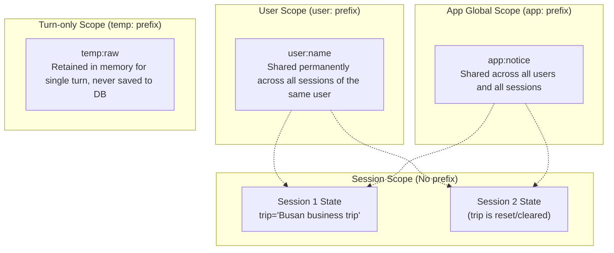
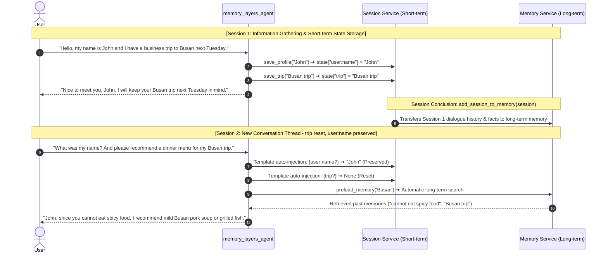

# memory_layers_agent — Dual-Layer Memory (Session Short-Term vs Memory Long-Term) Guide

`part02_architecture/adk-based_Agent/memory_layers_agent` is an intelligent agent package designed to demonstrate and verify the **Dual-Layer Memory** architecture in the Google Agent Development Kit (ADK).

It seamlessly combines the **Session Service (short-term memory)**, which manages active conversation threads and transient states, with the **Memory Service (long-term memory)**, which accumulates and retrieves user facts and past experiences across sessions, enabling continuous, personalized multi-turn interactions.

> **Related Lecture Note**: Part 2 · 02. Google ADK Architecture (Slide 29: Dual-Layer Memory)

---

## 1. Dual-Layer Memory Comparison Matrix

| Dimension | Session Service (Short-term Memory) | Memory Service (Long-term Memory) |
|---|---|---|
| **Storage Scope** | Active conversation threads and transient session state | Persistent user facts, preferences, and knowledge across sessions |
| **Data Stored** | Message history, tool calls/responses, Session State | Structured user profile, conversation summaries, past events & preferences |
| **Lifecycle** | Destroyed when conversation ends (persisted in DB if using Database session) | Persisted permanently regardless of process restart or session completion |
| **Backend Implementations** | `InMemorySessionService`, `DatabaseSessionService`, `VertexAiSessionService` | `InMemoryMemoryService`, `VertexAiMemoryBankService` |
| **Agent Access Method** | • Automatic conversation event history injection<br>• `{key?}` instruction template substitution<br>• Direct read/write via `tool_context.state` in tools | • `preload_memory`: Automatic per-turn pre-retrieval based on user query<br>• `load_memory`: Active retrieval tool called on-demand by the LLM |

---

## 2. Session State Variable Prefix Rules

In Google ADK, the storage scope and isolation boundary of Session State variables (`tool_context.state`) are strictly controlled by their key **prefixes**:



1. **`user:<key>`** (e.g., `user:name`):
   - **User Scope**: Automatically shared and preserved across **all conversation sessions** created by the same user (`user_id`).
   - Ideal for storing permanent profile attributes such as user name, language preferences, and job role.
2. **No prefix** (e.g., `trip`):
   - **Session Scope**: Valid only within that specific conversation session (`session_id`). Completely reset when a new session starts.
   - Ideal for transient context such as one-off itinerary plans, temporary calculations, or an in-progress order ID.
3. **`app:<key>`** (e.g., `app:notice`):
   - **Application Global Scope**: Shared globally across all users and all sessions within the application namespace (`app_name`).
4. **`temp:<key>`** (e.g., `temp:raw`):
   - **Invocation Turn Scope**: Kept in memory temporarily only during a single invocation turn; never persisted to persistent storage (DB).

---

## 3. `memory_layers_agent` Architecture and Mechanics

`memory_layers_agent` combines instruction template substitution and dedicated tools (custom and built-in) to harness both memory layers naturally.



### ① Instruction Template
```python
instruction="""
You are a personal assistant.
[Short-term: Current Session State]
  User name: {user:name?}
  Current session plan: {trip?}
Rules:
1) When the user mentions their name, call save_profile. When they mention business trip or travel plans, call save_trip.
2) For past information not in the current session State (food preferences, plans from past conversations, etc.),
   check automatically provided past memories first. If insufficient, search using load_memory.
   Use single concise keywords without extra particles for load_memory search queries (e.g., "spicy", "Busan", "business trip").
3) If information is not in memory either, state that you do not know. Do not make things up.
4) Keep responses concise in 2 to 3 sentences.
"""
```
- **`{user:name?}`**: If `user:name` exists in Session State, its value is injected; if absent, the question mark (`?`) safely substitutes it with an empty string.
- **`{trip?}`**: Automatically injects plan details recorded in the current session into the prompt.

### ② Tool Configuration
1. **`save_profile(name: str, tool_context: ToolContext) -> dict`**:
   - `tool_context.state["user:name"] = name`
   - Stores the user's name under the `user:` prefix State, instantly making it accessible across other sessions of the same user.
2. **`save_trip(trip: str, tool_context: ToolContext) -> dict`**:
   - `tool_context.state["user:trip"] = trip` and `tool_context.state["trip"] = trip`
   - Stores trip plans under the user-scoped State (`user:trip`) to persist them across sessions in SQLite DB (`session.db`). The agent retains the trip even when the CLI is restarted.
3. **`save_to_memory(tool_context: ToolContext) -> dict`**:
   - `await tool_context.add_session_to_memory()`
   - Transfers the current session events and details to long-term memory (Memory Service) when the user asks to persist or remember plans permanently.
4. **`preload_memory`** (ADK Built-in Tool):
   - Automatically queries the Memory Service each turn using keywords extracted from the user's query and injects the retrieved context into the prompt.
4. **`load_memory`** (ADK Built-in Tool):
   - Actively queried by the LLM on-demand when it determines that additional past context (food preferences, historical decisions, etc.) is needed.

---

## 4. File Structure and Roles

```text
part02_architecture/adk-based_Agent/memory_layers_agent/
├── __init__.py           # Exposes agent module (from . import agent)
├── agent.py              # Defines save_profile, save_trip tools, instruction, and root_agent
├── README-KR.md          # Detailed Korean manual
└── README-EN.md          # Detailed English manual (this document)
```

- **`agent.py`**:
  - Configured with `model=os.getenv("ADK_MODEL", "gemini-3.8-flash")`
  - Defines the `root_agent` instance according to Google ADK standards, allowing direct execution via `adk run`, `adk web`, or programmatic Python Runners.

---

## 5. Environment Configuration (`.env`)

Configure your `.env` file in the parent directory (`part02_architecture` or the project root):

```env
# Vertex AI Express Mode (Keys starting with AQ.)
GOOGLE_GENAI_USE_VERTEXAI=TRUE
GOOGLE_CLOUD_PROJECT=ssu-agent-vertex-509708
GOOGLE_CLOUD_LOCATION=global
GOOGLE_API_KEY=AQ.Ab8RN6...
GEMINI_API_KEY=AQ.Ab8RN6...

# Or standard Google AI Studio Key (Keys starting with AIza...)
# GOOGLE_GENAI_USE_VERTEXAI=FALSE
# GEMINI_API_KEY=AIzaSy...

# Gemini Model Selection
ADK_MODEL=gemini-3.8-flash
```

---

## 6. Execution and Verification Methods

### Method 1: Terminal Interactive CLI Mode (`adk run`)
Run the agent interactively from the command line inside `part02_architecture/adk-based_Agent`:

```bash
# 1. Navigate to adk-based_Agent directory
cd "part02_architecture/adk-based_Agent"

# 2. Run agent
adk run memory_layers_agent
```

**Example Conversation**:
```text
User: Hello, my name is John and I have a business trip to Busan next Tuesday.
Agent: Nice to meet you, John. I will keep your business trip to Busan next Tuesday in mind.
```

---

### Method 2: Web Development UI Environment (`adk web`)
Inspect session State variable changes, tool invocations, and real-time event streams via a browser interface:

```bash
cd "part02_architecture/adk-based_Agent"
adk web --port 8008
```

1. Open `http://localhost:8008` in your browser.
2. Select **`memory_layers_agent`** from the top-left dropdown.
3. Conduct a conversation while monitoring `tool_context.state` updates (`user:name`, `trip`) in the right-side inspection panel.

---

### Method 3: Multi-Layer Dedicated Verification Script (`run_memory_layers.py`)
`part02_architecture/Direct_ADK/run_memory_layers.py` rigorously verifies the lifecycle of short-term sessions and long-term memory transitions through code:

```bash
# Run from part02_architecture directory

# 1) Offline mode: Verify State scopes and memory retrieval mechanisms via Service API without LLM calls
uv run Direct_ADK/run_memory_layers.py offline

# 2) LLM integration mode: Session 1 persistence ➔ Long-term memory transfer ➔ Session 2 retrieval via Gemini
uv run Direct_ADK/run_memory_layers.py llm

# 3) Run all modes (default)
uv run Direct_ADK/run_memory_layers.py all
```

---

### Method 4: Standalone Python Script for Multi-Session Verification

Verify state transitions across two consecutive sessions using `InMemorySessionService` and `InMemoryMemoryService`:

```python
import asyncio
from google.adk.sessions import InMemorySessionService
from google.adk.memory import InMemoryMemoryService
from common.runner_util import Session
from part02_architecture.adk-based_Agent.memory_layers_agent.agent import root_agent

async def main():
    session_service = InMemorySessionService()
    memory_service = InMemoryMemoryService()
    app, user = "memory_layers", "user_01"

    # [Session 1] Provide profile, short-term itinerary, and food preferences
    print("=== [Session 1] Conversation Started ===")
    s1 = Session(root_agent, app_name=app, user_id=user, 
                 session_service=session_service, memory_service=memory_service)
    await s1.send("Hello, I am John. I cannot eat spicy food, and I have a business trip to Busan next Tuesday.")
    
    # Transfer Session 1 dialogue to long-term memory upon session completion
    current_s1 = await s1.get_session()
    await memory_service.add_session_to_memory(current_s1)
    print("Session 1 State:", {k: v for k, v in current_s1.state.items() if not k.startswith("_")})

    # [Session 2] Start a new conversation thread (trip resets, user:name is retained)
    print("\n=== [Session 2] New Conversation Started ===")
    s2 = Session(root_agent, app_name=app, user_id=user, 
                 session_service=session_service, memory_service=memory_service)
    
    # Include 'Busan' keyword to trigger preload_memory match
    res = await s2.send("What was my name? And please recommend a dinner menu for my business trip to Busan.")
    print("Session 2 Agent Response:", res)
    print("Session 2 State:", {k: v for k, v in (await s2.get_session()).state.items() if not k.startswith("_")})

if __name__ == "__main__":
    asyncio.run(main())
```

---

## 7. Troubleshooting and FAQ

| Symptom | Root Cause | Resolution |
|---|---|---|
| **User name not retained in a new session** | Saved without the `user:` prefix, or session service instance was recreated | Ensure the `save_profile` tool assigns to `tool_context.state["user:name"]`. |
| **Past preferences (e.g., spicy food intolerance) forgotten in a new session** | `memory_service.add_session_to_memory(s1)` was not called at the conclusion of Session 1 | Ensure the session completion lifecycle properly invokes `add_session_to_memory`. |
| **`InMemoryMemoryService` search returns empty** | The `InMemory` implementation performs **exact substring keyword matching** | Ensure the user query contains the exact keyword (e.g., "Busan", "spicy") stored in memory. In production, use `VertexAiMemoryBankService` for semantic vector search. |
| **404 NOT_FOUND error on Vertex AI calls** | `gemini-3.8-flash` requests were routed to a regional endpoint (e.g., `us-central1`) | Set `GOOGLE_CLOUD_LOCATION=global` in your `.env` file. |
