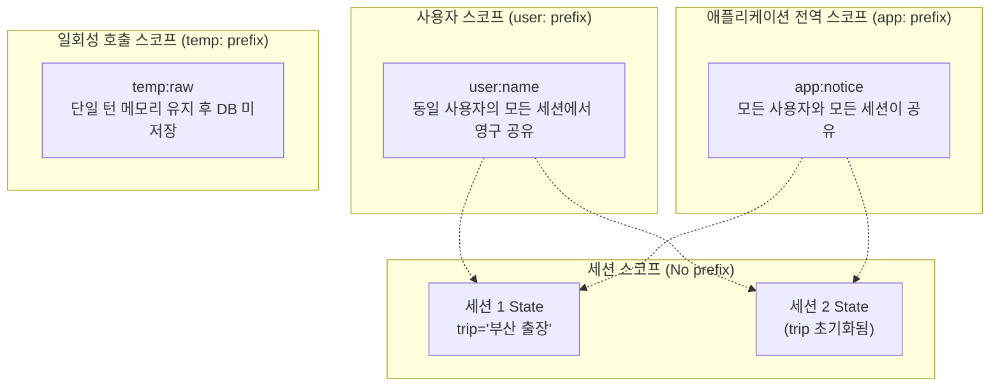
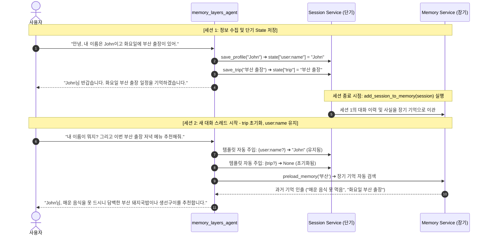

# memory_layers_agent — 이중 계층 메모리(Session 단기 vs Memory 장기) 가이드

`part02_architecture/adk-based_Agent/memory_layers_agent` 프로젝트는 Google Agent Development Kit (ADK)의 **이중 계층 메모리(Dual-Layer Memory)** 아키텍처를 구현하고 실습하기 위한 에이전트 패키지입니다.

대화 스레드 단위의 일시적 작업 상태를 관리하는 **Session Service (단기 메모리)**와, 여러 세션을 넘나들며 영구적인 사용자 지식과 과거 경험을 축적·검색하는 **Memory Service (장기 메모리)**를 상호 결합하여 개인화된 연속 대화를 수행합니다.

> **관련 강의노트**: Part 2 · 02. Google ADK 아키텍처 (슬라이드 29: 이중 계층 메모리)

---

## 1. 이중 계층 메모리 비교 매트릭스

| 비교 차원 | Session Service (단기 메모리) | Memory Service (장기 메모리) |
|---|---|---|
| **저장 범위 (Scope)** | 활성 대화 스레드 및 세션 임시 상태 | 세션을 넘어서는 영속적인 사용자 사실·선호·지식 |
| **저장 데이터 (Data)** | 대화 메시지 이력, 도구 호출/반환값, Session State | 구조화된 사용자 프로필, 대화 요약, 과거 사건 및 선호도 |
| **생명주기 (Lifecycle)** | 대화 스레드 종료 시 소멸 (DB 영속화 시 세션 키로 보존) | 프로세스 재시작이나 세션 종료와 무관하게 영구 보존 |
| **백엔드 구현체** | `InMemorySessionService`, `DatabaseSessionService`, `VertexAiSessionService` | `InMemoryMemoryService`, `VertexAiMemoryBankService` |
| **에이전트 접근 방식** | • 대화 이벤트 이력 자동 주입<br>• `{key?}` 지시문(Instruction) 템플릿 치환<br>• 도구 내부 `tool_context.state` 직접 입출력 | • `preload_memory`: 매 턴 사용자 질의어 기반 자동 사전 검색<br>• `load_memory`: LLM이 필요 시 능동적으로 호출하는 검색 도구 |

---

## 2. Session State 변수 접두사(Prefix) 규칙

ADK의 Session State(`tool_context.state`)는 딕셔너리 키의 **접두사(Prefix)**에 따라 저장 범위와 공유 스코프가 엄격하게 제어됩니다:



1. **`user:<key>`** (예: `user:name`):
   - **사용자 스코프**: 동일한 사용자(`user_id`)가 생성한 **모든 세션 간에 자동 공유 및 유지**됩니다.
   - 사용자 이름, 언어 선호도, 직책 등 영속적인 개인 프로필 저장에 적합합니다.
2. **접두사 없음** (예: `trip`):
   - **세션 스코프**: 해당 대화 세션(`session_id`) 내부에서만 유효합니다. 새 세션이 시작되면 완전히 초기화됩니다.
   - 특정 대화의 일회성 여행 계획, 현재 처리 중인 주문 번호 등 임시 컨텍스트에 적합합니다.
3. **`app:<key>`** (예: `app:notice`):
   - **애플리케이션 전역 스코프**: 애플리케이션(`app_name`) 내의 모든 사용자와 모든 세션이 공유하는 전역 설정값입니다.
4. **`temp:<key>`** (예: `temp:raw`):
   - **일회성 호출 스코프**: 단일 호출 턴(Turn) 동안만 메모리에 임시 유지되며, 세션 저장소(DB)에 영구 기록되지 않습니다.

---

## 3. `memory_layers_agent` 구조 및 동작 메커니즘

`memory_layers_agent`는 지시문(Instruction) 템플릿과 전용 도구(Custom Tools + Built-in Tools)를 결합하여 두 메모리 계층을 자연스럽게 활용합니다.



### ① 지시문(Instruction) 템플릿
```python
instruction="""
You are a personal assistant.
[Short-term: Current Session State]
  User name: {user:name?}
  Current session plan: {trip?}
Rules:
1) When the user mentions their name, call save_profile. When they mention business trip or travel plans, call save_trip.
2) For past information not in the current session State (food preferences, plans from past conversations, etc.),
   check automatically provided past memories first. If insufficient, search using load_memory.
   Use single concise keywords without extra particles for load_memory search queries (e.g., "spicy", "Busan", "business trip").
3) If information is not in memory either, state that you do not know. Do not make things up.
4) Keep responses concise in 2 to 3 sentences.
"""
```
- **`{user:name?}`**: 세션 State에 `user:name`이 있으면 값을 주입하고, 없으면 물음표(`?`) 문법에 따라 빈 문자열로 안전하게 치환됩니다.
- **`{trip?}`**: 현재 세션 State에 등록된 일정 정보를 프롬프트에 자동으로 주입합니다.

### ② 도구 구성 (Tools)
1. **`save_profile(name: str, tool_context: ToolContext) -> dict`**:
   - `tool_context.state["user:name"] = name`
   - 사용자 이름을 `user:` 접두사 State로 저장하여 다른 세션에서도 즉시 공유됩니다.
2. **`save_trip(trip: str, tool_context: ToolContext) -> dict`**:
   - `tool_context.state["user:trip"] = trip` 및 `tool_context.state["trip"] = trip`
   - 출장 일정을 사용자 스코프(`user:trip`)로 저장하여 SQLite DB(`session.db`)의 `user_states`에 영구 보존합니다. 따라서 CLI 창을 닫고 다시 실행해도 일정이 유지됩니다.
3. **`save_to_memory(tool_context: ToolContext) -> dict`**:
   - `await tool_context.add_session_to_memory()`
   - 사용자가 "이 일정을 저장해줘", "기억해줘"라고 요청할 때 현재 세션의 전체 대화와 세부 내용을 장기 메모리(Memory Service)로 즉시 이관합니다.
4. **`preload_memory`** (ADK 내장 도구):
   - 매 턴마다 사용자의 입력 문장에 포함된 키워드를 기반으로 Memory Service를 자동 사전 검색하여 프롬프트 컨텍스트에 주입합니다.
4. **`load_memory`** (ADK 내장 도구):
   - LLM이 답변 생성 중 추가적인 과거 기억(음식 취향, 과거 이력 등)이 더 필요하다고 판단할 때 능동적으로 장기 기억을 검색합니다.

---

## 4. 파일 구성 및 역할

```text
part02_architecture/adk-based_Agent/memory_layers_agent/
├── __init__.py           # agent 모듈 노출 (from . import agent)
├── agent.py              # save_profile, save_trip 도구, 지시문 및 root_agent 정의
├── README-KR.md          # 한국어 상세 매뉴얼 (본 문서)
└── README-EN.md          # 영문 상세 매뉴얼
```

- **`agent.py`**:
  - `model=os.getenv("ADK_MODEL", "gemini-3.8-flash")`
  - ADK 규격에 맞게 `root_agent` 객체를 정의하여 `adk run`, `adk web`, Python Runner에서 직접 불러올 수 있도록 구현되어 있습니다.

---

## 5. 실행 환경 설정 (`.env`)

상위 폴더(`part02_architecture` 또는 프로젝트 루트)의 `.env` 파일에 다음과 같이 API 인증 정보를 설정합니다:

```env
# Vertex AI Express Mode (AQ. 로 시작하는 키)
GOOGLE_GENAI_USE_VERTEXAI=TRUE
GOOGLE_CLOUD_PROJECT=ssu-agent-vertex-509708
GOOGLE_CLOUD_LOCATION=global
GOOGLE_API_KEY=AQ.Ab8RN6...
GEMINI_API_KEY=AQ.Ab8RN6...

# 또는 일반 Google AI Studio 키 (AIza... 로 시작하는 키)
# GOOGLE_GENAI_USE_VERTEXAI=FALSE
# GEMINI_API_KEY=AIzaSy...

# 사용할 Gemini 모델
ADK_MODEL=gemini-3.8-flash
```

---

## 6. 실행 및 검증 방법

### 방법 1: 터미널 대화형 인터랙티브 모드 (`adk run`)
`part02_architecture/adk-based_Agent` 디렉터리에서 ADK CLI를 통해 직접 에이전트를 대화형으로 실행합니다:

```bash
# 1. adk-based_Agent 디렉터리로 이동
cd "part02_architecture/adk-based_Agent"

# 2. 에이전트 실행
adk run memory_layers_agent
```

**대화 예시**:
```text
User: Hello, my name is John and I have a business trip to Busan next Tuesday.
Agent: Hello John, nice to meet you. I will keep your business trip to Busan next Tuesday in mind.
```

---

### 방법 2: 웹 GUI 개발 환경 (`adk web`)
브라우저 인터페이스를 통해 세션 State 변수 변화, 도구 호출 내역, 이벤트 스트림을 시각적으로 모니터링합니다:

```bash
cd "part02_architecture/adk-based_Agent"
adk web --port 8008
```

1. 웹 브라우저로 `http://localhost:8008` 접속.
2. 좌측 상단 드롭다운에서 **`memory_layers_agent`** 선택.
3. 대화를 진행하면서 우측 패널에서 `tool_context.state` 갱신 내역(`user:name`, `trip`)을 실시간 확인.

---

### 방법 3: 다중 계층 통합 검증 스크립트 실행 (`run_memory_layers.py`)
`part02_architecture/Direct_ADK/run_memory_layers.py`는 단기 세션의 생명주기와 장기 메모리 전이 과정을 코드로 엄밀하게 증명하는 스크립트입니다:

```bash
# part02_architecture 디렉터리에서 실행

# 1) 오프라인 모드: LLM 호출 없이 Service API 레벨에서 State 스코프와 메모리 검색 메커니즘 검증
uv run Direct_ADK/run_memory_layers.py offline

# 2) LLM 연동 모드: Gemini 모델을 통해 세션 1 저장 ➔ 장기 메모리 이관 ➔ 세션 2 인출 검증
uv run Direct_ADK/run_memory_layers.py llm

# 3) 전체 실행 (기본값)
uv run Direct_ADK/run_memory_layers.py all
```

---

### 방법 4: 독립 파이썬 스크립트 기반 멀티 세션 테스트

`google.adk.sessions.InMemorySessionService`와 `InMemoryMemoryService`를 활용하여 2개의 연속 세션 간 상태 전이를 테스트하는 코드입니다:

```python
import asyncio
from google.adk.sessions import InMemorySessionService
from google.adk.memory import InMemoryMemoryService
from common.runner_util import Session
from part02_architecture.adk-based_Agent.memory_layers_agent.agent import root_agent

async def main():
    session_service = InMemorySessionService()
    memory_service = InMemoryMemoryService()
    app, user = "memory_layers", "user_01"

    # [세션 1] 프로필과 단기 일정 및 음식 취향 전달
    print("=== [세션 1] 대화 시작 ===")
    s1 = Session(root_agent, app_name=app, user_id=user, 
                 session_service=session_service, memory_service=memory_service)
    await s1.send("Hello, I am John. I cannot eat spicy food, and I have a business trip to Busan next Tuesday.")
    
    # 세션 1 종료 시점에 장기 메모리로 대화 이관
    current_s1 = await s1.get_session()
    await memory_service.add_session_to_memory(current_s1)
    print("세션 1 State:", {k: v for k, v in current_s1.state.items() if not k.startswith("_")})

    # [세션 2] 새 대화 스레드 시작 (trip은 사라지고 user:name만 유지됨)
    print("\n=== [세션 2] 새 대화 시작 ===")
    s2 = Session(root_agent, app_name=app, user_id=user, 
                 session_service=session_service, memory_service=memory_service)
    
    # preload_memory 검색을 위해 'Busan' 키워드를 포함하여 질의
    res = await s2.send("What was my name? And please recommend a dinner menu for my business trip to Busan.")
    print("세션 2 에이전트 답변:", res)
    print("세션 2 State:", {k: v for k, v in (await s2.get_session()).state.items() if not k.startswith("_")})

if __name__ == "__main__":
    asyncio.run(main())
```

---

## 7. 트러블슈팅 및 주의사항 (FAQ)

| 현상 | 원인 | 해결 방법 |
|---|---|---|
| **새 세션에서 사용자 이름이 유지되지 않음** | `user:` 접두사 없이 State에 저장되었거나 세션 서비스 인스턴스가 새로 생성됨 | `save_profile` 도구가 `tool_context.state["user:name"]` 형태로 키를 저장하는지 확인합니다. |
| **새 세션에서 과거 취향(매운 음식 불가)을 기억하지 못함** | 세션 1 종료 시 `memory_service.add_session_to_memory(s1)`가 호출되지 않음 | 대화 세션 종료 후 장기 메모리 저장 메서드가 정상 호출되었는지 확인합니다. |
| **`InMemoryMemoryService` 검색 결과가 비어 있음** | `InMemory` 구현체는 키워드의 **완전 부분 일치(Exact substring match)** 방식을 사용함 | 사용자의 질문에 장기 기억에 저장된 핵심 단어(예: "Busan", "spicy")가 포함되어 있는지 확인합니다. 프로덕션 환경에서는 시맨틱 벡터 임베딩 검색을 지원하는 `VertexAiMemoryBankService`를 사용합니다. |
| **Vertex AI 호출 시 404 NOT_FOUND 에러 발생** | `gemini-3.8-flash` 모델이 특정 리전(`us-central1` 등)으로 요청됨 | `.env`에서 `GOOGLE_CLOUD_LOCATION=global`로 설정해야 합니다. |
